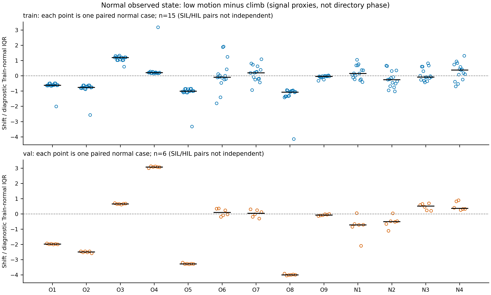
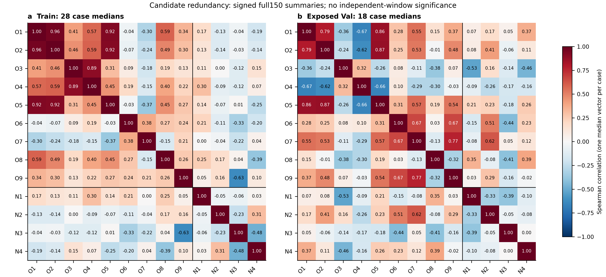

# 13维候选特征综合筛选分析 v1

> Git归档更新：用户在分析完成后明确要求推送本批报告、源码和轻量证据；原文中的“未提交／不推送”记录分析阶段边界。此次归档不启动M3、不连接训练服务器、不改历史模型或数据。

**已完成现有证据恢复、46例限定CPU补充、逐维评价与M3受控设计。当前没有任何一维获得“保持故障召回的独立增量”证明，A类暂空；O4、O5暂列C类低优先级，其余11项列B类待模型验证。该分类是研究预算优先级，不是最终删除／保留名单。**旧特征不能因物理名称有问题就全部淘汰，新特征也不能因有运动学定义就优先入选。

最值得验证的关系是O1/O2的可替代性、O3/O4随条件变化的信息重叠、O1/O2/O5的输出背景共变，以及旧候选与N1、姿态三分量是否互补。低相关并不能证明新信息，高相关也不足以直接删维。M1 Balanced的hover误报改善伴随GPS等故障召回下降，提示不能用运动学“自洽”无条件否决故障证据。

所有新增结果在[分析资产目录](../../../artifacts/13_feature_screening_v1_20261103/README.md)。仅源Train／Val、CPU、已有源case与sidecar。没有连接服务器、GPU调用、训练、模型权重加载／分类推理、Test／Real、阈值试探、旧公式／数据／统计／标签／成员／历史结果修改或Git提交／推送。

## 1. 任务、历史证据恢复与当前状态

研究目标仍是在保持故障检出能力的前提下降低不同正常运行状态误报。本报告将**历史已保存结果**、**本次新增统计**和**研究推断／M3提案**分别标记，避免把组级模型结果分摊成每维贡献。

指定七份材料已核对：研究主线v2、关系公式审查、M1接入协议、M1正式结果、M0正式结果、四维故障响应与可计算性。另复核现有`OnlineKGMSTCA._relation_features`、连续四维实现／Dataset、冻结协议及历史结果清单。

### 1.1 缺失的 candidate_feature_evidence_v1.md

- **本地找到了原文件**`docs/research/2026-11-01/candidate_feature_evidence_v1.md`，以及`artifacts/candidate_feature_evidence_v1_20261101/results/`的13张feature_cards.json、26行normal_stage_shifts.csv、156行matched_fault_auc.csv、数值附录、completion和独立核验。
- 对可见`HEAD`、`origin/main`、`origin/master`的路径树及`git log --all`查询，没有发现这些文件的提交；`.gitignore`的`docs/*`、`/artifacts/*`解释了“本地有，远端引用缺文件”的可能原因，但无法单凭ignore证明当时的操作经过。本轮没有刷新远端分支，也不能声称已检索所有远端／删除分支。
- 原4个结果文件和10个输入／生成器共14项SHA核对通过。原始文件保持不动，本轮在[recovered_historical_evidence](../../../artifacts/13_feature_screening_v1_20261103/recovered_historical_evidence/)保存字节一致副本和来源清单。**没有重编造旧分析，也没有把恢复副本冒称过去已经上传GitHub。**详见[evidence_recovery.json](../../../artifacts/13_feature_screening_v1_20261103/evidence_recovery.json)。
- 原证据只是固定36条hover、每窗后140帧的已有JSON重汇总，不是全量特征筛选、全150帧相关性或逐维增益实验。其“尚无M0／全量残差／训练统计”的状态已过时；以下采用新M1状态，不改旧记录来掩盖历史。

### 1.2 模型结果只支持组级判断

|已完成组级比较|当前可说的结果|不能推出|
|---|---|---|
|M0 原26维|Uniform故障召回97.88%、hover FPR45.23%；Balanced96.81%、35.81%（原754 hover窗）|不能把未加候选归为没有物理信息；26通道已有acc_norm等派生量|
|M1 vs同人口M0-matched|Uniform整体正常FPR3.06%→3.15%；Balanced2.97%→2.11%、hover40.56%→27.61%，故障召回97.56%→96.81%（共同710 hover窗）|不能说新4维已解决误报；不能分配各N轴贡献|
|M2 原完整旧9维双分支|原全Val Uniform召回97.53%、hover35.68%；Balanced95.83%、27.59%|不同结构、容量、初始化／人口不能作逐维或同召回的增量证明|

M1与M0-matched是相同预训练公共起点继续训练；M0与M2的历史起点／架构另有差别。前轮Balanced同ID分析找到192新增漏检／68恢复、166纠正误报／29新增；105新增漏检及84纠正误报的M1分类边界跨越依赖残差分支直接贡献，但分支含常数bias、共同路径也变了。这仍不是四个分量的独立因果归责，见[配对分析](m1_balanced_window_difference_v1.md)。

## 2. 新增分析的最小范围与计算口径

现有完整故障响应只有hover。为了补相关性与正常运行状态信息，冻结为**已有36例响应集与12例正常锚点的并集，共46例**：Train28、Val18；24个故障案例全部hover，22个独立正常案例，其中Train16覆盖六个日志目录、Val6只覆盖hover。没有按响应好坏再抽案例、替换困难案例或扫描全库。源case shard及连续M1 sidecar重用，未解析ULog；仅对24固定故障案例读各自TestInfo.csv保存原参数字面值。

|资格口径|窗口数|占原26维已准入2890窗|
|---|---:|---:|
|原cap64分母|2944|包含原54窗无资格，不救回|
|原26维可监督／旧9维均可计算|2890|100%（仅此46例）|
|N1单独全150有效|2829|97.89%|
|N2/N3/N4单独姿态组全150有效|2664|92.18%|
|13维同ID、同150共同有效|2644|91.49%|

N1和姿态组不可用机制不同，不能把三个轴当三次独立覆盖损失。246个新增共同不可用窗、原54窗不合格的ID与原因位保留在window_qualification.csv；不补0／均值、不改标签或删原窗。共同域有1273个独立正常窗、836个全激活故障窗、445个故障案例正常窗、90个混合／窗内未知窗；后90窗不纳入纯正常／稳态故障AUC，但保留在全共同域描述／相关性，分层也保留。Train／Val active分别434／402，不把与旧140碰巧相同的数量解释为逐窗定义不变。

旧九维以原26通道标准化张量逐窗调用原确定性函数；气压仍先逐窗减首值。N1～N4直接取连续原生历史sidecar物理值。每窗13维**有符号原量median**为主要相关／AUC摘要，另留P95和std；绝对值与三轴模长不是候选替代项。时序摘要会损失短暂尖峰，不能据median AUC宣判原时序无用。

诊断效应尺度只用**此面板Train独立正常16例／923窗**的median/IQR，单独保存在diagnostic_reference.json。它不是历史340窗IQR，也不是M1训练用74700窗均值／std；未改任何训练统计。所有效应同时保留物理／原始统计单位，IQR很小时的大倍数不等于巨大物理位移。

## 3. 13维精确定义、来源与可用性

z均指基础26维的冻结源Train逐通道标准化值；u为roll/pitch/yaw/throttle四控制槽，o为四输出槽。std均population。O1–O9是26维的确定性重表达，其可能收益来自有限模型和数据下的归纳偏置，不是新增传感器信息。

|ID|数学定义／输入|含义、单位与归一化评价|代码位置|
|---|---|---|---|
|O1|std_i(z_o_i)|输出槽离散统计；各槽独立z，无PWM／转速单位|lstm.py::_relation_features:355|
|O2|max_i(z_o_i)−min_i(z_o_i)|输出槽极差，和O1近似但非恒等|同上:356|
|O3|mean_i(abs(z_u_i−z_o_i))|逐索引统计差，不是混控后的电机跟踪误差|同上:357–358|
|O4|std_i(abs(z_u_i−z_o_i))|上述差的离散度，槽语义问题保留|同上:359|
|O5|mean(concat(z_u,z_o))/max(z_acc_norm,0.1)|原人工截断比值，不是推力效率；26维版本无外来effort列|同上:361–365|
|O6|abs(z_acc_norm)|距源训练总体均值的绝对标准差倍数；不是norm(a)−g|同上:366|
|O7|norm(z_gyro_xyz)|标准化旋转活动代理，不是rad/s物理模|同上:367|
|O8|abs(diff(z_baro,prepend=first)−z_vel_z)|原缺dt／同尺度／NED符号的混合代理；首差0为原实现|同上:369–372|
|O9|norm(z_q_xyz)|标准化姿态分量统计，不是能量或单位四元数几何不变量|同上:374|
|N1|h_av(t)−h_av(t−0.2)+∫vz_av ds|米，NED向下正；原生可用时间段ZOH积分，非同步真值|validate_kinematic_residuals.py::compute_residuals；continuous_kinematic_residuals.py|
|N2|Log(R_hatᵀ R_end).vee_x|弧度，有符号姿态积分误差x|同上姿态路径|
|N3|Log(R_hatᵀ R_end).vee_y|弧度，有符号姿态积分误差y|同上姿态路径|
|N4|Log(R_hatᵀ R_end).vee_z|弧度，有符号姿态积分误差z|同上姿态路径|

N2～N4的R_hat＝R_start·∏Exp(ω_body·原生dt)，Hamilton wxyz、FRD→NED、右乘；四元数单位化、q/-q等价及不可交换旋转已有合成验证。各分量按自己的signed值评价，不能把norm(rR)的证据分摊到三轴。

旧9维在窗口末端因果可计算，继承基础年龄／可用性门禁，但跨话题并非同步物理观测。新4维用原生消息可用时刻、200ms历史及中间年龄／valid、reset、设备变化、四元数门禁；不是从26×150等价恢复，缺历史仍无效。当前连续版借真实crop前历史，不再每个滑窗重新丢前10帧；旧140报告只作独立历史对照。

### 3.1 数值范围、缺失与异常

[feature_evidence.csv](../../../artifacts/13_feature_screening_v1_20261103/feature_evidence.csv)逐项列精确定义、单位、处理、独立有效率、正常／全部原值范围、响应及初筛；[feature_validity.csv](../../../artifacts/13_feature_screening_v1_20261103/results/feature_validity.csv)区分逐帧贡献与窗口摘要。数值并非物理允许运行边界，重叠窗的重复帧贡献未伪称独立观测。

- 本46例旧9维在2890个基础准入窗全部有限。不能外推所有3135例逐项异常分布已审计。
- O5共433500个旧合格窗帧贡献中336198（**77.55%**）触发acc_z≤0.1截断；观察范围约−13.43～23.05，正常也约−13.43～9.85。该范围和O1/O2高相关共同构成降优先级理由，而非“物理名不成立所以无预测信息”。
- O6/O7正常最大分别约15.36／26.74（z空间代理）；正常机动或偏置可以很大，不凭正常峰值改标签。
- N1有效物理范围约−21.119～21.168m，正常约−0.228～0.166m；其正常P5–P95约−0.0828～0.0778m。大故障值未裁剪，也不意味着所有故障N1都大。
- N2正常约−0.0218～0.0165rad；N3约−0.1760～0.1969rad；N4约−0.00715～0.00725rad。**N3正常大峰值被保留**，呼应原circling锚点0.19693rad的姿态修正峰；不以峰值删案例或宣布物理故障。
- O9的q符号／航向鲁棒性、四维共享估计和异步误差具体占比尚未做受控测量；有限且可算不等于这些问题已解决。

## 4. 故障区分能力：有条件响应，非单维普适检测

新增[feature_fault_response.csv](../../../artifacts/13_feature_screening_v1_20261103/feature_fault_response.csv)为**312行：13项×24个故障案例**，保留每案例pre／active分布、原始与IQR效应、两种固定正向AUC及未匹配窗；原156行历史配对AUC和26正常表另恢复保存，不与新150统计拼接。

方法一：每故障案例，完整150帧已知正常pre与已知active比较；窗口多重相关，不算逐窗p值。方法二：该active窗按**物理信号得到的粗观测状态**匹配同split／同域的独立正常hover窗，先对每个正常case算AUC再等case平均，并按该故障case各状态窗数汇总。一直定义“signed原特征越大越故障”；AUC<0.5保留，不改为1−AUC，不用0.5当保留门槛。

下表为方法二在**已暴露Val每目录SIL/HIL两个case的等权均值**，不是置信区间、MSTCA增量、召回或PR-AUC：

|ID|Motor|Accelerometer|Gyroscope|Barometer|Magnetometer|GPS|
|---|---:|---:|---:|---:|---:|---:|
|O1|1.000|0.594|0.700|0.719|0.537|0.640|
|O2|1.000|0.646|0.737|0.742|0.739|0.639|
|O3|0.690|0.362|0.476|0.563|0.516|0.471|
|O4|0.000|0.423|0.518|0.209|0.412|0.407|
|O5|1.000|0.526|0.582|0.745|0.576|0.523|
|O6|0.455|0.421|0.385|0.658|0.472|0.567|
|O7|0.975|0.508|0.309|0.634|0.210|0.634|
|O8|0.301|0.402|0.351|0.769|0.323|0.335|
|O9|0.981|0.247|0.199|0.255|0.653|0.292|
|N1|0.533|0.579|0.536|0.490|0.542|0.569|
|N2|0.652|0.462|0.427|0.625|0.484|0.460|
|N3|0.618|0.605|0.518|0.428|0.555|0.578|
|N4|0.393|0.417|0.513|0.712|0.021|0.549|

关键差异：

- **O1/O2/O5**在所选motor案例都有强排序，说明不能先验淘汰旧代理；但共享输出背景且正常阶段漂移，单量排序不能解释M0是否已捕捉同样信息。
- **O3/O4**并非处处等价：O4在Val motor为固定反向0.000，Train同状态motor约0.780／0.830；既有正常漂移、模式差异，也可能有真实反向信息，不能翻符号包装结果。O3 Val motor为SIL0.965、HIL0.416，域差不应被均值0.690藏掉。
- **O6**Train所选accelerometer两域AUC都1.000，Val约0.496／0.347；**O7**Train所选gyroscope约0.940／0.955，Val约0.375／0.244。这不是相同故障模式控制下的“泛化失败”证明。
- **O8**在Val barometer约0.795／0.743仍有诊断排序，尽管它不是合格的物理垂向残差；N1没有呈相同排序，因此不能把二者看作同一信号新旧命名。
- **N1**Train accelerometer两域1.000，Val同状态约0.491／0.666；其余Val多重叠，不能据0.5附近宣判时序或联合无用。
- **N2／N3**各自保留条件信息和域差，例如N2 motor0.620／0.684、barometer0.652／0.597；N3 motor0.533／0.704。它们并非故障轴标签。
- **N4**Val magnetometer固定方向约0.019／0.024，说明有反向排序信息；但motor约0.085／0.702、gyroscope0.800／0.227存在相反方向。不能只取姿态模长或按域翻符号。

### 4.1 强度／模式与状态控制的证据边界

TestInfo的Fault ID／Fault Parameter原字符串及SHA保存在[fault_parameter_metadata.csv](../../../artifacts/13_feature_screening_v1_20261103/results/fault_parameter_metadata.csv)。例如GPS Train`[4,1,0.9,1]`、Val`[4,1,0.9,0.9]`；accelerometer Train`[4,1,0.9,0.9]`、Val`[4,1,1,1]`；gyro Train`[3,0,0.5,0,0.5,0,0.5]`、Val`[4,1,0.9,1]`；barometer`0.9975`与`1.0025`。Val magnetometer的SIL/HIL选定case也不同。**没有已核参数语义／统一强度标尺和同模式重复样本，无法建立剂量—响应、将差异归为纯强度或SIL/HIL效果。**不据case编号或参数数字猜严重度。

状态匹配会漏掉部分Train active：barometer SIL仅3/19、HIL4/26可匹配，accelerometer12/24、32/38；这些状态在固定正常hover controls中缺乏覆盖。未匹配的38气压与18加速度故障窗明确保留，不能将匹配后AUC冒称全部active表现。Val active全部可匹配，但控制仍粗，故障本身也可改变速度／陀螺仪状态，**状态条件化可能隐藏故障影响**。因此两种比较都保留，任何一种都不是无混杂机理实验。

## 5. 正常工况：由过去物理信号定义，不能拿目录当真值

在相同过去150帧，用物理vel_xyz／gyro_xyz建立固定粗代理：先判gyro模P90≥0.3rad/s或speed std≥0.5m/s为maneuver；非机动且至少80%帧vz≤−0.5m/s为climb、vz≥＋0.5为descent；至少80%帧speed≤0.3m/s且gyro≤0.15rad/s为low_motion；剩余至少80%帧speed>0.3为translation，其余other。规则先写plan，不看故障分数调界。**只描述观测运动，不是认证爬升／稳态／机动意图，不作为已选线上工况条件。**标签只用于事后限制正常统计，不参与state函数；不输入目录、裁剪进度或未来。

Train独立正常：climb316窗／16例、low_motion208／15、maneuver29／7、translation319／11、other51／15；Val只有hover正常6例：climb157、low_motion170、maneuver17、other6。无合格descent，不能给下降阶段结论；Val没有其他目录正常作跨工况确认。

同case的low_motion减climb，以各特征Train正常诊断IQR为单位，再取**案例中位数**；Train15例、Val6例（SIL/HIL配对非独立），图中每点是一case而非窗口：

|ID|Train低运动−爬升|Val低运动−爬升|可支持的描述|
|---|---:|---:|---|
|O1|−0.616|−1.981|正常状态变换明显改变输出离散背景|
|O2|−0.757|−2.491|与O1同向漂移|
|O3|＋1.196|＋0.657|低运动时配对差均值变大|
|O4|＋0.204|＋3.073|Val后段大漂移；Train跨目录差异保留|
|O5|−1.011|−3.278|人工比值强状态依赖|
|O6|−0.089|＋0.100|中央位移小，不代表机动尾部稳定|
|O7|＋0.199|＋0.045|爬升—低运动中央位移小，但Train低运动减机动中位−7.479 IQR|
|O8|−1.066|−4.000|强垂向运行背景依赖|
|O9|−0.040|−0.070|此对比中央位移小，但机动、航向／域条件不能忽略|
|N1|＋0.149|−0.718|不同案例／split方向不同，非完全状态不变|
|N2|−0.256|−0.502|signed轴有位移|
|N3|−0.079|＋0.519|反向／域和正常峰值保留|
|N4|＋0.377|＋0.361|signed轴与状态有关，不能用模长掩盖|

O6在Val低运动减maneuver中位−40.43 IQR，反映正常机动可产生强加速度代理；该17个机动窗是小样本，不能视为覆盖所有机动。O9低运动减机动Train中位−3.27 IQR，也不能从爬升对比小就宣布稳健。

同一仿真配对组、同观测state的正常SIL/HIL中位差也保存：O9跨30个Train pair-state行的HIL−SIL中位约＋0.724 IQR、Val11行＋0.792；这些行不独立，域分布并非完全相同。N3的某些Train pair-state差达到约−18.99 IQR，来自个别机动／姿态背景，仍未删。无任何特征可以据此宣布跨域／所有正常工况稳定。

## 6. 13×13相关性与冗余：必须看聚合层次

主[feature_correlation.csv](../../../artifacts/13_feature_screening_v1_20261103/feature_correlation.csv)为**每个Train case取共同150窗median向量后算Spearman，n＝28**；另有Pearson、18个已暴露Val、14个Train仿真配对组折叠、同域、正常／故障、正常观测state矩阵及逐case active段相关。未用数千重叠窗制造高置信度，不给p值。case中位数也会隐藏时序变化，相关不等于可替代性。

|组合|Train case Spearman|Val case Spearman|Train case Pearson|Train pair组折叠Spearman|解释|
|---|---:|---:|---:|---:|---|
|O1／O2|0.960|0.790|0.989|0.986|最强替代候选，但不能直接删|
|O1／O5|0.924|0.861|0.794|0.982|输出背景和截断比值重叠|
|O2／O5|0.921|0.874|0.827|0.981|同上，不预设提供三份信息|
|O3／O4|0.895|0.317|0.692|0.943|重叠随条件变，不能只取Train高相关|
|O8／N1|0.250|0.350|—|—|并非同义冗余；低相关也不是独立预测增量|
|N2／N3|−0.233|−0.049|0.052|−0.266|未见可普遍替代|
|N2／N4|0.306|−0.079|0.017|0.055|同上|
|N3／N4|−0.479|0.003|−0.642|−0.662|方向／层次可变，不压成一个轴或只留模长|

条件例证：

- O1/O2在正常case Spearman Train0.980、Val0.955；但Val故障case0.702。逐case仅active时间内，Train motor两域0.999–1.000，GPS0.295／0.496，Val GPS0.792／0.335。全局高相关不保证不同故障响应可互换。
- O3/O4在Train正常case0.853、Val正常case0.943；Val故障case约−0.252，Val barometer各自active内约−0.508／−0.584。O3均值与O4离散度不能仅凭共享输入视为重复。
- Train正常case里O1/O8相关0.956、O2/O8 0.964、O5/O8 0.941，但全部Train case下降到0.588／0.487／0.453，暴露了正常运行背景共变；不能把这种相关叫作故障机制。
- O9/N3 Train case约−0.630、Val−0.158，属于背景相关线索，不支持删N3。所有N轴相关分层见correlation_by_fault_within_case.csv。
- 同一split×故障类型只有SIL/HIL两case，跨case相关在输出里**故意设为缺失（min n＝4）**，避免两点必±1的假证据；改报两个case各自active窗口相关的实际范围，不把它当独立重复显著性。

## 7. 逐维综合评价与初步筛选

[feature_evidence.csv](../../../artifacts/13_feature_screening_v1_20261103/feature_evidence.csv)和[feature_screening_summary.json](../../../artifacts/13_feature_screening_v1_20261103/feature_screening_summary.json)给出每维公式、来源、单位、因果性、有效率／尾部、分故障响应、正常位移、相关性、证据强度及实验建议。判级不按AUC阈值或单一总分自动产生。

|特征|初类|价值与问题的综合判断|下一实验角色|
|---|---|---|---|
|O1|B|motor排序、可算；输出背景和O2/O5冗余，正常漂移|输出离散代表候选|
|O2|B|与O1强相关但故障内并非等价，不能删|替换O1与同时加入的受控比较|
|O3|B|有统计信息但槽位物理解释不足，正常状态依赖|旧核心候选；与O4替代／联合可后验设计但须再预注册|
|O4|C|不是无信息；强正常漂移、模式反向、与O3条件冗余且未见增量|不优先进入小核心；保留完整旧9组反证机会|
|O5|C|motor仍有排序；高截断占比、正常尾值、与O1/O2重叠|不优先小核心；保留完整旧9组|
|O6|B|低全局相关，Train加速度响应而Val弱，正常机动大|检验基础acc_norm非线性重表达增量|
|O7|B|motor／特定gyro模式响应，正常旋转强混杂|活动量统计候选，不能当普适残差|
|O8|B|物理公式缺口但barometer仍有条件排序，正常漂移强|统计代理候选；不原位修公式|
|O9|B|部分motor强排序、爬升对比中央稳定；机动／域／q符号风险|姿态统计候选，保留物理语义边界|
|N1|B|独立较高覆盖与因果单位明确；多数故障重叠、自洽不等健康|与姿态分开成垂向块|
|N2|B|signed轴有条件信息、不是可替代的冗余轴；无增量证明|姿态三分量块，块有效后逐轴验证|
|N3|B|同上且正常大峰值／共享估计影响|姿态块保留y，不能以尾值删案例|
|N4|B|部分故障反向排序强、其他域方向变；不统一翻向|姿态块保留z，预设域方向检查|

A类空是因为**没有逐维受控且保持召回的正向增量证据**，不是13项都无用。D类空是因为每项至少有公式／实现／有限数据／逐案例诊断，足够形成探索性B/C预算优先级；但强度鲁棒性、完整跨工况、真正独立增量这几项对全部13仍应标“证据不足”。C不是最终删除决定；后续可回归B，不能凭本表改M2历史输入。

## 8. M3有限受控实验设计（仅提案，未实现／未训练）

### 8.1 共同比较合同

1. **原26维纯MSTCA是同批新对照。**旧M0／M1／M2仅背景，本提案不原样重跑历史M2。所有新候选和M0用相同151833 Train／32381 Val共同full150资格、原ID／裁剪／标签／base norm及同采样draw；同时保留原覆盖分母。全量旧9输入仅在日后授权后派生，不在本轮扩大生成。
2. **同骨干与起点**：建议主提案用已留存、未训练seed42纯M0初始公共state，所有encoder/head逐张量相同；候选adapter final projection从0开始。不要一组从trained M0 best开始、另一组随机。若另选共同预训练继续训练，必须整组统一并另命名，不能与从头混比。现有源Val多次暴露，不能称盲测试。
3. **统一候选时序结构**：O1～O9是原逐帧函数，N1～N4是原signed物理序列，保留完整150；不将N轴改范数、不把统计摘要冒充原时序。独立轻量adapter固定13个候选槽、Conv13→16(k3)→ReLU→Conv16→16(k3)→ReLU→pool→Linear16→128，一次相加后共用原头；不是26+13直接拼39通道，也不是恢复旧KG门控。总新增3600参数、合计109538（设计数，待实施核对）。所有adapter结构／初始化相同。
4. **选择器仅作实验删维**：在已完整有效的13维中，不用的候选槽输入被固定选择器屏蔽。它表示有意移除可用特征，绝不是拿0填无效残差；无效窗在Dataset／BN前仍拒绝。各变体名义参数相同但被屏蔽通道有效自由度不同，须同时记有效输入／梯度参数数，不能夸称容量已绝对隔离。
5. **容量／重表达对照**：同一3600参数adapter改读预先固定的13个现有基础标准化通道（4控制＋4输出＋gyro_xyz＋baro_relative＋acc_norm），无额外测量。它检验候选优于相同额外参数的普通基础输入再表达与否；自身也是另一种表征，不能作纯粹无归纳偏置容量定理。候选需同时胜过纯M0和该对照才有较强依据。
6. **标准化不改物理公式**：base26沿原规范，N轴沿冻结Train正常统计；O项如需二次缩放，统一另拟合源Train已知正常、共同有效窗口统计，单独新版本，与历史M2“无独立旧9缩放”口径明示不同。所有候选共用同一统计，未选项不重新拟合。当前诊断923窗IQR不能拿去训练。
7. 训练预算沿现有max100／warmup5／min30／patience20、batch512、AdamW3e-4／wd1e-4、Focal gamma2、固定0.5、完整源Val总体Macro-F1 strict best；不按hover挑epoch、不补seed／扫阈值追分。主先预注册Balanced、seed42；Uniform只作为后续固定确认，不能跨采样取最优。

### 8.2 第一轮8个固定配置，最多8次主训练，尚未授权

定义旧核心S＝{O1,O3,O6,O7,O8,O9}、V＝{N1}、R＝{N2,N3,N4}。S是本次探索建议，**不是已证明最优**；O2通过下一步替代验证，O4/O5仍由完整旧组保留反证。

|配置|输入／机制|回答的问题|
|---|---|---|
|C0|纯26 MSTCA同人口|基础新参照|
|Ccap|26＋同参数基础13通道再表达adapter|额外容量／简单基础重表达能否解释收益|
|CO|26＋旧核心S|精简旧候选整体价值|
|CO9|26＋完整O1–O9，统一adapter|保留O2/O4/O5是否有额外价值；不冒称历史M2重现|
|CV|26＋N1|垂向块增量|
|CR|26＋N2～N4|姿态块增量，暂不按轴预删|
|CN|26＋N1～N4|V/R组合有无超过单块收益；统一结构下的M1组参照|
|CON|26＋S＋N1～N4|新旧互补是否超过CO和CN|

### 8.3 只在块有收益后追加，最多4个条件配置

- **高相关可替代**：若CO有价值，取`S−O1+O2`与`S+O2`两个同结构配置，与已有CO比较。替换近似不损且并用不增，才支持“此背景下可替代”；有一类召回／正常状态明显差异，则不能合并。O3/O4问题用相同的“只A／只B／A+B”逻辑另预注册，但本轮预算不同时遍历全部相关对。
- **某一维是否独立增量**：剩余至多2个配置对已经有价值的候选组作单维移除；待块结果明确后，按预先写下的“对关键故障／最差正常工况的损害”问题选择维度，先登记再训练。加入A有益但移除A无损时，证据可能来自可替代表征或容量；需记录不能下单维结论。若姿态块有效而重点是N轴，则2个预算改用于该块指定轴移除；**不能两套都做再说只4个**。
- **新旧互补**：CON需优于CO、CN并满足各故障召回边界；只有相对C0好、未超过CO或CN，不算互补。即使CO9优于S，也只能定位O2/O4/O5联合差异，不能直接宣称某一项独立有用。
- 若第一轮无符合召回约束的候选，停止，不追加leave-one-out／新公式；允许最终不增加特征。若有候选，再另批至多3次Uniform确认（C0、Ccap、1个预注册候选），绝不把该确认悄悄并进8次授权。本设计主配置上限8＋条件4＝12，连Uniform确认理论上限15；不是执行清单，更非自动占用GPU。

### 8.4 评价与如何接受结论

固定0.5同时报总体／六故障Recall、正常总FPR、独立正常与hover后段、每正常观测状态、SIL/HIL／case／仿真配对组分布、Precision／AP及连续事件／时延／覆盖／算量。单seed只能探索，不能作显著性或非劣认证。

本轮没有依据制定可接受Recall损失δ或绝对R*，**正式启动前须由研究目标固定**，不能在看到候选结果后放宽；总体与GPS等子类都要约束。未定义δ时只能列固定点Pareto取舍，不能把降低召回后的FPR下降称成功。不在本轮／最后Test上补扫阈值补回召回。候选、接口和评估规则冻结后，最终Test／Real才按各角色另行授权。

真正意义的独立增量还需要相同多seed、按仿真pair分组的误差评估或预先固定源Train组内开发／确认设计；若设计未见组，不可从已见过该组的trained M0 checkpoint初始化后冒称未见。这些是后续证据升级要求，本轮不启动也不强行增加训练预算。

## 9. 复核、交付与研究局限

独立验证重建46例各首／中／末共138窗旧9与signed四维摘要，最大数值差2.38e−7；13×13 Train Spearman独立rank计算差2.22e−16；312个同case signed AUC逐对比较、状态匹配AUC和585个可配对状态位移全部复算。全部输入SHA不变。本轮及相关57项测试通过，涵盖信号状态不依赖目录／未来、两case相关缺失、固定方向且正常case等权AUC，以及相关原公式／连续门禁。图像按scipilot-figure-skill做数据剖析、300DPI／SVG、对称色阶、案例散点／中位线、机器排版与PNG／灰度人工读图复核，无伪显著性或均值柱掩盖小样本。

交付入口：

- [feature_evidence.csv](../../../artifacts/13_feature_screening_v1_20261103/feature_evidence.csv)：13行逐项证据／评价。
- [feature_correlation.csv](../../../artifacts/13_feature_screening_v1_20261103/feature_correlation.csv)：13×13主Spearman矩阵；其他条件与Pearson另存。
- [feature_fault_response.csv](../../../artifacts/13_feature_screening_v1_20261103/feature_fault_response.csv)：312行完整逐故障case证据，含弱／反向／未匹配。
- [feature_normal_stability.csv](../../../artifacts/13_feature_screening_v1_20261103/feature_normal_stability.csv)：逐正常case×观测状态×特征分布。
- [feature_screening_summary.json](../../../artifacts/13_feature_screening_v1_20261103/feature_screening_summary.json)：B/C建议及未证实项。
- [plan.json](../../../artifacts/13_feature_screening_v1_20261103/plan.json)、[independent_verification.json](../../../artifacts/13_feature_screening_v1_20261103/independent_verification.json)、输入输出manifest与复现脚本：可追溯来源、范围与计算。

仍不能回答：任一维的MSTCA受控增量、同模式多强度剂量响应、所有真实正常阶段的鲁棒性、真实接收时钟认证、同步误差／共享估计具体责任、最终测试／真实域泛化。相关与有条件AUC只为缩小下一步问题；本轮没有以这些诊断自动改模型输入或发布新方法。
