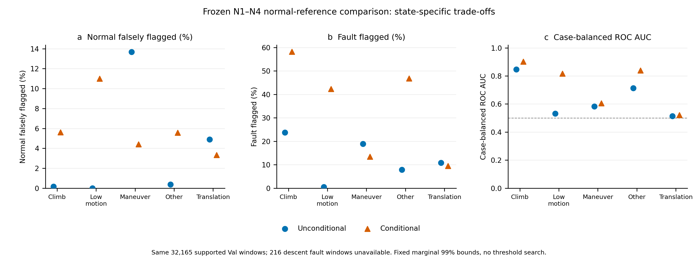

# 有限工况条件化N残差验证 v1

**结论：不支持本次假设在已冻结统计方案下达到研究目标，不建议据此进入下一阶段模型实验。**条件化确实改变了正常参考，并提高部分同状态排序／故障响应，但总体正常异常判定更多；正常误报减少的状态又伴随检出损失。不能把局部改善当作“保持检出、降低误报”。

本次只有一个方案：N1～N4原有signed150帧中位摘要；使用此前冻结的过去150帧物理vel／gyro运动代理。当前工况函数不接收标签、故障类型、目录、域或未来帧。目录／故障标签仅用于事后分组评价；Train标签仅选择已知正常参考样本。

参考只来自Train **74700个完整已知正常窗**，包括独立正常及故障案例的已知正常部分；每案例总质量相等，案例内窗口等权。无条件池与每状态池使用相同的固定经验Q0.005／Q0.5／Q0.995，四维任一越界即异常，边界相等不算异常。规则在新Val结果读取前冻结，参考在Val加载前保存，未调分组／阈值。**每维99%范围不等于四维联合1%误报保证。**这是统计异常标记，不是新模型，也不替代C0或改变MSTCA的0.5边界。

原Val32381个ID全部保留。下降代理没有Train正常窗，216个Val下降故障窗标为无法验证，不补参考。主比较两种参考使用完全相同的**32165窗＝15883正常＋16282故障**；无条件全32381窗另列补充，不混分母。

## 1. 正常残差是否存在明显工况依赖性？

**是。**仅Train正常数据即可观察到。例如N3的案例等权窗口中位摘要方差，在机动为9.73e−7rad²、低运动为1.04e−9rad²，约相差934倍；对应参考区间约为[−0.005100,+0.000463]与[−0.000117,+0.000060]rad。N1的参考中位数也从爬升−0.000706m移到低运动+0.004534m。

|观测代理状态|Train正常窗|案例|association groups|参考可用|
|---|---|---|---|---|
|maneuver_proxy|8571|1844|940|是|
|climb_proxy|25981|2562|1296|是|
|descent_proxy|0|0|0|否：无法验证|
|low_motion_proxy|7441|2533|1296|是|
|translation_proxy|27706|2040|1146|是|
|other_motion|5001|2537|1295|是|

五个可用状态的SIL／HIL正常案例覆盖均通过预先固定的最低门槛；下降状态不能外推。案例／仿真配对仍相关，窗口数不是独立样本量，也没有把这些分布差异宣称为显著性或真实运行意图真值。

## 2. 条件化后，正常与故障是否更好区分？

**同状态排序存在局部提高，但没有实现目标内改善。**

|状态|正常异常率：无条件→条件化|故障检出率：无条件→条件化|解释|
|---|---|---|---|
|climb_proxy|0.164%→5.608%|23.697%→58.143%|检出上升，误报上升|
|low_motion_proxy|0.000%→11.005%|0.524%→42.329%|检出上升，误报上升|
|maneuver_proxy|13.687%→4.413%|18.872%→13.383%|误报下降，检出下降|
|translation_proxy|4.893%→3.334%|10.848%→9.448%|误报下降，检出下降|
|other_motion|0.371%→5.561%|7.826%→46.739%|检出上升，误报上升|

总体正常FP **550→818**，FPR **3.463%→5.150%**；纠正299个原误报，却产生567个新误报，净增268个。其中独立正常4264窗的FP由202增至462。故障TP **1769→3542**，Recall **10.865%→21.754%**；恢复2092个漏检，同时损失319个原检出窗。两种纯N统计规则的绝对检出率都低，不能称为具有C0的故障检出能力。

五状态内的案例等权AUC均略有或明显提高，例如低运动0.532→0.817；但混合状态总体案例等权AUC反而**0.616→0.553**。局部排序、固定异常标记及跨状态总体排序不是同一个指标，不能只选有利指标。案例等权正常FPR也由3.058%升到4.328%，association-group等权由3.031%升到4.297%，因此不是仅由少量长案例窗口数造成的总体现象。

## 3. 改善是否同时存在于不同故障类型和SIL/HIL？

**否，没有一致的“减少误报且保持检出”改善。**六类在共同人口的净TP均上升，但都有新增漏检；两域总体TP上升，正常误报也都更多。

|故障|共同故障窗数|无条件TP→条件化TP|恢复漏检／新增漏检|
|---|---|---|---|
|GPS|1228|47→159|135/23|
|accelerometer|1046|652→679|53/26|
|barometer|914|149→409|273/13|
|gyroscope|1683|347→425|109/31|
|magnetometer|1536|196→259|114/51|
|motor|9875|378→1611|1408/175|

SIL正常FP **151→360**，HIL **399→458**。按类别×域看，HIL Magnetometer的TP还由**101降到93**（20故障案例），不能用跨域／跨类总数相抵掩盖这项损失。

重点Hover中，GPS **0/291→64/291**、Gyro **0/375→107/375**、Mag **0/246→109/246**，同状态排序提高，但同一Hover已知正常池FP **7/2602→239/2602**；其中独立正常Hover为 **1/710→171/710**，显然没有减少误报。

Hover各域GPS只有4故障案例、Gyro5案例；HIL Mag仅3案例，未通过预设的4案例描述性最低门槛，**该格标为无法充分验证**。没有补抽或换规则。22个含下降窗案例的216个故障窗无条件参考仍保留可计算结果，但条件化未验证；其中Accelerometer84窗、Barometer132窗，不纳入上述共同分母。其他小样本状态×故障×域格同样在表中明确标记，不能据少量窗推广。

## 4. 是否值得进入下一阶段模型实验？

**本次证据不支持进入。**本次检验确认了工况依赖，却未确认“建立状态正常参考即可更准确区分正常变化、并在保住检出的同时减少误报”。相反，低运动参考收紧后正常和故障都更容易被标异常；机动／translation条件参考减少误报时，也吞掉部分故障响应。

结论限于这一预先固定的signed中位摘要、经验99%参考与运动代理方案，**不是证明所有条件化方法都不可能有效**。本轮不调整参考覆盖、分组、摘要或阈值，不设计模型、不扩实验范围，也不提出额外方向。C0、原始数据、N公式、模型和历史配置均保持不动。

开发Val已被此前研究使用，本轮不是盲测；单seed来源、重叠窗口、SIL/HIL配对和小样本限制结论。没有独立统计显著性、物理损伤真值或实机保证。图的程序布局／字体检查通过，当前图像工具未展示图像给代理，未冒称人工视觉审核通过。

[协议、Train参考、全部Val台账、分组计数和核验文件](../../../artifacts/M3_conditioned_residual_validation_v1_20261103/README.md)。3项最小检查通过；独立按参考上下界核对全32381窗标记，并复算32组配对计数／案例等权AUC。必要结果发布GitHub，原权重和原始缓存未上传或修改。
