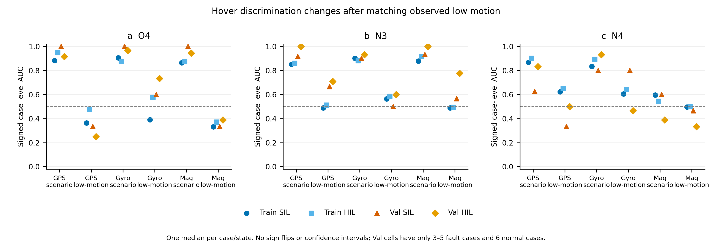
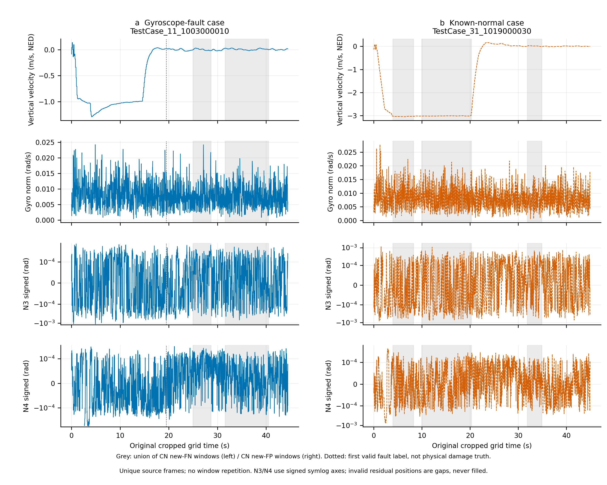

# M3物理数据诊断 v1

**建议：停止当前“13维无条件融合”的推进，保留本批C0／纯MSTCA为基线；后续研究转向工况条件化的物理残差方法，但只作为待验证方向，不视为已经有效。**本次数据支持“部分特征具有条件排序信息”，不支持“13维都是可靠故障物理量”或“新4维已提供满足召回约束的独立增量”。

## 范围与方法

仅本地CPU、现有Train151833／Val32381共同150帧窗。一次性计算13维及Base26的窗口中位数、均值、时间方差，按案例聚合；不训练／拟合任何分类或回归模型，不做模型前向、服务器、GPU、连续回放、Test／Real或阈值搜索。公式、标准化、模型及历史配置未改。

M3 CN新增154个Hover故障漏检来自29案例：**145个完整稳定故障窗、9个过渡／窗内标签不全有效窗**，后者保留但不混入纯正常—稳态故障排序。对照包括同案例正确故障窗、独立正常正确窗及正常误报窗。Train／Val全部共同人口保留；不按结果删除困难案例。

统计单位主要是一案例／标签段／观测状态的中位向量，不是窗口IID样本。Hover正常Train56案例／28 association groups，Val12案例／6 groups；Val低运动GPS／Gyro每域仅4／5故障案例，Mag每域3／5案例。AUC固定“有符号特征越大越故障”，小于0.5不翻号；不报告显著性或非劣认证。案例及SIL/HIL仍相关。

## 1. 这13维是否有可靠物理意义？

**不能整体称为13维故障物理特征。旧9维有可核数学定义，新4维有较明确的运动学意义，但都不自动等于故障或健康真值。**

|特征|实际定义与物理评价|
|---|---|
|O1／O2|四输出槽各自z值的标准差／极差；输出离散统计，无PWM／转速物理单位。|
|O3／O4|控制槽与输出槽按索引做abs差后求均值／标准差；未经过混控对应，不是电机跟踪残差。|
|O5|控制／输出z值均值除以max(acc_norm的z值,0.1)；不是推力效率。全共同Train／Val约76.36%的重复窗帧贡献触发原clamp，未改变截断。|
|O6／O7|abs(z_acc_norm)、norm(z_gyro)；是标准化活动代理，不是加速度减重力或rad/s物理模。|
|O8|abs(diff(z_baro)−z_vz)，逐窗首差为0；缺dt、同量纲及NED符号匹配，不是合格垂向物理残差。|
|O9|norm(z_quaternion_xyz)；不是姿态能量或四元数几何不变量。|
|N1|h(t)−h(t−0.2s)+∫v_z ds，NED向下为正，单位米；垂向估计流的运动学一致性。|
|N2–N4|Log((R_start·∏Exp(ωdt))ᵀR_end)的有符号xyz分量，单位弧度；原生姿态／陀螺仪流的积分一致性。|

N采用消息发布可用时刻、真实原生dt和年龄／reset／latest-invalid门禁；不是同步物理测量，也不是外部真值残差。姿态估计与gyro、速度估计与GNSS等共享输入，存在共同误差／估计器修正的可能；本轮没有将其分解成真实损伤、估计器误差或异步误差的独立份额。

**数据处理检查：**全部154目标窗的有效mask、原生支持、ID／时序及缓存对应核对通过，无补零、无reset跨越、无无效位置。病例重建摘要最大误差8.80e−7；窗口末端原生N公式重算与sidecar一致。最高端点年龄115ms、attitude–gyro观测时刻差57ms，均属于现有准入流，不是已证明的同步。20ms粗网格重算N1与原生N1在目标窗末端最大差0.316mm，不能据此把两种实现互换。

额外限定读取6份原始source-Val ULog，核对4个原生话题值／发布时钟，描述sensor_gps、sensor_gyro、sensor_mag和vehicle_magnetometer的已记录响应。日志里的GNSS精度／fix字段在检查案例前后可保持相同；SIL raw gyro／mag约每秒一条，HIL约每100ms一条。**这些稀疏、仿真及估计链路数据不足以认证真实损伤或统一故障强度；没有据此翻标签。**

## 2. 哪些特征有稳定差异，哪些只是看起来能区分？

**不存在跨六故障、所有工况和域都稳定的单特征。**有条件排序不能自动证明真实故障机理、增量收益或可用分类阈值。

- Motor在特定工况／运动状态下，O1／O2／O3／O4／O5仍有重复的排序差异；不能因为旧9物理命名弱就全部判无用。
- Circling的translation代理状态下，Gyro故障O7四个Train/Val×SIL/HIL层AUC为0.709–0.875，保留条件响应证据。
- Hover低运动GPS／Gyro的O8仍稳定反向：四层AUC分别0.042–0.205／0.096–0.214。但O8本身是混合z代理，不能将此直接解释为垂向损伤或Base26外信息。
- N3在Waypoint的maneuver代理GPS案例中仍有条件排序（四层AUC0.746–0.841）；N4在Circling Motor机动代理为正向、translation代理为反向。这是局部证据，不是普适故障识别。

最容易误判的是Hover N3：

|故障|按Hover目录：Train HIL／SIL AUC|同目录且低运动：Train HIL／SIL|同低运动：Val HIL／SIL|
|---|---|---|---|
|GPS|0.861／0.852|0.513／0.489|0.708／0.667|
|Gyroscope|0.880／0.902|0.585／0.564|0.600／0.500|
|Magnetometer|0.917／0.880|0.494／0.489|0.778／0.567|

**原先很强的排序大量包含状态混杂，特别是Train。**小样本Val还保留部分差异，不能宣称条件化后全部失效，也不能据此认定稳定泛化。O4对这些Hover故障原先多为强正向，GPS／Mag低运动对照却转为低于0.5，说明正常对照的状态结构对方向影响很大。

同状态控制也有边界：故障本身可能改变速度／旋转，条件化可能控制掉一部分故障效应；本轮同时保留未控制、同案例前后和同状态结果，不把任一比较当无混杂因果实验。

## 3. 工况依赖性是否明显？

**明显，而且不仅是六目录均值变化；同一目录内部运动状态也可反转方向。**目录不是运行意图真值，采用的是此前冻结的过去150帧vel／gyro代理规则，未据结果调界。

- 正常Train各目录O5案例中位数约从Velocity +0.520到Waypoint −3.437；Val Velocity −0.521，提示连跨split方向也不保证稳定。
- O9对Gyro的案例AUC在Hover四层约0.167–0.400，而Acce／Circling／Waypoint约1；这是条件关联，不应把“姿态能量大就是故障”设为统一解释。
- 正常N3平均窗内方差：Train Hover **2.35e−8 rad²**，Circling **2.36e−5**、Dece **4.19e−5**；Val相应约2.41e−8、2.36e−5、4.71e−5。尾部／时变尺度可相差约千倍，单一正常缩放不能证明条件健康分布相同。
- Circling Motor的N4：机动状态四层AUC **0.694–0.853**，translation **0.005–0.275**；O5同样从机动反向变成translation正向。不能只翻一个全局符号解决。

完整均值、方差、分位数、半窗变化、各工况六类signed AUC和小样本标记均在附表；median可能漏短暂峰值，故同时保存时变统计与限定原始曲线。

## 4. 新4维是否真正提供Base26之外的信息？

**没有新增传感器；有额外的原生时序／历史支持和物理重表达，但尚未证明独立增量判别价值。**

O1–O9是当前Base26窗口的确定性函数，因此不增加信息源；仍可能帮助有限容量模型表达。N1–N4使用Base26已有的baro、vel、quat、gyro来源，但有原生发布时钟、reset／valid和窗口开头之外200ms历史。它们不与26×150网格严格等价，却不能因“不等价”直接宣称有健康信息或分类增益。

案例摘要中，O5与Base输出最大Spearman约0.952／0.944（Train／Val），O9与q_w约−0.923／−0.925；N3最大约−0.537／−0.545。域／目录／故障目录／标签段内中心化秩后，新4与各单Base摘要的相关一般更低。**这不是独立信息证明：非线性函数也可低线性／秩相关，且这些只是摘要，不是完整序列。**

另作无模型的Base26中位向量最近正常案例配对：Hover N3在GPS／Gyro／Mag部分配对仍大多正向（Val约80%–87.5%）。但匹配不等于完整序列／运动阶段相同，正常案例复用，且在真正低运动控制下Train排序明显减弱。全库按正常最近邻P90定义的描述性共同支持，仅覆盖Train **352/2198**、Val **87/472**故障案例；不在支持内的全部保留，不据匹配后的子集宣传全库增量。

**最终增量证据仍以已有M3为准：七个候选没有一组同时满足总体、六类及SIL/HIL零Recall下降且降低FPR。**统计分析不替代受控模型增益；本轮不拟合新判别模型，也不换epoch／调阈值救结果。

## 5. Hover误报和漏检是否有可解释的物理原因？

**可以解释相似观测与运行背景，但不能从此认定CN分支的具体因果机制。**

- 145个纯故障新漏检中133个是低运动代理；CN纠正的52个独立正常Hover误报全部是低运动。正常和故障都可能运动学自洽，“残差小”不是可靠健康否决证据。
- CN正确正常Hover窗438个中274个是climb代理；其案例vz中位数约−2.00m/s，而纠正正常误报窗案例中位约+0.0078m/s。直接比较这两组，容易把爬升—低运动变化当健康差异。
- 同案例、同纯度正确故障对照均可找到；纯新增漏检只涉及26案例。配对案例N1/N2/N3/N4差值均跨零，无一致“漏检窗残差更小”的关系。只看预测概率作残差因果解释会遗漏这一点。

三个具体窗口的**有符号150帧中位值**：

|原ID／案例|N1（m）|N3（rad）|N4（rad）|C0→CN故障概率|
|---|---|---|---|---|
|21481，HIL Hover GPS|−0.000640|+1.89e−5|+2.42e−5|0.5325→0.4823，新增漏检|
|21818，HIL正常Hover|−0.006362|−7.41e−6|+1.75e−5|0.5353→0.4563，纠正误报|
|34980，HIL Dece Barometer|−0.051304|−4.11e−4|−2.32e−4|0.9995→0.0658，补充反例|

21481与正常例的输出／控制代理及运动状态接近；GPS不在N公式的直接输入中，GNSS故障不能保证立刻造成垂向／姿态不自洽。34980却伴随明显旋转／运动响应（O7窗口中位约25.06），仍被CN漏掉，说明“CN只压低低残差疑似健康窗”不是完整解释。

限定原始曲线中，SIL Gyro案例从约−1m/s爬升转到近0垂速，gyro模仍约0.007–0.008rad/s；N3峰值约0.00110rad，选定正常案例也达到约0.00113rad。**原记录没有显示普遍的大幅不一致故障响应，正常修正／异步与真实故障响应不能仅按幅值分开。**原native与缓存吻合，未发现需修复的处理错位；但也不能用这6例排除全库未检查日志的问题。

## 6. 路线决策

**选择“转向工况条件化的物理残差方法”，同时停止现有13维无条件融合、保留C0基线。**理由不是“已证明条件方法有效”，而是现有证据表明条件分布不可忽略，当前融合未满足研究目标；继续无条件扩模型／加特征缺乏依据。

下一步若获授权，只应验证：在因果观测状态和发布时间／年龄条件下，N是否仍能区分正常与故障；是否能减少正常低运动误报而不牺牲GPS／Gyro／Mag及两域检出。条件不可输入故障标签／目录真值，运动学自洽不可直接否决故障。若控制这些背景后没有剩余差异，或仍违反召回门槛，应放弃这13维作为检测增益路线，不为保留假设继续追加实验。

本轮尚不能认证真实损伤、统一故障严重度、逐分支因果贡献、统计显著或实机保证。Val已用于开发；不同故障模式、配对案例和共享估计链路限制解释。原始数据及历史成果保持不动。

## 交付

[全部统计、来源和复算说明](../../../artifacts/M3_physical_diagnosis_v1_20261103/README.md)。报告、CSV、图及核验文件发布GitHub；窗口摘要NPZ、限定原始曲线和原始日志只本地保留并列SHA。两张图程序字体／布局检查通过；当前工具未向代理展示图像内容，未冒称完成独立人工视觉复核。
