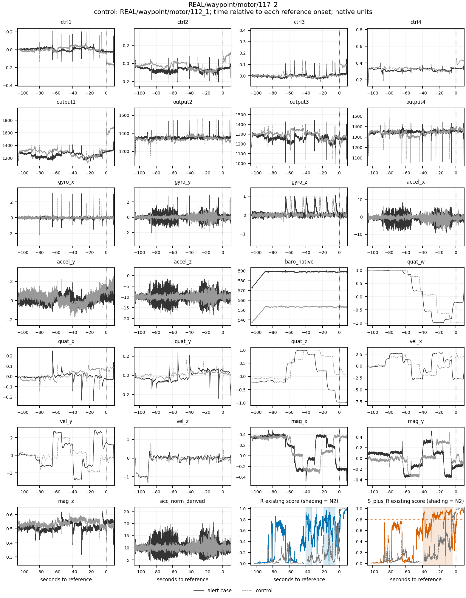
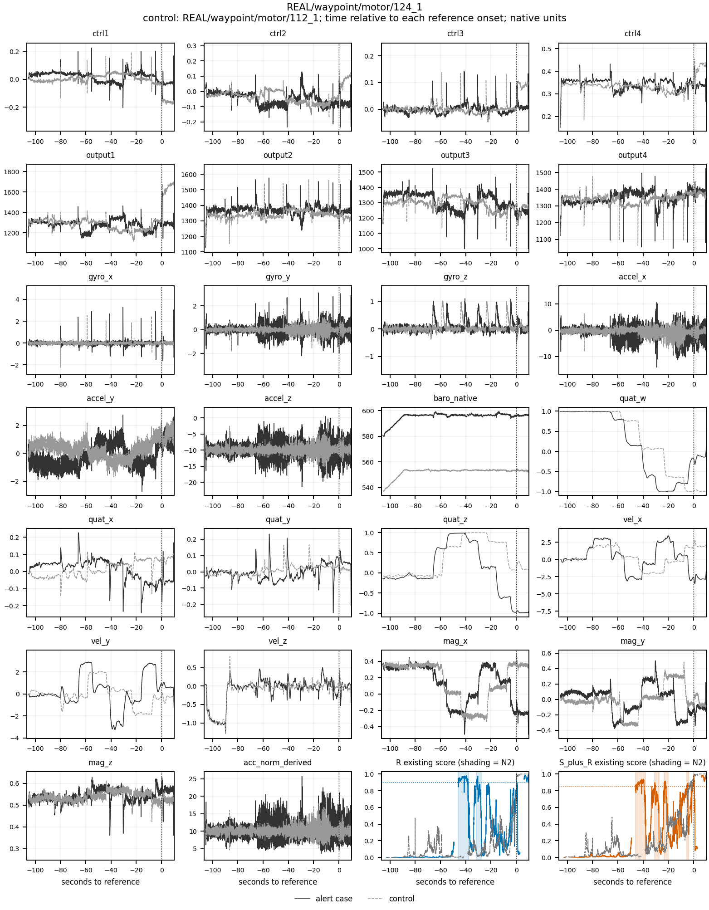
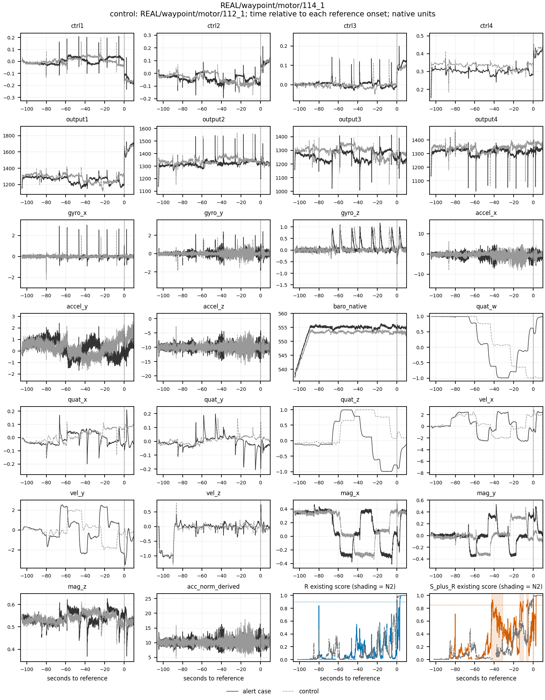
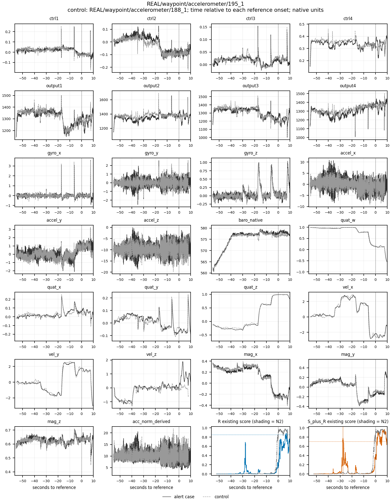

# B1 N2误报事件根因审计 v1

**状态：审计完成；B1的18/27次N2判定不变。没有认证真实故障前兆或能解释这些事件的标签时间错位。最明确的新发现是waypoint早期日期组、长前故障航线覆盖和动态输入分布相互混杂，不能把它们单独当作已证实根因。**

本次是零训练、零新预测、零阈值调整的诊断。H1成立/H2不成立以及“不进入B2”均保持原结论。报告中的E表示物理根因未确定，不是把原N2改成unknown、剔除或豁免。

## 1. 范围、输入与方法

- 全部20个有N2事件的开发案例（19关联组），45个“臂×事件”：R18次/13例，S+R27次/16例。另审查32个不同案例的无N2对照，共52例；均eligible dev、非quarantine。
- 先保存方法`plan.json`；原40个配对优先同目录/家族/故障子型、同外层折，再按N2覆盖长度排序。仅看元数据即发现部分waypoint同折对照前故障覆盖短，保留全部原对照，再增加10个跨折最近覆盖配对（新增3个独立案例），形成50个配对关系；没有按原始信号或高分择对照。方法修订在任何npz/分数读取前记录为`plan_r2.json`。
- B1 CSV仅有逐案例次数，故读取已有104份逐帧分数；只抽取原`aggregate_scores`和`event_record`函数，按原各折onset固定回放一次恢复时间。104个案例×臂（包括全部对照）计数和参考onset全部与B1一致；无模型加载、fit、predict或新onset。
- 所有52例均审查26个canonical输入通道、输入/标签mask、现成分数、TestInfo、保存的ROS参考及原ULog的注入/状态消息。26通道加速度模长按B1从加速度重算；气压通道图展示native值，但模型每3秒窗会减去首行，不能把绝对气压高度差直接说成模型依赖。
- 诊断取样：事件前5至1秒、事件本段、结束后1至5秒，原20ms整数µs网格；至少25有效行才给分位数，缺失不补零、不插值、不跨缺口算差分。控制映射以各自参考onset的相同提前时间为proxy，不等价于已认证的同一转弯/航段。事件后检查窗可能越过注入起点，仅作上下文。
- 120个事件×控制映射中，每臂96个完整可评分且已知正常区间、116个至少有正常评分；每个原事件至少有一个完整支持的对照。对照案例/配对不是新增独立样本，不做因果显著性检验。
- 批次分母使用全部265个eligible故障开发案例的`case_records`元数据，不加载额外213个案例的时序或分数；未读封存/quarantine payload或source/internal test。

### 实际输入文件与原生IMU复核

| 输入类别 | 唯一文件 | 实际打开次数（运行时guard记录） |
|---|---:|---:|
| 26通道连续案例NPZ | 52 | 116 |
| 已有逐帧分数NPZ | 104 | 232 |
| 保存标签参考NPZ | 52 | 52 |
| 已认证ROS命令/timesync参考NPZ | 52 | 52 |
| 原ULog（注入/状态、124参数及原生IMU复核合计） | 52 | 105 |
| 原TestInfo XLSX/CSV | 52 | 52 |
| eligible故障case_records元数据 | 265 | 265（另有准备阶段52例及61_1一次schema读取） |

重复取诊断统计、复核图和导SVG会重新读取同一现成输入，不是新预测，也不增加案例。输入路径、用途集合和次数在`input_files.csv`；准备阶段与代码/协议元数据单列`preflight_metadata_reads.json`。分数、案例、标签及ROS参考都以已有身份SHA核对，原模型文件一次未打开。

26通道图是50Hz因果发布回放视图，不等价于未加工的原生高频传感器流。为防止把回放尖峰直接叫作传感器损坏，另对同52个原ULog读取sensor_combined、sensor_accel、sensor_gyro和vehicle_imu_status；165个事件/对照映射区间逐topic记录（不是165个独立病例）。45个告警区间原生gyro/accel均有限，相关topic的发布timestamp无倒序；实际记录的accelerometer_clipping、clip_counter、accel_clipping及gyro/accel error_count在检查区间均0、无计数增加。原生检查仍没有提供确诊硬件故障的证据，**缺少这些flag也不认证健康**。原生采样存在至少98、最多5291个/告警区间，未用稀疏50Hz视图推断削顶；完整字段与支持样本数见`native_IMU_interval_review.csv`及topic inventory。

## 2. 全45事件清单与分类

时间均为保存PX4流时钟，提前量=参考onset−事件时刻；start为候选起点、confirm为3点确认，不混同最终emit。关联组数字G表示`testinfo_case_id_candidate:G`；完整UID、组、家族、目录、起止/确认/emit/提前/持续时间见`events.csv`及`event_classification.csv`。45个确认均早于参考起点；重放生成的主机Unix时间没有当作历史证据。

| 臂 | 案例（REAL/前缀省略） | 关联组 | start / confirm（PX4秒） | 起始/确认提前秒 | 持续秒 | waypoint | 主类/候选 |
|---|---|---|---|---|---|---|---|
| S_plus_R | acce/motor/429_1 | 429 | 166.312650 / 166.352650 | 1.90 / 1.86 | 0.50 | 否 | E / B |
| S_plus_R | circling/gyroscope/376_1 | 376 | 193.866171 / 193.906171 | 21.46 / 21.42 | 1.06 | 否 | E / B |
| S_plus_R | circling/magnetometer/385_1 | 385 | 233.999237 / 234.039237 | 21.22 / 21.18 | 2.02 | 否 | E / B |
| R | circling/magnetometer/386_1 | 386 | 246.665344 / 246.705344 | 21.56 / 21.52 | 1.14 | 否 | E / B |
| S_plus_R | circling/magnetometer/386_1 | 386 | 246.865344 / 246.905344 | 21.36 / 21.32 | 2.04 | 否 | E / B |
| S_plus_R | hover/barometer/72_1 | 72 | 141.007432 / 141.047432 | 1.32 / 1.28 | 0.74 | 否 | E / B |
| S_plus_R | hover/gyroscope/61_1 | 61 | 169.914232 / 169.954232 | 5.62 / 5.58 | 2.74 | 否 | E / B |
| R | hover/gyroscope/61_1 | 61 | 170.294232 / 170.334232 | 5.24 / 5.20 | 1.88 | 否 | E / B |
| R | hover/magnetometer/89_1 | 89 | 209.623790 / 209.663790 | 3.44 / 3.40 | 2.12 | 否 | E / B |
| R | hover/motor/17_1 | 17 | 150.106060 / 150.146060 | 3.04 / 3.00 | 2.52 | 否 | E / B |
| R | velocity/barometer/301_1 | 301 | 147.101331 / 147.141331 | 5.80 / 5.76 | 3.06 | 否 | E / B |
| R | velocity/motor/267_1 | 267 | 406.039621 / 406.079621 | 12.04 / 12.00 | 8.36 | 否 | E / B |
| S_plus_R | velocity/motor/267_1 | 267 | 411.599621 / 411.639621 | 6.48 / 6.44 | 2.68 | 否 | E / B |
| S_plus_R | waypoint/accelerometer/195_1 | 195 | 737.691426 / 737.731426 | 27.90 / 27.86 | 0.70 | 是 | E / B |
| S_plus_R | waypoint/motor/114_1 | 114 | 383.614098 / 383.654098 | 42.72 / 42.68 | 11.46 | 是 | E / B;D |
| S_plus_R | waypoint/motor/114_1 | 114 | 412.854098 / 412.894098 | 13.48 / 13.44 | 3.34 | 是 | E / B;D |
| S_plus_R | waypoint/motor/114_1 | 114 | 419.674098 / 419.714098 | 6.66 / 6.62 | 1.74 | 是 | E / B;D |
| S_plus_R | waypoint/motor/116_1 | 116 | 264.846008 / 264.886008 | 47.64 / 47.60 | 9.22 | 是 | E / B;D |
| S_plus_R | waypoint/motor/116_1 | 116 | 300.766008 / 300.806008 | 11.72 / 11.68 | 8.78 | 是 | E / B;D |
| R | waypoint/motor/117_1 | 117 | 766.959647 / 766.999647 | 39.56 / 39.52 | 1.78 | 是 | E / B;D |
| S_plus_R | waypoint/motor/117_1 | 117 | 767.439647 / 767.479647 | 39.08 / 39.04 | 6.94 | 是 | E / B;D |
| S_plus_R | waypoint/motor/117_1 | 117 | 777.839647 / 777.879647 | 28.68 / 28.64 | 15.20 | 是 | E / B;D |
| S_plus_R | waypoint/motor/117_1 | 117 | 794.599647 / 794.639647 | 11.92 / 11.88 | 2.26 | 是 | E / B;D |
| R | waypoint/motor/117_2 | 117 | 224.417355 / 224.457355 | 40.08 / 40.04 | 6.72 | 是 | E / B;D |
| S_plus_R | waypoint/motor/117_2 | 117 | 225.057355 / 225.097355 | 39.44 / 39.40 | 26.80 | 是 | E / B;D |
| R | waypoint/motor/117_2 | 117 | 236.497355 / 236.537355 | 28.00 / 27.96 | 1.26 | 是 | E / B;D |
| R | waypoint/motor/117_2 | 117 | 246.017355 / 246.057355 | 18.48 / 18.44 | 5.86 | 是 | E / B;D |
| S_plus_R | waypoint/motor/117_2 | 117 | 252.357355 / 252.397355 | 12.14 / 12.10 | 7.72 | 是 | E / B;D |
| R | waypoint/motor/117_2 | 117 | 252.537355 / 252.577355 | 11.96 / 11.92 | 7.12 | 是 | E / B;D |
| R | waypoint/motor/118_1 | 118 | 277.948760 / 277.988760 | 4.78 / 4.74 | 0.88 | 是 | E / B;D |
| S_plus_R | waypoint/motor/120_1 | 120 | 190.470260 / 190.510260 | 60.32 / 60.28 | 0.54 | 是 | E / B;D |
| R | waypoint/motor/120_1 | 120 | 222.670260 / 222.710260 | 28.12 / 28.08 | 5.32 | 是 | E / B;D |
| S_plus_R | waypoint/motor/120_1 | 120 | 226.230260 / 226.270260 | 24.56 / 24.52 | 1.76 | 是 | E / B;D |
| S_plus_R | waypoint/motor/120_1 | 120 | 234.050260 / 234.090260 | 16.74 / 16.70 | 13.70 | 是 | E / B;D |
| S_plus_R | waypoint/motor/122_1 | 122 | 236.440498 / 236.480498 | 40.20 / 40.16 | 2.94 | 是 | E / B;D |
| R | waypoint/motor/122_1 | 122 | 236.540498 / 236.580498 | 40.10 / 40.06 | 2.64 | 是 | E / B;D |
| S_plus_R | waypoint/motor/123_1 | 123 | 290.856367 / 290.896367 | 41.66 / 41.62 | 13.92 | 是 | E / B;D |
| R | waypoint/motor/123_1 | 123 | 295.176367 / 295.216367 | 37.34 / 37.30 | 9.84 | 是 | E / B;D |
| R | waypoint/motor/123_1 | 123 | 325.616367 / 325.656367 | 6.90 / 6.86 | 1.82 | 是 | E / B;D |
| R | waypoint/motor/124_1 | 124 | 223.585416 / 223.625416 | 46.00 / 45.96 | 8.22 | 是 | E / B;D |
| S_plus_R | waypoint/motor/124_1 | 124 | 223.585416 / 223.625416 | 46.00 / 45.96 | 8.04 | 是 | E / B;D |
| R | waypoint/motor/124_1 | 124 | 237.925416 / 237.965416 | 31.66 / 31.62 | 4.00 | 是 | E / B;D |
| S_plus_R | waypoint/motor/124_1 | 124 | 238.705416 / 238.745416 | 30.88 / 30.84 | 3.44 | 是 | E / B;D |
| S_plus_R | waypoint/motor/124_1 | 124 | 246.145416 / 246.185416 | 23.44 / 23.40 | 3.16 | 是 | E / B;D |
| S_plus_R | waypoint/motor/124_1 | 124 | 264.185416 / 264.225416 | 5.40 / 5.36 | 1.28 | 是 | E / B;D |

### 因果分类统计（保守主分类，与B1事件判定分离）

| 因果主分类 | R事件 | S+R事件 | 含义 |
|---|---|---|---|
| A | 0 | 0 | 未认证真实前兆 |
| B | 0 | 0 | 没有认证工况为唯一/可分离根因 |
| C | 0 | 0 | 没有确认标签时间错误 |
| D | 0 | 0 | 日期/分布有直接关联，但未隔离其因果 |
| E | 18 | 27 | 物理根因证据不足，保留B/D候选 |

B是工况候选，D是目录日期/航线/分布候选，**不是已认证因果标签**。D关联线索涉及R12和S+R19个waypoint/motor事件；其余事件保留工况线索。没有用“标签正常”证明B，也没有用“模型高分”证明A。所有事件主类保留E，避免用生态相关或不可比对照强行给出根因。124_1的6个事件另带参数注释复核标记，不据此认定C时间错误。

## 3. R与S+R的共同与独有误报

- 案例层：共同9例；R独有4例；S+R独有7例，共20例。
- 时间区间层：11个跨臂重叠连通分量，涉及R13个事件、S+R11个事件；R独有5个事件、S+R独有16个事件。`event_overlap_components.csv`列出每个成员。
- 重叠按同案例区间相交定义，无额外时间容差；允许一对多，不强行做一对一配对。117_2中一个S+R 26.80s长事件覆盖R的3段；另一个S+R段与R第4段相交。R总持续20.96s、S+R34.52s，**S+R计数更少不等于报警占用更少**。
- 两臂onset本来就不同：R折0–4为.85/.85/.85/.85/.90；S+R为.70/.85/.80/.85/.85。此次没有统一阈值反事实重评，不能把全部计数差只归因于源监督或某个输入通道。

## 4. waypoint专项：日期、航线和覆盖混杂

32/45事件来自waypoint，其中31为motor（R12、S+R19），另1为accelerometer195_1。waypoint/motor共有51个开发案例；31事件全部出自目录日期2023-05-22/23的15例，其余36例0事件。目录日期不等于经过独立认证的实验批次，ULog内部UTC日志可能与文件夹本地日期跨日；这里始终使用同一目录proxy，不混合两种日期。

| 原始目录日期proxy | 案例/关联组 | N2小时 | R事件/事件案例 | S+R事件/事件案例 | R/S+R次每小时 |
|---|---|---|---|---|---|
| 2023-05-22 | 4/4 | 0.105978 | 1/1 | 8/3 | 9.436/75.488 |
| 2023-05-23 | 11/11 | 0.221622 | 11/6 | 11/5 | 49.634/49.634 |
| 2023-05-24 | 1/1 | 0.013556 | 0/0 | 0/0 | 0.000/0.000 |
| 2023-05-25 | 1/1 | 0.013728 | 0/0 | 0/0 | 0.000/0.000 |
| 2023-05-26 | 34/32 | 0.462444 | 0/0 | 0/0 | 0.000/0.000 |

按曝光量归一后，早期两日仍为R36.630、S+R57.998次/h（0.327600h）；后续日期0次/0.489728h，但这**不是控制飞行阶段后的日期效应**。早期告警案例TestInfo多为107s注入（120_1为87s）、航线等待80s（120_1较短）；已审后期motor对照多为约58s注入、30s等待。相对起点−40秒在早期可能正飞航线，在后期却接近起飞/尚未进入同一航段，缺乏可比支持。

同早期日期组、长等待的112_1两臂均无N2，是重要反例；它的计划航速约2，与多数告警案例约3、114_1约2.5不同。112_1又被多个告警案例重复匹配，不能当作许多独立健康重复。因此日期/协议共同关联得到直接支持，**D作为独立因果解释尚未证实，B也未被单独隔离**。

## 5. 典型案例的26通道时序证据

典型展示按事前规则确定：waypoint最多事件的117_2、其后124_1、S+R独有最多事件114_1，以及字典序首个waypoint sensor195_1。其余20例全部量化，不以可解释性挑展示。图中黑实线为告警案例、灰虚线为对照，各自参考起点对齐；底部为既有R/S+R分数和原N2阴影。展示完整前段及参考后10秒，不代表两条曲线已精确对齐相同航点；图线断开处不插值。

### 5.1 117_2：分段与长事件合并，不是“源数据减少了误报”

参考onset264.497355s。R4段提前40.08/28.00/18.48/11.96s，S+R2段提前39.44/12.14s。26通道中姿态、水平速度、磁场分量分段变化，gyro/accel有不同程度振动；112_1也有转向脉冲，但并非完全相同速度/振动。首个R区间水平速度中位2.848，对照112_1为2.087；不可把该对照当作精确工况匹配。没有证实是哪一通道造成模型告警。

### 5.2 124_1：有振动差异，但不能认证“真实前兆”

R2段、S+R4段，最早提前46s；第一共同段gyro_y IQR约0.683，对照112_1约0.198，加速度模长IQR约3.334对1.281（对应事件窗；支持行数不同已记录）。这是真实记录到的输入差异，但风、振动、机体/采集状态和潜在机械问题没有独立真值区分。气压native层面也有明显偏移，不能直接归因到使用窗内相对高度的模型。

### 5.3 114_1：S+R独有，不是两臂共同确认的前兆

3次S+R事件提前42.72/13.48/6.66s，R没有N2。raw输入相同，现成分数与原onset共同决定两臂差别；没有做改阈值重评或特征归因实验。其首段速度中位2.434，112_1约1.964，对照不能证明完全相同的飞行状态。

### 5.4 195_1：同类型对照也有相似运动，不支持“看到振动即故障”

S+R独有0.70s事件，提前27.90s；R未形成N2。对照186_1/188_1同为waypoint accelerometer，事件映射水平速度中位2.934/2.816，对案例2.939；gyro_y和加速度局部离散程度仍有不同。姿态、速度和磁场整体演化较相似，但这些条件下分数差别不能认证传感器已经故障。

### 全20告警案例的逐例复核摘要

| 案例 | R/S+R次数 | 起始提前范围秒 | 事实与限制 |
|---|---|---|---|
| acce/motor/429_1 | 0/1 | 1.90–1.90 | 事件水平速度中位2.129、倾角13.95°；与加减速/姿态工况相容，但无独立物理故障起点。 |
| circling/gyroscope/376_1 | 0/1 | 21.46–21.46 | 圆周飞行，事件速度2.748、角速度范数0.347；运动与角速度变化并存，不能据此确诊陀螺故障。 |
| circling/magnetometer/385_1 | 0/1 | 21.22–21.22 | 圆周飞行，速度2.647、倾角6.08°；磁场分量随姿态变化不单独作为磁力计损坏证据。 |
| circling/magnetometer/386_1 | 1/1 | 21.36–21.56 | 两臂共同区间；速度约2.94，事件加速度范数中位10.14–10.50；运动与传感器效应不能单靠该值区分。 |
| hover/barometer/72_1 | 0/1 | 1.32–1.32 | 低水平速度0.087，倾角9.43°；没有足够证据将短时姿态/高度波动归因于气压计提前故障。 |
| hover/gyroscope/61_1 | 1/1 | 5.24–5.62 | 两臂共同短段；速度0.16–0.18、角速度范数0.28–0.31；命令仍未注入，实际硬件状态无独立参照。 |
| hover/magnetometer/89_1 | 1/0 | 3.44–3.44 | 速度0.128、倾角7.05°；磁场变化可与姿态/环境有关，未认证真实磁异常。 |
| hover/motor/17_1 | 1/0 | 3.04–3.04 | 速度0.174、倾角7.30°；未注入接收记录早于参考，无维修/转速等独立故障证据。 |
| velocity/barometer/301_1 | 1/0 | 5.80–5.80 | 速度1.758、倾角25.13°；大倾角运动支持工况线索，不等同已定位误报因果通道。 |
| velocity/motor/267_1 | 1/1 | 6.48–12.04 | 速度约5.0；R事件长8.36s，S+R仅覆盖其后段2.68s；工况和振动都应保留为线索。 |
| waypoint/accelerometer/195_1 | 0/1 | 27.90–27.90 | 与186_1/188_1同类对照速度相近；26通道演化相似但局部振动幅度不同，S+R独有0.70s事件，不能证明前兆。 |
| waypoint/motor/114_1 | 0/3 | 6.66–42.72 | S+R独有3段；107s计划注入，80s航线等待；112_1同日期组长前段对照无N2，两臂score形状也不同。 |
| waypoint/motor/116_1 | 0/2 | 11.72–47.64 | S+R独有2段；107s计划注入、长航线；低速后期对照不能自动视为同一物理飞行阶段。 |
| waypoint/motor/117_1 | 1/3 | 11.92–39.56 | R1段/S+R3段；姿态、速度、磁场分量均有分段变化；与117_2同关联组，不计作独立重复。 |
| waypoint/motor/117_2 | 4/2 | 11.96–40.08 | R4段/S+R2段；一个S+R长段覆盖3个R段；正常对照112_1也有转向脉冲，但速度和振动并非完全匹配。 |
| waypoint/motor/118_1 | 1/0 | 4.78–4.78 | R独有0.88s段，角速度范数中位1.119；发生于较强转动，但不能据峰值直接判定正常或故障。 |
| waypoint/motor/120_1 | 1/3 | 16.74–60.32 | 计划注入87s、长于后期对照；S+R最早事件提前60.32s，时间远大于命令/接收差，不能用毫秒级对齐差解释。 |
| waypoint/motor/122_1 | 1/1 | 40.10–40.20 | 两臂几乎共同区间；角速度范数约0.50、速度2.836；与早期长航线日期组关联。 |
| waypoint/motor/123_1 | 2/1 | 6.90–41.66 | R2段/S+R1段；共同长段及R独有短段，角速度/速度均变化；不将关联当成因果认证。 |
| waypoint/motor/124_1 | 2/4 | 5.40–46.00 | R2段/S+R4段；gyro_y与加速度振动明显，但112_1也有部分共同转向结构；TestInfo参数字段与首条接收参数不逐项一致，非起点错位证明。 |

每个事件及各匹配对照的全26通道基线/事件/后窗中位、IQR、P05/P95、相邻差分和重复值比例见`channel_period_statistics_integer_us.csv`；存在至少25行的支持才给统计，未据任何通道阈值自动判健康/故障。已有配对AUC只作背景，不代替事件/物理证据。

## 6. 标签时间与故障注入核查

- 保存标签参考、按原整数首timesync锚点重取的ROS发送状态，以及本次新读原ULog接收状态：52例所有有效行分歧均0。所有52例在裁剪前都没有已记录的ULog active注入，未发现“前一次注入被当成N2”的证据。
- 首个**可监督且双方一致**故障帧相对ROS发送首active最多晚0.290309s，相对ULog接收首active最多晚0.025293s；这是通信/网格/有效性共同参考，不是证明标签与发送时刻零误差。
- 45次事件全部在原ROS首active之前结束，最小间隔0.285834s；候选起始提前1.32–60.32s。当前看到的亚秒参考差不能解释这些事件，更没有移动标签使其变成检出。
- ROS侧本次使用既有逐case、带SHA并曾独立核验原bag相关字段的参考，**未重新解码原bag**；ULog与TestInfo本次实际重新读取。缺少独立物理损伤/传感器校准真值，不能由ID正常推论硬件必正常，也不能由高分推论提前故障。

TestInfo是计划相对时间，原文未单独认证其零点等于ULog armed消息。下表只列一致性旁证，不拿差值直接判错或拟合新时钟：

| 案例 | TestInfo计划秒 | 参考−armed日志秒 | 两者差秒（非认证时钟误差） |
|---|---|---|---|
| waypoint/accelerometer/195_1 | 57.0 | 57.321531 | 0.321531 |
| waypoint/motor/114_1 | 107.0 | 106.684537 | -0.315463 |
| waypoint/motor/116_1 | 107.0 | 107.081811 | 0.081811 |
| waypoint/motor/117_1 | 107.0 | 106.576838 | -0.423162 |
| waypoint/motor/117_2 | 107.0 | 107.257089 | 0.257089 |
| waypoint/motor/118_1 | 107.0 | 107.161009 | 0.161009 |
| waypoint/motor/120_1 | 87.0 | 86.559353 | -0.440647 |
| waypoint/motor/122_1 | 107.0 | 106.982681 | -0.017319 |
| waypoint/motor/123_1 | 107.0 | 107.163532 | 0.163532 |
| waypoint/motor/124_1 | 107.0 | 107.567707 | 0.567707 |

124_1的TestInfo Control Sequence包含`...,123450,11,10,1,0.8,...`，Fault parameter字段也不是接收首条的直接逐项副本；原ULog首active为269.565740s、id123450、mode1、controls[0]≈0.8，其余前三电机系数1。此处需要原控制脚本/字段语义复核，**不是已确认的起点或故障标签错误**，也不能解释提前5–46秒的全部事件。没有修改任何参数注释或标签。

ULog在所查前段没有severity≤warning日志（日志ASCII等级已解码），事件状态均nav_state14/arming_state2；这些只说明记录状态，不能用“没报warning”认证健康，也不将nav_state14直接解释为某个具体航段。

## 7. 证据强度、能回答与不能回答

| 问题 | 结论与强度 |
|---|---|
| 18/27事件是否真实存在于冻结事件规则 | 强：全104案例臂计数、原onset和保存分数SHA核对一致 |
| 是否源于秒级保存标签/ROS/ULog错位 | 本次没有支持：有效行一致，全部事件在发送active前结束；不是独立物理真值认证 |
| 是否真实故障前兆A | 未认证：没有独立损伤/注入已提前的证据；振动与模型分数不足以证明 |
| 是否正常工况造成B | 有工况共现与正常对照线索；没有单独隔离到因果，不能全部改判B |
| 是否批次/分布差异D | 早期目录日期与长前段、速度/姿态/振动分布共同关联为直接事实；真实批次ID、环境/载荷/机体效应尚未隔离 |
| 模型到底使用了哪个通道 | 不能回答；没有做新预测、消融、SHAP或阈值反事实 |
| S+R为何多9次 | 已定位独有区间、不同原onset及部分事件合并；不能唯一归因于源域负迁移 |

**可确定**：现有命令/参考证据不支持用简单全局标签平移解释全部事件；事件高度集中且伴随阶段/日期分布支持不一致；只看pooled AUC或事件计数不足以定位物理根因。**不能确定**：45个事件里哪些是没有注入记录的真实机械前兆，哪一个输入/批次因素独立导致告警；因此保持E主分类与原B1评价。

## 8. 下一步建议（仅建议，不执行）

1. 优先索取原控制脚本、TestInfo时间零点/字段语义和真实实验批次、机体/载荷、天气、传感器校准记录；专项核对124_1参数注释。没有新证据前不改标签。
2. 围绕早期waypoint长航线补独立健康对照：相同路径、速度、80s等待和同机体/环境；不能用30s后就注入的后期案例替代完整前段。112_1是反例但单一且速度不同，不能重复使用它伪造独立性。
3. 若要检验真实机械前兆，须有独立转速/电流/维修/视频或受控健康基线；不能用GBT高分给物理故障定时。
4. 如原始记录最终支持时间/标签修正，另交版本化审计方案，保留旧B1结果；不得按本次模型效果回填标签、事后删例或宣布H2通过。
5. 不启动B2/T1/GPU，不训练新模型，不自动统一/重扫阈值。由用户决定是否开展上述数据取证。

## 9. 完整偏差与实现选择

1. 未产生数值协议、标签或既有事件判定变更。已有摘要没有逐事件时间，新增固定原规则回放仅恢复时间并核对，未调用模型/新预测/搜索阈值，B1所有原结果及历史仍在。
2. 对照先按元数据冻结，发现覆盖不匹配后在任何payload读取前保留原配对并补最近覆盖关系；两版计划都保留，最终52例/50配对。相同相对onset只是阶段proxy，跨折对照还混有不同模型/onset，不作完美匹配声明。
3. 原始统计第一版用浮点秒选区间，“covers_full_interval”只检查裁剪覆盖且有分数，不能证明完整评分。发现边界取样问题后保留原表，另生成整数µs权威表，并区分expected/present/scored/known-normal及完整支持；增加边界回归，7项合成检查通过。未重放事件或修改其端点。
4. 仅前后窗等诊断统计使用25行最小支持，非模型/事件阈值；缺失保持null，不插值、不补零，不跨缺口算相邻差分。
5. 首轮26通道PNG机器QA无问题，但AI发现图例可能压住第一轴尖峰；保留r1，移到图外生成r2，4图重新机器和AI检查通过，再导SVG，严格矢量检查通过；灰度预览亦通过。这是展示修改，不改数据/事件。
6. 全20案例量化，4典型图按预先元数据规则选取。没有按“好解释”挑案例、没有加反事实评分/消融；新增病例事实表、目录日期曝光表均为已有数据的描述，不是模型优化或独立确认。
7. 原bag本次未重解码，使用已有认证字段参考；新读52原ULog与52 TestInfo，124参数另读一次。TestInfo计划秒与armed起点只作旁证，目录日期不等于认证批次，未构造有利新时钟。
8. 主分类全E是证据门槛下的未决结论，并非漏审；B/D候选及124注释问题单列，未把相关性、参考正常或分数升高当作物理因果。
9. B1原文本证据全部逐文件SHA/mtime保护验证未变；没有读取模型权重、source train/val、内部test、封存/quarantine payload，没有训练、预测、标签修改、病例删除、规则调整、依赖安装或CPU dispatch变化。
10. 实际读取文件和数量见`input_files.csv`（逐路径/用途/打开次数）及`preflight_metadata_reads.json`。准备阶段52个selected case_records及61_1一次额外schema读取在运行时guard之外，明确补记；运行时265故障元数据用于完整日期分母，不打开其余213例payload。重复出图/统计只重新读取既有输入，不生成预测，绝不把重复打开计作新案例。
11. 初始6项、整数边界修正后7项合成测试均首轮通过，0真实数据/模型访问；正式提取一次退出0，69.58秒，无失败/模型重试。仅诊断表与图的修订如上，旧版本不覆盖。
12. 报告和唯一维护入口更新属于本次用户明确授权；其他历史结项报告/协议、无关case-relative脚本与两份临时日志不修改。审计完成后只提交/push本次文件，不启动后续实验。
13. 补充原生IMU健康/剪切检查仍使用同52案例，未扩展样本或生成预测；ULog累计105次打开、52唯一文件。保存补充前results/audit/access快照，更新最终读取回执；原始B1全部证据不变。缺少clipping/error flag只降低特定硬故障解释的支持，不能排除真实机械前兆或把事件强行归为B。
14. 提交前全文件Git空白检查退出2：Matplotlib原生SVG的path属性含合法行尾空格，生成检查日志另有末尾空行。完整58MB失败输出在本机保留，完整gzip副本与按文件计数回执入库；不清洗SVG或原日志、不改Git配置。随后仅对手写代码/文档做空白检查，通过；生成图使用已通过的SVG严格检查与视觉QA。没有实验重跑或提交失败。

## 10. 产物和复现

- `scripts/research/audit_real_v2_b1_n2.py`及`tests/test_real_v2_b1_n2_audit.py`；仅合成单测。
- `artifacts/real_v2_b1_n2_audit_v1/`：两版方法与对照、45事件、分类、20案例证据、时钟核查、全26通道诊断表（整数µs版为准）、对照分数摘要、目录日期曝光、四例PNG/SVG、输入回执与results。
- `artifacts/real_v2_b1_n2_audit_v1_checks/`：实现/检查/出图配方、数据剖析、视觉QA及执行日志。旧浮点表、首轮PNG保留，不能替代权威整数表/最终r2图。
- `docs/文档索引与实验台账.md`已增加B1完成状态、N2审计状态和本报告链接；未改写B1原结论。
- Git精确提交清单见checks目录的`submission_files.txt`，commit/push验证由Git记录与任务回复给出，避免自引用哈希。
