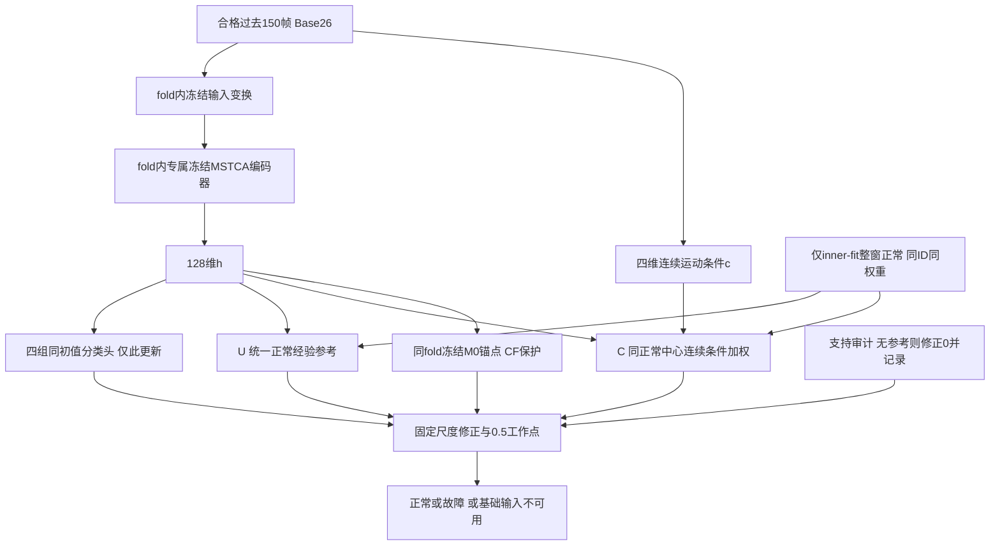
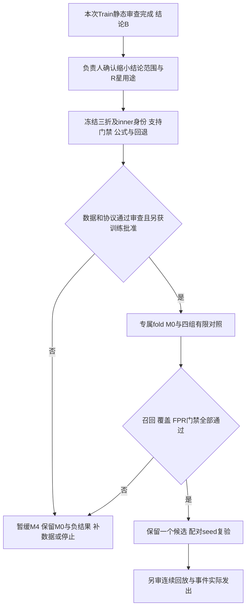

# M4专项研究设计与数据可行性报告 v1

项目：基于数据驱动的无人机故障智能诊断系统  
日期：2026-11-05（北京时间）  
审查基点：`main@28a5078186a60fd1e21bb7f8142f1941b5f2d2de`  
阶段：**source Train 静态可行性分析与未来协议设计；没有实施M4算法、训练或模型前向。**

## 1. 决策与证据性质

**选择B：部分条件有研究价值，必须缩小可主张的研究范围；本次不建议进入正式M4训练。**

完整Base26 Train中，五类运动代理有正常支持，下降代理没有正常支持。现有数据足以设计总体六故障、SIL/HIL层面的分组比较，但不足以在每一折对所有“状态×故障×域”作可靠比较。三折仍有87/216个细分格未通过预先登记的描述性支持门槛；最关心的Hover低运动中，Accelerometer和HIL Magnetometer尤其不足。**缩小的是结论与验证范围，不能删去这些故障、状态或困难窗口来改善结果。**[完整统计与运行完成记录][A01]、[独立核验][A02]。

本次尚未证明连续条件可靠、正常参考不吸收故障、条件化优于统一参考，也没有得到任何M4的FPR或Recall。推荐将低维连续运动摘要作为**后续待审查的条件变量**，先以统一正常参考M4-U检验必要性，再以M4-C检验条件化的独立增量。M4-CF只是同一方向的保护消融，不是第三条算法路线。所有未来训练均须另行明确批准；本报告和协议草案不构成启动许可。

|证据类别|本报告中允许成立的表述|不能据此成立的表述|
|---|---|---|
|已有实验事实|M0/M1/M3正式报告和核验已记录的结果|将旧人口成绩移作本次Base26全人口成绩|
|本次新增静态事实|162069个Train窗的身份、物理摘要、固定代理状态与fold支持|未见案例诊断效果、实时性能、物理故障因果关系|
|研究假设|正常背景建模可能减少部分误报；条件路由也可能吸收故障|工况感知已经有效、已经有原创算法贡献|
|未验证设计|第8—11节公式、更新范围和四组矩阵|已经实现、已经选定最佳结构或工作点|
|未来获批工作|fold内独立训练、冻结后留组评价、之后连续回放|复用历史完整Train编码器冒充独立验证|

本报告承接[科研技术路线总览](科研技术路线总览_2026-11-05.md)，但**修正其中“冻结M0后再留组拟合正常参考”可能产生的独立性误读**：完整Train监督训练过的编码器已暴露全部Train案例，后续只隔离正常参考无法消除表征暴露。旧总览及其他历史文件未改写。

## 2. 已有研究依据与不能绕过的负结果

|研究|正式证据及关键结果|对M4的约束|
|---|---|---|
|M0纯26维MSTCA|105938参数；完整34710窗source-Val中，Uniform/Balanced的独立正常Hover FPR为341/754=45.23%、270/754=35.81%；故障Recall约97.88%、96.81%|去掉旧9维仍有正常误报，不能把问题全部归因于关系分支。[M0报告](2026-11-02/mstca_m0_training_v1.md)|
|M1同人口Balanced比较|32381窗；全正常FPR 2.9717%→2.1092%，独立Hover 40.5634%→27.6056%；Recall 97.5633%→96.8117%，GPS 95.1954%→90.4723%|有减少误报和增加漏检的取舍；小残差不能定义健康。[M1正式结果](2026-11-02/m1_training_and_response_results_v1.md)|
|M2/旧9维物理诊断|O1—O9主要是Base26标准化量的确定性重表达；混控对应、物理量纲、clamp均有限制，部分条件排序仍存在|数学信息重表达与物理故障真值不同；不能因为有可解释名字就推断增益。[物理诊断](2026-11-03/M3_physical_data_diagnosis_v1.md)|
|M3八组|共同32381窗，C0正常FP384/FN623；CN FP382/FN721；CO Macro-F1最高0.969237，但GPS/Gyro/Motor Recall下降；候选通过0/7|总体F1或局部Hover改善不能代替逐项召回约束；容量增加没有解决目标。[八组正式结果](2026-11-03/M3_eight_group_results_v1.md)|
|固定条件N参考|Train74700完整正常窗；共同Val32165窗中，FP550→818、FPR3.463%→5.150%，故障异常标记1769→3542（10.865%→21.754%）；案例等权总体AUC0.616→0.553|保留失败。既不能挪用C0的召回，也不能改分位数/状态边界挽救原方案。[条件残差验证](2026-11-03/M3_conditioned_residual_validation_v1.md)|

历史固定N参考用的是N有效域；本次使用完整Base26有效域。74700与83051个正常Train窗、32381与34710个历史Val窗的差别是**人口及输入资格差别**，不是模型改善。上述历史Val数字仅引用正式报告，本次没有加载Val数据或保存预测进行新分析。没有读取最终Test/Real数据。

## 3. 数据身份、统计口径和执行方法

### 3.1 冻结输入与只读方法

仅读取`D:/UAV-Data/causal_input_v1`中六项Train允许文件：`train_cache_complete.json`、`input_contract.json`、`norm_stats.json`、`ledgers/train_all_windows.csv`、`ledgers/train_included_windows.csv`、`cache/train.pt`。逐项SHA见[输入身份][A03]，与[历史M0冻结配置](../../configs/experiments/causal_pure_mstca_m0_v1.json)交叉核对。没有遍历其他数据角色。

|关键对象|身份|
|---|---|
|Train张量SHA256|`d4c3c2c741c67d224547cf604087f45fa4ed371197129fd026ecf475d4de428d`|
|Train合格ID台账SHA256|`0c491c2ede34534eaba020ae5a9d09257fedb692519863f325c6b0dfeb4afecb`|
|历史Base26标准化SHA256|`cd61a134842d0322d9e4bc76962ac0a8c0ff90566786c423d3096721cd856a30`|
|本次统计计划SHA256|`f45db21ac640f8aab2a351ad8c73ed0828287c8d274a6e3c8a64add527a8f1bf`|

使用既有后端Python环境、CPU内存映射、`weights_only=True`读取**Train数据张量**，未加载模型checkpoint、未构造神经网络。张量为未标准化的物理输入`float32[162069,26,150]`，逐窗气压已按原协议相对化；检查全部元素有限、全部ID/标签对应、150帧长度、输入与监督mask。历史`norm_stats.json`本次只提供通道身份核对，**没有将其全Train均值/方差用于新fold变换**。

本次输出由[预登记计划][A04]、[统计脚本][A05]和[逐窗台账][A06]连接。状态函数用AST抽取原函数体执行，未导入可能加载模型的父模块；951次标量/向量函数探针对应。另一个核验脚本按每案例首/中/尾共7708窗重算状态及物理摘要，核对全部162069个ID/标签、两套fold隔离和2198个前后配对，并对100个案例AUC作直接两两比较，最大舍入差`1.11e-16`。[规则SHA](../../artifacts/M4_design_preflight_v1_20261105/state_rule_identity.json)、[独立核验脚本](../../artifacts/M4_design_preflight_v1_20261105/verify_preflight.py)、[核验结果][A02]。

### 3.2 分母、标签和独立单位

|口径|窗口|案例|关联组|含义|
|---|---:|---:|---:|---|
|旧Train总分母|168800|不将旧附加窗折算案例|不混作source组|165120个source抽样窗+3680个历史Rfly附加窗|
|原source Train|165120|2580|1296|冻结成员，单案例最多64窗|
|当前Base26合格Train|162069|2570|1296|本次全集；相对旧总分母96.0124%，相对source98.1523%|
|正常端点/整窗已知正常|83051|2570|1296|本人口中二者恰好相同；正常参考只用整窗有效且fault_fraction=0|
|故障端点|79018|2200|1128|正式分类任务分母，保留过渡窗|
|完整稳定故障|73098|2198|1127|整窗有效且fault_fraction=1；用于纯正常—纯故障描述|
|故障端点中的过渡/非整窗纯故障|5920|不另当独立样本|不另相加|仍留在未来分类与覆盖率评价中|
|独立正常目录|21145|334|168|`no_fault`正常案例|
|故障案例未激活正常段|61906|2236|1128|正常参考可用，但与同案例故障段相关|

历史排除合计6731=2936输入无效+115标签无效+3680附加窗；本次未修复、补样或重写任何排除理由。2580→2570为已有门禁造成的整案例无合格窗，具体10案例见[完成记录][A01]与[案例可用性][A07]。其中2个SIL Motor、8个HIL Hover Magnetometer；不能将这些缺失当成本次删难例。

1296个合格关联组中，1274组为两个合格SIL/HIL案例，22组只剩一个合格案例。**单成员仍保留原association_group，不重新配对。**各域内“组数=案例数”不意味着两域可以相加成独立组数；同一案例可同时贡献正常和故障、多种状态，行间案例数也不可直接求和。[关联组表][A08]。

### 3.3 按域、故障目录和历史运行目录覆盖

|域|全部窗|案例|正常窗|故障端点窗|完整故障窗|
|---|---:|---:|---:|---:|---:|
|SIL|81946|1282|41590|40356|37445|
|HIL|80123|1288|41461|38662|35653|

|父故障目录|全部窗|案例|关联组|正常窗|故障端点窗|完整故障窗|
|---|---:|---:|---:|---:|---:|---:|
|GPS|12063|191|96|5265|6798|6270|
|Accelerometer|11966|190|96|5344|6622|6087|
|Barometer|12372|195|98|6169|6203|5597|
|Gyroscope|12200|194|97|5459|6741|6203|
|Magnetometer|11351|183|96|4965|6386|5919|
|Motor|80972|1283|645|34704|46268|43022|
|no_fault|21145|334|168|21145|0|0|

父目录案例数包含故障未激活正常段，**不是有故障端点的案例数**。每项故障端点/纯故障案例与组数另在[完整故障目录覆盖](../../artifacts/M4_design_preflight_v1_20261105/coverage_fault_directory.csv)。

|历史运行目录|全部窗|案例|组|正常窗|故障端点窗|完整故障窗|
|---|---:|---:|---:|---:|---:|---:|
|Acce|15440|244|122|7574|7866|7281|
|Circling|37632|596|299|22510|15122|14178|
|Dece|15192|240|122|8183|7009|6370|
|Hover|36653|585|299|14597|22056|20046|
|Velocity|19589|309|155|9139|10450|9635|
|Waypoint|37563|596|299|21048|16515|15588|

这些目录用于审计、分层与未来评价，不作为在线工况输入，不认证飞行意图。窗口抽样有间隔，不能用这些表计算事件数、监测小时或时延。[域覆盖](../../artifacts/M4_design_preflight_v1_20261105/coverage_domain.csv)、[运行目录覆盖](../../artifacts/M4_design_preflight_v1_20261105/coverage_flight_directory.csv)。

## 4. 冻结运动代理及正常参考支持

### 4.1 原状态规则保持不变

直接复用[observed_states](../../scripts/research/collect_m3_formal_results.py)和[observed_motion](../../scripts/research/analyze_13_feature_screening.py)。输入只有过去150帧物理速度与陀螺仪，定义`s=||v||₂`、`r=||ω||₂`，**按以下顺序优先匹配**：

|顺序|状态|固定条件|
|---:|---|---|
|1|maneuver_proxy|P90(r)≥0.3 rad/s，或std(s)≥0.5 m/s|
|2|climb_proxy|至少80%帧满足v_z≤−0.5 m/s（NED向下为正）|
|3|descent_proxy|至少80%帧满足v_z≥+0.5 m/s|
|4|low_motion_proxy|至少80%帧s≤0.3 m/s，且另外至少80%帧r≤0.15 rad/s|
|5|translation_proxy|至少80%帧s>0.3 m/s|
|6|other_motion|其余|

第4条是两个分别计数的比例条件，不是“同时满足两条件的帧≥80%”。状态不是Hover/Velocity等目录的重命名。没有使用故障类别、域、注入标志、绝对位置、日志总长、裁剪进度或未来帧。

### 4.2 Base26全人口支持结果

|状态|全部窗|正常窗|正常案例/组|正常SIL/HIL案例|故障端点窗|纯故障窗|正常参考门槛|
|---|---:|---:|---|---|---:|---:|---|
|climb_proxy|37018|31257|2569/1296|1282/1287|5761|5528|通过|
|descent_proxy|1344|0|0/0|0/0|1344|1343|不通过|
|low_motion_proxy|23983|7521|2550/1296|1281/1269|16462|15206|通过|
|maneuver_proxy|21654|8797|1868/941|932/936|12857|10530|通过|
|translation_proxy|68550|28102|2071/1174|903/1168|40448|38661|通过|
|other_motion|9520|7374|2559/1296|1281/1278|2146|1830|通过|

门槛在计算前写入计划：每个拟合状态≥1000正常窗、≥30正常案例、≥15关联组、每域≥10正常案例。继承旧条件残差审查的**工程描述门槛**，不是统计功效保证或应用安全标准。[正常支持表][A09]、[状态×故障×域完整计数][A10]。

下降状态无正常参考，涉及1344/162069=**0.8293%**全部合格窗，全部为故障端点，占故障窗**1.7009%**，108案例/62组。这个缺口在完整Base26人口仍存在，不能归因于N残差门禁。不得补参考后宣布已验证下降，也不能把无支持记为正常或删出主分母。

独立正常案例单独看，climb有7008窗/334案例/168组，low-motion为2823/329/168，maneuver为2293/290/146，translation为7808/277/146，other为1213/328/168，descent仍为零。因此五状态支持并非全部依赖故障案例的未激活片段；但是“有支持”仍不等于分布能跨未见案例稳定复现。[独立正常分层](../../artifacts/M4_design_preflight_v1_20261105/independent_normal_state_domain_flight_support.csv)。

## 5. 条件可靠性、重叠及潜在故障敏感性

### 5.1 正常状态差异存在，但尚未验证跨案例稳定性

每个正常案例×状态先取各窗口物理摘要的中位数，再跨案例描述分布；没有将重叠窗当IID样本。下表为这些案例统计量的中位数`[Q25,Q75]`，采用全部整窗正常池：

|状态/域|Throttle控制需求 control[3]|窗口相对气压高度(m)|acc_norm(m/s²)|
|---|---|---|---|
|climb HIL|0.277080 [0.276771,0.277353]|1.710902 [1.680515,1.747234]|9.749125 [9.741344,9.756625]|
|climb SIL|0.275779 [0.275667,0.275875]|1.563439 [1.544659,1.582219]|9.780284 [9.775411,9.785167]|
|low-motion HIL|0.263952 [0.263690,0.264248]|0.120887 [0.081251,0.157219]|9.743406 [9.730321,9.757289]|
|low-motion SIL|0.264012 [0.263765,0.264354]|0.090380 [0.051645,0.117376]|9.750545 [9.742755,9.760414]|
|translation HIL|0.262567 [0.261091,0.274107]|0.005285 [−0.007432,0.684692]|9.804483 [9.797728,9.811365]|
|translation SIL|0.261292 [0.261120,0.265663]|0 [−0.009390,0.012324]|9.805680 [9.800700,9.810888]|

六状态、两域、全部31项摘要的分布见[完整分布表][A11]。速度/gyro本身定义状态，其组间差异部分是规则直接造成，不能作为条件有用性的独立证据。Throttle、加速度等其他通道存在条件关联，仍可能有飞行阶段、机型配置、控制补偿或选择偏差。没有作p值、显著性、域因果归因。

同一独立正常案例同时有climb和low-motion的329案例/168组中，low−climb案例差值中位数分别为：Throttle **−0.012597**、四输出均值 **−12.5原生单位**、acc_norm **−0.004939 m/s²**、窗口相对气压高度 **−1.568133 m**。acc_norm的P10/P90为−0.045404/+0.028854，方向并不逐案例一致。说明同案例正常背景会变化，不能将整体幅值下降统一解释成故障。[逐案例配对表][A12]。

全部334个独立正常案例均出现至少两种代理状态；全部已知正常池为2566/2570个多状态案例。**正常飞行阶段可变化，多状态并不直接证明代理不可靠。**现有每案例最多64个抽样窗不支持对路由抖动率或连续保持时间作结论。[正常案例动态表](../../artifacts/M4_design_preflight_v1_20261105/known_normal_case_dynamics.csv)。

### 5.2 同状态正常与故障仍存在重叠

计算单位为“案例×状态×整窗已知标签”的物理摘要中位数；正类只用完整故障，正常对照只用独立正常案例。AUC固定“值越大越故障”，不翻号、不选阈值、不拟合模型。以low-motion的Throttle和acc_norm两项为例，完整31项、所有状态结果均发布，未按最大AUC筛选推理特征：

|故障|纯故障案例 SIL/HIL|Throttle案例AUC SIL/HIL|acc_norm案例AUC SIL/HIL|
|---|---|---|---|
|GPS|20/20|0.9271/0.8942|0.9133/0.9233|
|Accelerometer|7/7|0.9028/0.9728|0.7883/0.8186|
|Barometer|19/20|0.9493/0.8512|0.9601/0.9442|
|Gyroscope|20/20|0.9295/0.9261|0.9151/0.9334|
|Magnetometer|23/12|0.9125/0.9202|0.9212/0.8931|
|Motor|167/170|0.9473/0.9441|0.8697/0.8541|

对应low-motion独立正常为SIL166/HIL163案例。高AUC表示本Train样本中的排序关联，仍有分布重叠；少数格案例很少，SIL/HIL又配对相关。它不证明阈值可用、控制信号是独立意图、额外于M0的增量，或未见案例泛化。对其他状态中的低AUC也不事后翻号。[全部固定方向案例AUC][A13]、[案例物理摘要][A14]。

### 5.3 故障前后路由变化：有风险证据，没有因果结论

固定配对：同案例最近的完整已知正常`pre_fault`窗，与最早完整`stable_fault`窗；保留原ID、距离激活及端点间隔。2198案例/1127组可配对，**692/2198=31.4832%**的最近两窗状态不同。各类/域的变化比例：

|故障|HIL变化率|SIL变化率|配对案例 HIL/SIL|
|---|---:|---:|---|
|GPS|23.6559%|14.7368%|93/95|
|Accelerometer|47.3118%|28.7234%|93/94|
|Barometer|17.7778%|15.7895%|90/95|
|Gyroscope|18.2796%|8.2474%|93/97|
|Magnetometer|19.5122%|8.4211%|82/95|
|Motor|45.0237%|34.4828%|633/638|

窗口并非紧邻，配对间隔混有完整150帧限制和抽样间隙；正常任务本来也可能切换阶段。故障注入/标签只用作审计锚点，不能进入条件推理。**不能说31.48%的状态变化由故障导致，也不能据同状态比较推断已剥离故障效应。**能够确认的是：路由不恒定，条件吸收风险必须在未来评价中保留。当前没有故障前后M0 latent或正常参考选择结果。[逐对台账][A15]、[变化矩阵](../../artifacts/M4_design_preflight_v1_20261105/pre_post_state_transitions.csv)、[分类域摘要](../../artifacts/M4_design_preflight_v1_20261105/pre_post_by_fault_domain.csv)。

### 5.4 条件来源的可用性与限制

|来源|本次判断|后续用法|
|---|---|---|
|过去150帧vel/gyro物理摘要|输入时序因果可用；可能受到GNSS/gyro/电机故障和估计器响应影响|推荐低维连续条件候选；固定状态仅用于解释和支持审计|
|姿态四元数/加速度|当前输入存在；姿态与gyro、速度与导航估计共享链路|暂不增加条件维度；不能当独立背景真值|
|MSTCA h|结构支持128维；本次未生成；历史完整Train模型有监督暴露|未来fold内生成，作为行为表征；不默认适合表达故障鲁棒工况|
|Roll/Pitch/Yaw/Throttle需求|控制器需求，不是四电机量，也可能是故障补偿|本轮只描述分布，不作为独立意图锚点|
|actuator_outputs|驱动输出命令，不是转速反馈；通道映射未统一|不据此建立已验证推力/电机跟踪参考|
|TrueState RPM|仿真内部转速状态；不属于本轮26维在线输入|不纳入M4主线；不能称实测ESC/RPM|
|独立任务指令/setpoint|现有冻结输入缺少经审查的可靠来源|未来如取得，另审时钟、延迟、可用性和故障独立性|

依据[控制语义与时间审计](2026-11-03/control_signal_semantics_and_clock_audit.md)。本次未重新读取该审计中的原始ULog、TrueState或Val样本；控制补偿支线不并入本轮实验。

## 6. M0已有资产的训练暴露审查

代码[OnlineMSTCA与_MSTCAFeatureEncoder](../../packages/uav_fault/uav_fault/models/cnn/lstm.py)实际为并行kernel3/7/15卷积、BN/ReLU、拼接、SE、池化、后续卷积及全局池化；hidden64时输出`h∈R¹²⁸`，Dropout+Linear(128,2)分类头。**该MSTCA没有LSTM或Transformer层，不能按名称想象结构。**105938为历史配置/正式记录的网络参数量，本阶段未通过实例化网络复核参数量。

检查的历史资产包括M0 Uniform运行目录的文件清单、历史训练配置/报告，以及`artifacts/M3_physical_diagnosis_v1_20261103/local_summaries/train.npz`的键与形状。后者含151833个ID及39维物理摘要等，**不是128维M0潜在表征**。在本次检查的这组资产里未发现可直接用于M0 Train latent分析的已保存文件；这不是全仓库不存在此类文件的证明。本次没有提取latent，也不为补齐资产而运行模型。[资产暴露记录](../../artifacts/M4_design_preflight_v1_20261105/asset_exposure_inventory.json)。

历史完整Train M0已经见过2570案例及其监督标签；“不更新参数”不消除历史暴露。历史26维标准化也使用完整Train拟合，即便无标签仍有留出组分布接触。未来独立方案必须新建fold统计，不能把旧统计改名。[数据泄漏原则](https://scikit-learn.org/stable/common_pitfalls.html#data-leakage)支持训练侧拟合预处理的要求；[嵌套选择说明](https://scikit-learn.org/stable/auto_examples/model_selection/plot_nested_cross_validation_iris.html)说明模型选择必须与外层评价分离。

## 7. 严格group-fold数据可行性

### 7.1 先定规则，再看覆盖

使用冻结association_group，不重新推断SIL/HIL配对。5-fold和3-fold都只生成一次，固定种子字符串`M4-group-preflight-v1-20261105`；按父故障目录×历史运行目录分层，在层内对组作SHA排序，从当前负载最少fold开始轮转分配。不按状态、预测、收益重试或优化。目录和域用于划分/评价，绝不进入推理。

预登记支持门槛：每个held-out故障×域至少20故障端点窗、4故障案例、2关联组；细分“状态×故障×域”额外要求同状态/域正常20窗、4案例、2组，以及纯故障20窗、4案例、2组。细分表的正常池可包含故障案例未激活段，另用独立正常Hover表审查主要目标。门槛仅判“能否作最低限度描述”，不保证置信区间窄。

### 7.2 5折与3折结果

|设计|每fold留出组数|总体六故障×域|状态×故障×域不足格|结论|
|---|---|---|---|---|
|5-fold|260/259/259/259/259|60/60通过|167/360|总体比较可设计；全状态细分不可完整验证|
|3-fold|432/432/432|36/36通过|87/216|每折支撑更多，但仍不能宣称全覆盖|

|状态|5-fold通过格/60|3-fold通过格/36|每fold outer-train正常参考门槛|
|---|---:|---:|---|
|climb|23|18|两设计均通过|
|descent|0|0|两设计均不通过|
|low-motion|39|30|两设计均通过|
|maneuver|60|36|两设计均通过|
|translation|60|36|两设计均通过|
|other|11|9|两设计均通过|

**三折只是缩小研究范围后的候选设计，不是用三折消除了支持缺口。**若目标必须是全状态×全故障×全域，则本数据未通过准入，应补数据或暂缓。两设计均核对每个原ID恰好进入一次outer-held-out、案例/组跨折数为零。[5折身份与计数][A16]、[3折身份与计数][A17]、[细分5折](../../artifacts/M4_design_preflight_v1_20261105/fold_state_fault_domain_support_5.csv)、[细分3折](../../artifacts/M4_design_preflight_v1_20261105/fold_state_fault_domain_support_3.csv)。

### 7.3 主目标Hover低运动仍有缺口

|三折Hover low-motion|SIL每fold最少故障案例/通过fold数|HIL每fold最少故障案例/通过fold数|
|---|---|---|
|GPS|6 / 3/3|6 / 3/3|
|Gyroscope|6 / 3/3|6 / 3/3|
|Motor|54 / 3/3|56 / 3/3|
|Barometer|5 / 3/3|6 / 3/3|
|Accelerometer|2 / 0/3|1 / 1/3|
|Magnetometer|6 / 3/3|2 / 1/3|

这些fold中每域独立正常Hover low-motion至少9案例；5-fold时至少5案例。支持问题主要不在本格正常案例总数，而在部分故障的同状态案例数量。五折还存在Barometer等支持不足。不能合并SIL/HIL、改故障定义或删除低支持格假装通过。[Hover重点支持表][A18]。其他目录/状态的完整分布一并保留，不将Hover作为唯一评价。

### 7.4 三折内部开发划分草案

另登记[nested设计计划][A19]：每个outer-train中，按相同父故障×运行目录层内对冻结组SHA排序，以目标20%组数（逐层半入取整，至少1组且留至少1组拟合）分到inner-dev。没有单成员层、没有结果驱动重试；实际inner-dev185—187组，受逐层取整影响约21.4%—21.6%，不是精确20%。

|outer fold|inner-fit 窗/案例/组|inner-dev 窗/案例/组|outer-held-out 窗/案例/组|
|---:|---|---|---|
|0|84876 / 1346 / 679|23185 / 367 / 185|54008 / 857 / 432|
|1|84658 / 1344 / 677|23477 / 372 / 187|53934 / 854 / 432|
|2|84560 / 1341 / 677|23382 / 370 / 187|54127 / 859 / 432|

每fold inner-fit五类非下降状态均通过正常支持门槛，下降仍零；inner-dev故障×域格最少13案例、450故障端点窗。它证明**身份/描述性支持可行**，不证明训练后分布稳定、选择无方差或细分格都够。[嵌套组身份](../../artifacts/M4_design_preflight_v1_20261105/nested_group_assignments_3.csv)、[正常支持](../../artifacts/M4_design_preflight_v1_20261105/nested_normal_state_support_3.csv)、[故障支持](../../artifacts/M4_design_preflight_v1_20261105/nested_fault_domain_support_3.csv)、[复核][A20]。

未来流程是：inner-fit拟合基础归一化并训练fold专属M0；inner-dev严格Macro-F1选点；冻结编码器、仅inner-fit整窗正常拟合正常参考和条件统计；四组使用相同inner-dev选点；outer-held-out只在方案冻结后评价一次。**本草案不在选点后另用全部outer-train重训**，避免隐含第二次机会；如需要重训，必须另登记固定epoch和数据所有权版本。

开发过程中已看过本次全Train支持和物理分布，故未来是“对未参与该fold编码器训练的案例”的验证，**不是从未被研究人员看过的盲测**。不能借此替代最终独立测试，也不能反复用outer结果改公式。

## 8. 推荐条件表征与两个低复杂度方向（均未验证）

### 8.1 条件变量提案

推荐先审查以下四维连续变量，不增加新传感器：

$$
c_t=(\operatorname{median}v_z,\ \operatorname{median}\|v\|_2,
\ \operatorname{std}\|v\|_2,\ Q_{0.90}(\|\omega\|_2))_{t-149:t}.
$$

全部取自本窗口物理输入，分别保留垂向方向、速度量级、速度变化和旋转活动。不用日志目录分类器、绝对时间或标签；不把这四项称为真正飞行意图。选择它们是因果可获得且维度有限的研究提案，**没有通过本次AUC筛选或证明故障鲁棒**。固定observed_motion仅保留作审计与无支持标识，不作为五状态硬参考池。

若后续c主要反映故障响应，或条件化收益以吸收GPS/Gyro等故障为代价，就停止M4-C，保留U/纯M0；不继续增加姿态、控制或神经条件器来掩盖失败。未来独立setpoint需另行审查，不在本版本中补造。

### 8.2 公共表征和正常样本权重

下面给出一个可供审查的**经验核正常参考**设计，目的在于使U/C的差异足够单一，不宣称新颖性。本次没有实现或计算该参考。

设`x_t∈R^(26×150)`为合格输入，`T_f`为仅inner-fit拟合的Base26变换，`h_t=E_f(T_f x_t)∈R^128`为fold专属M0冻结编码器输出。`D_N`仅含inner-fit中整窗已知正常样本，含两种正常来源；U/C/CF完全同ID、同来源、同权重。拟合统计时按**关联组等权→组内正常案例等权→案例内正常窗等权**：

$$
a_j=\frac{1}{G_N}\frac{1}{C_{g(j),N}}\frac{1}{n_{\mathrm{case}(j),N}},\qquad \sum_{j\in D_N}a_j=1.
$$

`G_N`为有参考正常窗的组数，`C_g,N`为组内有正常窗的案例数，`n_case,N`为该案例参考窗数。组身份只作离线权重，推理不输入组ID。此权重与旧N参考的案例等权不同，但**在新U/C/CF之间必须一致**，不能把历史差异归因于条件化。

`z_h,z_c`分别由inner-fit正常参考的加权均值/标准差变换，零方差维用固定数值floor并记录，不能用outer数据补尺度。`T_f`可用inner-fit全部合格训练窗拟合以继承原训练含义；h/c正常参考统计与基础输入统计是两套有明确定义的对象。

### 8.3 M4-U：统一多模态正常参考

用同一批经验中心而非单高斯/单包络保留正常多模态：

$$
K_h(h,h_j)=\exp\left[-\frac{\|z_h(h)-z_h(h_j)\|_2^2}{2d_hb_h^2}\right],\quad d_h=128,
\qquad p_U(h)=\sum_{j\in D_N}a_jK_h(h,h_j).
$$

这里`p`是可比较的核相似度参考，不是校准的故障概率；省略的共同核常数不影响同版本对照。`b_h=1`是标准化后可审查的固定起点，**不是已选出的有效带宽**。不对outer结果扫带宽；若inner开发表明设计退化，只允许停止或另提版本，不能隐含多轮试验。

假设H-U：M0表征上的合理统一正常多模态参考已经能够纠正部分正常误报，无需工况路由。若U不比M0-matched好，不能默认C一定能补救。

### 8.4 M4-C：连续条件加权同一正常参考

$$
K_c(c,c_j)=\exp\left[-\frac{\|z_c(c)-z_c(c_j)\|_2^2}{2d_cb_c^2}\right],\quad d_c=4,
$$
$$
p_C(h\mid c)=
\frac{\sum_{j\in D_N}a_jK_c(c,c_j)K_h(h,h_j)}
     {\sum_{j\in D_N}a_jK_c(c,c_j)},\qquad b_c=1\ \text{（待审提案）}.
$$

H-C：固定h、参考人口、权重、K_h、优化和工作点后，仅改变正常中心的连续背景权重，能提供U之外的目标内增益。连续加权可能让同样h更正常或更异常，不能默认只降低分数。条件和h来自同一输入，**这不是新增独立测量信息**。

所有求和使用稳定log-sum-exp；高维核距离集中、背景噪声、带宽尺度、参考内存和`O(|D_N|·128)`逐窗计算均是未验证风险。这里“低复杂度”指无额外深网络和少量设计自由度，**不表示已满足20ms运行预算**。不为实时需求先行换成未经对照的近邻/原型近似；未来如近似，U/C必须同步审查精度和资源。

### 8.5 支持不足和条件变化的处理

需区分基础输入不可用、条件参考无支持、正常/故障分类三件事。建议：

1. Base26不合格：明确不可推理，保留台账，不记正常。
2. Base26合格但固定下降状态无正常参考：U/C/CF统一不给参考修正，回退当前组基础分类头，记录`reference_supported=false`，该ID仍参加全部分类/覆盖指标。
3. 连续条件的局部权重高度集中或超出参考覆盖：同样回退，不能将核有非零尾部当成有支持。
4. 条件变化时只用当前过去150帧重新计算，不借助事后注入时间锁路由，不在线更新正常池，不把新观测自动吸收为正常。

局部支持拟议用聚合组/案例权重的`ESS=1/Σw²`审计；例如组ESS≥15、案例ESS≥30、各域案例ESS≥10可作为待审起点，**它们不能沿用计数门槛后就声称已通过**。还需inner-fit留一关联组正常条件距离包络来识别远离参考的c；具体数值边界未从本次数据选择，必须在正式协议前冻结。本版本故意将这一点列为准入未完成项。连续条件有效参考覆盖率目前**尚未计算**，不能用五个离散状态支持率替代。

## 9. 融合、保护消融及参数更新（未验证）

### 9.1 公共异常修正和分类工作点

令`a_U=−log p_U`、`a_C=−log p_C`。为避免两组各调阈值，建议用inner-fit正常留一association_group计算的U分数确定**共同**加权中位数`q_U`和IQR尺度`s_U`，两组共用：

$$
r_U=(a_U-q_U)/s_U,\qquad r_C=(a_C-q_U)/s_U.
$$

构建留一组分数时排除该组的全部SIL/HIL案例，不只排除单窗；未来inner-fit头部优化的参考查询也排除查询所属组，避免正常中心自身匹配造成乐观训练分数。inner-dev/outer查询使用完整inner-fit正常参考，两种查询人口差异需保存并审查。这里h仍由inner-fit监督M0产生，**这些留组分数只用于训练内尺度设计，不称独立验证**。`s_U`退化时停止该参考，不用outer数据修补。固定修正系数1为首版提案，不增设按候选调参的工作点。

基础故障margin `m_θ(h)=l_fault−l_normal`，`θ`为共同128→2分类头参数；推理`p_fault=σ(m)`，`m>0`为故障、相等归正常，对应历史0.5工作点：

$$
m_{\mathrm{matched}}=m_\theta(h),\qquad
m_U=m_\theta(h)+r_U,\qquad
m_C=m_\theta(h)+r_C.
$$

参考不支持时上述r强制为0并记录回退，不能生成伪正常概率。训练期沿用各组相同Dropout与两logit头，可用对称加减修正构造两logit；参考查询用Dropout之前的冻结h。推理时关闭Dropout/BN更新。

### 9.2 M4-CF故障证据保护消融

将同fold公共M0选点时的故障头另存为冻结锚点`m_A(h)`，全部组保留相同锚点资产；它与正常参考是**分开计算的证据路径，但不具有传感器/统计独立性**。设`g=σ(m_A)`、`r⁺=max(r,0)`、`r⁻=min(r,0)`：

$$
m_{CF}=m_\theta(h)+r_C^+ +(1-g)r_C^-.
$$

高故障锚点只衰减负修正，低置信区域仍允许降分以纠正误报。没有规定`m_CF≥m_A`，故既不自动保召回，也不自动保留全部M0误报。原锚点高置信FP也可能被保护，必须报告。H-CF：在C降低误报但损失TP时，这种有限保护能否改善错误迁移，而非完全禁止降分。

### 9.3 损失与梯度边界

公共任务损失沿用二分类FocalLoss，gamma=2、alpha=None、不另加类别权重。CF另提议：

$$
L_{CF}=L_{Focal}(y,m_{CF})+
\lambda\,\operatorname{mean}_{i:y_i=1,m_A(h_i)>0}
\left[\max(0,m_A(h_i)-m_{CF,i})\right]^2,\qquad\lambda=1\ \text{（待审）}.
$$

本batch无锚点TP时保护项为0。训练标签仅用于损失和正常参考资格，不进入推理。U/C使用Focal损失；CF同时改变门控和保护损失，四组矩阵只能检验**保护组合**是否有用，不能分离两者各自贡献。首轮不追加门控/损失排列组合。

更新范围建议冻结编码器、BN运行统计、h/c尺度、经验正常参考、g及锚点；仅更新原有分类头θ。四组相同可训练参数`128×2+2=258`，没有新增可训练深层或分数标量。原神经网络总参数仍105938；固定锚点复制和正常字典增加存储，应另报字节/内存，不能隐去非参数容量。

冻结编码器避免第一轮正常参考梯度直接冲淡编码器故障表征，但**不消除头部梯度冲突或条件吸收**。Focal纠正正常FP与保护锚点TP可能方向相反，需记录相应头梯度内积/余弦（只在未来获批训练中），以及TP→FN和FP→TN分布；本次未计算梯度。若未来改为端到端更新，将成为另一个协议，不能沿用本版公平性结论。

### 9.4 与失败的固定条件残差方案的实质区别

|维度|已失败N方案|本报告U/C提案|
|---|---|---|
|行为表征|N1—N4 signed150帧中位摘要|未来fold专属M0的128维h；尚未证明适合正常密度|
|正常分布机制|逐维Q0.005/Q0.995包络，任一越界|同正常经验中心的多模态核参考；不改旧包络|
|条件|五个有正常支持的硬状态分池|四维连续背景权重；旧状态只审计支持/缺口|
|任务结合|纯统计异常标记，不等于C0预测|明确融合故障margin并设CF保护消融|
|验证独立性|历史Train→开发Val统计规则|未来fold编码器/所有新增统计排除outer-held-out|
|当前证据|方案未达目标，保留负结果|只有提案，无训练、无参考分数、无性能|

这是统计机制和对照结构的变化，不是阈值改名；但并不因此证明有效或具有论文新颖性。若新增表征仍把故障映射到高正常相似度，失败可重复出现。

## 10. M0-matched及有限正式矩阵草案

### 10.1 共同机会与容量公平

未来每fold先仅inner-fit训练**全新专属M0**，不载入历史完整Train训练权重，使用固定随机初始化seed42及同一实现；inner-dev选公共锚点。随后四组复制同一编码器/BN/头，冻结编码器，用新AdamW得到同等头部继续优化机会。M0-matched也必须继续优化，不能只拿共同起点预测当基线。

|组|原始ID/标签/人口|正常参考|可训练参数|回答问题|
|---|---|---|---:|---|
|M0-matched|同fold、同mask、全Base26资格|无|258|共同训练机会下纯MSTCA头基线|
|M4-U|完全相同|统一经验参考|258|正常行为参考是否必要且有目标内增量|
|M4-C|完全相同|同中心/权重，连续条件加权|258|条件化是否优于统一参考|
|M4-CF|完全相同|与C相同，加冻结故障锚点保护|258|保护组合能否减少原TP流失|

该设计不增加可训练模块，因此不额外启动Ccap深网络组。非参数正常字典与条件权重本身仍有有效复杂度，U/C共用中心、相同K_h/尺度/带宽，主要隔离条件加权因素；不声称总统计容量被严格证明相等。未来若增加可训练条件网络/投影/门控，必须先补容量匹配对照并重新审查，不能直接把收益归给条件化。

本版是“fold内共同预训练后冻结编码器、四组仅头部优化”的有限探针，**不是复现历史M0、M1继续训练或M3的联合训练轨迹**。历史结果仅作研究动机，不与新OOF数字横向宣称提高。

### 10.2 训练与选择提案（未运行）

|项目|拟继承/明确的设置|
|---|---|
|随机种子|首轮42；相同fold各组相同seed和采样ID序列；不保证所有优化轨迹相同|
|采样|选定单一uniform replacement作为首轮主协议；每轮draws=该fold inner-fit合格窗数；不同时扩展两采样臂|
|优化|新AdamW，lr3e-4、wd1e-4、clip1；Focal gamma2、alpha=None；batch512|
|预算|公共M0预训练、四组头部优化各max100/warmup5；min_lr1e-6，原warmup-cosine；四组同预算、可按同规则提前停止|
|早停与保存|inner-dev总体Macro-F1严格最大保存，完全并列取最早；min30/patience20/significant_delta0.002仅用于早停，不限制strict best保存|
|固定工作点|故障概率>0.5；相等正常。不因候选召回不足改阈值或另选epoch|
|输入/预训练公平|同fold新统计，同公共M0；全部四组有相同后续优化机会；不读取历史best作为初始化|
|参考公平|仅inner-fit整窗正常；U/C/CF同ID、来源、组/案例/窗权重；不自动更新参考|
|不扩展|无新网络搜索、额外采样臂、条件边界重调、outer调参或自动多seed|

原成熟设置来源为[M0配置](../../configs/experiments/causal_pure_mstca_m0_v1.json)、[M1协议](2026-11-02/m1_model_and_experiment_protocol_v1.md)；冻结编码器和头部优化是新提案，不能声称已验证成熟。公共M0训练1次加4组优化=每fold5作业；候选3-fold共15作业是**预算估算，不是授权或排队计划**。如果未来先批准一个fold探针，查看后改方案就只能称开发探针，不能再把该fold作冻结方案的独立外层验证；本报告不自动执行该探针。

### 10.3 未来产物与独立复算

每fold保存专属统计及fit-ID SHA、分组身份、代码/数据SHA、完整配置、公共初值、四组初值/最佳权重、训练有效ID与采样序列摘要、每轮history、strict-best轨迹、正常参考中心/权重/尺度/支持门禁，以及完整held-out原ID/真值/两logit/分数/状态/条件/参考支持/回退/参考权重摘要。保留正常来源、故障子类与域用于分层，但不接入推理图。

保存双向错误迁移原ID及案例/组聚合；独立脚本从保存分数重算指标和配对计数，不靠训练日志四舍五入值。outer-held-out原始概率缺失就不能宣称完整独立复算。模型与预测身份绑定应另有可核对的权重SHA和固定导出记录；不能在无前向核验时声称已复算权重到预测。

## 11. 指标、召回门禁及绝对目标

### 11.1 主评价人口与覆盖

未来主评价为每个outer-held-out全部**原Base26合格ID**，汇成162069窗OOF，不能改用N有效域，也不能因无正常参考删除窗。正常分母83051、故障端点79018，具体fold/类别分母沿用本次冻结表。纯故障73098仅作补充解释。人口不包含原来无Base26输入资格的窗，仍单列旧分母覆盖，避免“合格集100%”掩盖原数据损失。

必须同时报告：输入可推理率、参考可用率、回退率、最终可判定率；按正常/故障、六故障、SIL/HIL、目录和代理状态分层。参考无支持但基础分类可用可计入最终可判定率，**仍不得计为参考覆盖**。若新增设计产生输入不可推理，主分母不缩：单列不可判定数，故障的保守检出率`TP/原故障总数`；正常FPR同时给出可推理口径和未知数，不能以未知=TN。主比较若覆盖下降则不得判通过，不能用较低覆盖的FPR宣称收益。

### 11.2 具体指标及解释口径

|层次|必须保存/报告|禁用替代|
|---|---|---|
|窗口故障|总体、六故障、SIL/HIL及六故障×域的TP/FN/分母、Recall；Precision/F1、Macro-F1/AP作辅项|用总体相抵子类下降；把二分类当六分类|
|窗口正常|全部、独立正常、故障未激活正常段FP/TN/FPR；六目录、固定代理、每域；Hover≤30s/>30s历史评价分层|将裁剪进度或时长输入条件器；只挑Hover后段|
|案例与组|每案例FPR与最差案例、案例等权FPR；每组先组内案例等权再组间等权；SIL/HIL配对差|窗口占比当独立飞行次数；少数最差案例删除|
|双向迁移|M0 FP→TN、TN→FP、FN→TP、TP→FN；每故障/域/目录/状态/案例与组|只报FP或FN净值|
|参考吸收|原M0 TP→FN对应c变化、参考支持/选择、相似度、负修正、基础margin；同案例前后|以同状态比较宣称剥离故障效应|
|资源|参考拟合/存储量、查询内存、端到端每窗计算P50/P90/max；BN/Dropout状态|参数量小等同实时|

### 11.3 相对召回与误报接受提案

默认继续**零个百分点相对下降**：在同一fold同分母上，M4总体、六故障、SIL总体、HIL总体各项`TP_M4≥TP_M0-matched`，再报告全OOF相同整数门禁。六故障×域全部报告；本版不把它们偷偷提升/降低为历史已有硬门槛。如希望同时设硬门槛，项目负责人须在正式开始前决定并冻结。逐fold约束比仅池化更严格，是本版待批准的明确提案；不能运行后放宽。

在满足召回/覆盖门槛前，不接受任何低FPR收益。满足后建议要求：全正常及独立正常FP均严格减少；预声明重点Hover/low-motion和最差案例统计不恶化，同时完整报告其余状态。若U/C都达标而C未优于U，则条件化假设不获支持，优先简单U。不通过时保留全部负结果，不靠另选best/阈值救回。

这是**项目研究筛选规则**，不是统计非劣效认证或安全标准。零净TP下降仍可能有TP→FN被FN→TP抵消，需逐项迁移与案例危害审查，不等于保住原有每一次故障检出。

### 11.4 绝对Recall目标必须留待决定

|项目|绝对目标参数|应用依据|当前状态|
|---|---|---|---|
|总体|R*overall|任务危害成本、漏检后果、告警处置能力|未给定，不能合理自行定数|
|Motor|R*Motor|故障严重度/可接受失效风险|待项目负责人确定|
|Accelerometer|R*Accel|感知冗余、估计器响应与漏检危害|待确定|
|Barometer|R*Baro|任务高度/导航依赖及后果|待确定|
|Gyroscope|R*Gyro|姿态闭环依赖与风险|待确定|
|Magnetometer|R*Mag|导航模式/冗余与任务风险|待确定|
|GPS|R*GPS|定位依赖/备份方案与后果|待确定|
|SIL/HIL|R*SIL、R*HIL|域内适用场景与故障分布|待确定；仿真域不构成实飞安全依据|

历史M3 C0的GPS Recall90.065%、Mag86.328%已提示“跟基线一样”不代表应用足够。上述数字为[历史报告](2026-11-03/M3_eight_group_results_v1.md)中的同人口结果，不是本次性能。若R*尚未确定，未来即使相对通过，也只能叫探索性研究结果；进入正式实验前须明确“仅探索”还是另有应用目标，不作安全性能承诺。

### 11.5 连续回放是后置验证

抽样Train缓存不具备事件级完整时间轴。本次无连续回放、无新源日志读取。未来窗口门禁通过且另获授权后，固定独立连续清单，记录：事件Recall；最终误报事件/有效监测小时；首次0.5越界时间；迟滞确认时间；最终实际发出时间；告警占用；gap flush/end flush数量；输入不可用时间；计算P50/P90/max及20ms节拍积压。确认、事件区间起点、最终发出和物理激活时钟不能混用。

M3没有已核验trained-best正式连续回放，本报告不给M4沿用M1时延。M1已知最终通知常依赖结束/缺口flush，不能把首次分数约0.21s当最终告警延迟。[M1连续结果](2026-11-02/m1_training_and_response_results_v1.md)、[事件时延审查](2026-11-02/m1_continuous_latency_v1.md)。

## 12. 稳定性、失败情形与停止规则

|潜在失败|可观测证据|决策|
|---|---|---|
|条件由故障主导|TP→FN随c/参考选择改变集中增加，六故障门禁失败|停C/CF，保留M0或U；不换状态阈值|
|统一参考已足够|U目标内改善，C没有独立增量|保留U候选，不强加工况模块|
|h密度失效|正常/故障核分数重叠、距离集中或尺度退化|停本参考，不堆深网络；重新审问题|
|条件支持不足|ESS/距离门禁大量回退、下降无正常、主要格案例不足|明确范围；补充对应正常/故障案例或暂停|
|保护锁住误报|锚点高置信正常FP经CF仍保留|不宣称保护成功；记录正常/故障取舍|
|头部冲突|正常纠错与锚点TP保护梯度冲突、负修正新增FN|在既定协议下判负，不事后调λ|
|收益仅局部|少量案例/单域改善，最差案例或其他目录明显恶化|不判普适有效，按已定准入停止/缩小|
|资源不满足|核参考查询导致20ms预算积压|不宣称在线可用；另审近似方案并重做公平对照|
|基线绝对能力不足|满足相对门槛却低于已确定R*|不能应用承诺，优先数据/标签/任务定义审查|

首轮seed42只能作探索。若冻结方法通过所有门禁，才建议对**一个保留候选与M0-matched**作有限三配对seed稳定性复验，seed列表事先冻结；不是自动给全部四组扩seed。报告各seed结果/配对差/均值标准差，并以association_group为聚类单位估计配对不确定性，整组同时重采样SIL/HIL及组内窗口，按故障分层避免空类。区间方法/重采样次数需另登记，三seed不称统计显著或安全认证。原OOF由多个训练模型产生，组自助区间也不能覆盖全部训练随机性或域偏移。

## 13. 有顺序的后续路线与准入

|阶段|目标/科学问题|必要工作/依据|对照与指标|成功/失败决策|
|---|---|---|---|---|
|0 本次已完成|现有Train和分组是否有最低支持|固定状态、全ID、组隔离和物理描述|5/3折计数，正常支持、故障前后描述|B；不进入训练|
|1 待确认|研究范围和应用期望是否合理|接受低支持格不能充分验证；决定R*或明确纯探索；冻结局部支持和回退规则|本报告计数，不增加模型|范围不接受/支持规则不成立则暂停或补数据|
|2 未来需批准|未见编码器案例中，正常参考有无增量|fold内新M0/新统计；固定U/C/CF公式、权重、budget|四组同ID/初值/机会；逐项TP/FN、FP、覆盖、迁移|全部门禁通过才保留；否则停失败方案|
|3 通过后另批准|收益是否跨训练随机性稳定|一个候选与基线，有限配对seed|组/案例分布、各类各域、配对差与不确定性|局部/不稳定则降级结论，不扩结构|
|4 再后置|窗口收益能否转为事件收益|完整连续清单、严格时钟与输入不可用记录|事件Recall、误报/小时、确认/发出、时延与积压|未通过不能称实时有效或部署替换|

**目前尚未满足正式训练准入**：连续条件正常覆盖/故障吸收未验证；局部支持门禁和异常修正尺度未最终审定；部分细分故障案例不足；R*或“仅探索”定位待负责人确认；没有未来fold编码器。这些是明确的研究门槛，不是本次可以靠多跑实验自动补齐的事实。可先完成协议评审；不能以“任务书希望继续”为理由启动训练。

## 14. 待核实事项、成果边界及负责人决定项

|事项|现在能确认|还不能确认/需要决定|
|---|---|---|
|正常条件分布|Train物理统计随代理状态/域而变|未见案例h的条件分布稳定性；是否值得建密度|
|故障鲁棒条件|条件仅用过去输入；前后状态会变|变化由故障还是任务阶段造成；可靠独立意图来源|
|故障吸收|旧N条件规则确有新增FN和FP|本提案会否吸收故障、CF能否缓解|
|分组验证|总体六故障×域覆盖；三折内层可分|全状态细分不足是否允许缩小主张；不可删难例|
|旧表征资产|已查资产不提供可用独立M0 Train latent；历史编码器全Train暴露|其他未查归档是否另存latent；即使有也仍属训练内|
|新支持规则|离散五状态正常计数通过；下降为零|连续ESS/距离边界、有效参考覆盖与退化判据|
|训练协议|已有成熟设置可参考；四组头部参数相同|冻结编码器设计是否获准，具体修正尺度/带宽/λ是否冻结|
|召回门槛|零相对下降是默认提案；必须逐项整数比较|逐fold门槛及六故障×域是否额外设硬约束；R*应用依据|
|实时与外推|本次仅SIL/HIL Train静态分析|连续事件、Test/Real、实机、跨设备和安全可靠性均未验证|

需要项目负责人决定：①是否接受B并缩小可验证结论；②是否采用本三折/内部划分草案；③是否批准四组冻结编码器探针及明确预算；④局部支持、融合/保护公式是否按提案冻结；⑤R*与应用场景，或明确仅科研探索；⑥是否/如何补充下降正常与低支持故障案例。**在这些决定和训练明确授权前，本任务止于报告与静态资产。**

本次可交付的是可审查的数据身份、支持缺口、独立性修正、有限假设及停止规则。不是M4算法成果或论文已证实贡献。软件系统和大创结项不以M4成功为前提，不擅自把论文创新列为结项必要条件。

## 15. 实际阅读索引、产物、复算和工作区保护

### 15.1 核心阅读范围

|类别|实际阅读对象/范围|
|---|---|
|项目边界|[README](../../README.md)、[CONTEXT](../../CONTEXT.md)、[项目进程](../../项目进程.md)相关边界/数据章节；本次不以较旧进度替代最新负结果|
|模型/训练静态代码|[lstm.py](../../packages/uav_fault/uav_fault/models/cnn/lstm.py)中的MSTCA及头；[train_causal_mstca_m0.py](../../scripts/research/train_causal_mstca_m0.py)初始化映射/训练接口；[causal_cache.py](../../packages/uav_fault/uav_fault/data/causal_cache.py)缓存读取合同；仅阅读，不执行|
|分组/状态代码|[build_rflymad_case_split.py](../../scripts/data/build_rflymad_case_split.py)配对/分层；[collect_m3_formal_results.py](../../scripts/research/collect_m3_formal_results.py)的observed_states；[analyze_13_feature_screening.py](../../scripts/research/analyze_13_feature_screening.py)的observed_motion|
|配置|[M0冻结配置](../../configs/experiments/causal_pure_mstca_m0_v1.json)、[因果合同配置](../../configs/experiments/causal_input_contract_v1.json)、Train完成记录/合同/统计的身份和字段；没有读取Val/Test/Real张量|
|正式报告|[M0](2026-11-02/mstca_m0_training_v1.md)、[M1结构协议](2026-11-02/m1_model_and_experiment_protocol_v1.md)、[M1正式结果](2026-11-02/m1_training_and_response_results_v1.md)相关训练/覆盖/召回及事件段、[M3八组结果](2026-11-03/M3_eight_group_results_v1.md)、[固定条件N验证](2026-11-03/M3_conditioned_residual_validation_v1.md)|
|诊断审计|[M3物理诊断](2026-11-03/M3_physical_data_diagnosis_v1.md)的公式/状态混杂相关章节；[控制语义和时钟审计](2026-11-03/control_signal_semantics_and_clock_audit.md)的语义、映射和时钟结论。没有重新读其原始Val数据|
|已保存资产|M0 Uniform运行文件名/大小、M3物理诊断Train摘要NPZ键/形状；没有读取模型权重内容或生成h；身份见[资产记录](../../artifacts/M4_design_preflight_v1_20261105/asset_exposure_inventory.json)|
|本次新统计|允许列表的Train元数据/张量；全部新覆盖/状态/分组/配对/物理AUC表及独立复核|

### 15.2 轻量产物与复算入口

产物只在[独立目录](../../artifacts/M4_design_preflight_v1_20261105/README.md)新增；完整文件/字节/SHA见[发布清单](../../artifacts/M4_design_preflight_v1_20261105/publication_manifest.json)。主要文件：

|内容|入口|
|---|---|
|预登记/输入SHA/完成及独立核验|[analysis_plan][A04]、[input_identity][A03]、[completion][A01]、[independent_verification][A02]|
|案例/组/全窗口与覆盖|[case_identity][A07]、[association_groups][A08]、[window_state_ledger][A06]；`coverage_*.csv`|
|正常支持/正常分布/条件重叠|[normal_state_support][A09]、[normal_case_state_distributions][A11]、[fixed-direction AUC][A13]、[case summaries][A14]|
|前后变化/正常案例变化|[pre_post pairs][A15]、[normal pairs][A12]、`known_normal_case_dynamics.csv`|
|5/3折及重点/内部支持|[fold5][A16]、[fold3][A17]、[Hover重点][A18]、[nested plan][A19]、[nested verification][A20]|
|未执行的未来协议草案|[future_protocol_draft.json](../../artifacts/M4_design_preflight_v1_20261105/future_protocol_draft.json)，明确NOT_AUTHORIZED；不包含可启动训练代码|
|保护与交付检查|[初始工作区快照](../../artifacts/M4_design_preflight_v1_20261105/initial_workspace_snapshot.json)、[最终交付核对](../../artifacts/M4_design_preflight_v1_20261105/delivery_verification.json)|

统计代码只处理允许Train数据；已有输出使用exclusive-create避免覆盖，复算应在**另一个新目录**复制脚本和原计划并保持项目根路径解析正确，不直接重跑覆盖本目录。独立核验脚本只读已生成表并读允许Train作核对，具体命令与环境见README。

元数据补充脚本v1在写出四个新nested CSV后，因物理案例摘要字段为`known_label`而非`qualified_y`于末尾报错；失败脚本和[错误记录](../../artifacts/M4_design_preflight_v1_20261105/metadata_extension_failure_v1.json)保留。新版本`design_metadata_reproduce_v2.py`重新构造并逐表比对四CSV，复算329正常配对，核验通过，不覆盖已有表。该问题不涉及源数据/模型/历史结果，也不影响已通过独立复核的主统计；不掩盖失败过程。

### 15.3 Git及边界

任务开始和结束均为`main@28a5078186a60fd1e21bb7f8142f1941b5f2d2de`，没有commit/push。开始已有未提交修改为`CONTEXT.md`、`docs/research/2026-11-01/model_research_direction_v1.md`、`项目进程.md`，已有未跟踪日志`tmp_control_compensation_audit.log`、`tmp_control_compensation_audit_sampled.log`；这些内容和先前总览均按初始SHA保护，不覆盖。

新增仅本报告与本次独立artifact目录。仓库现有`.gitignore`忽略`docs/*`和`artifacts/*`，因此新增报告/资产处于**ignored**状态，普通`git status --short`不会显示；没有改ignore、没有强制add，后续如需版本发布应由用户明确选择。最终保护核对见交付JSON。

严格遵守：无训练、无模型前向/推理、无GPU、无服务器连接、无Test/Real数据读取、无Val新数据分析、无依赖安装、无原始数据/缓存/标签/统计/模型/部署/历史配置/SHA锁改动、无历史文档改写、无已有产物删除移动覆盖。CPU张量读取仅为数据统计；静态代码阅读不等于执行。交付核对采用允许Train输入SHA及已列保护文件SHA，**没有为全仓库哈希而额外读取禁止数据**。

[A01]: ../../artifacts/M4_design_preflight_v1_20261105/completion.json
[A02]: ../../artifacts/M4_design_preflight_v1_20261105/independent_verification.json
[A03]: ../../artifacts/M4_design_preflight_v1_20261105/input_identity.json
[A04]: ../../artifacts/M4_design_preflight_v1_20261105/analysis_plan.json
[A05]: ../../artifacts/M4_design_preflight_v1_20261105/analyze_train.py
[A06]: ../../artifacts/M4_design_preflight_v1_20261105/window_state_ledger.csv.gz
[A07]: ../../artifacts/M4_design_preflight_v1_20261105/case_identity_and_availability.csv
[A08]: ../../artifacts/M4_design_preflight_v1_20261105/association_groups.csv
[A09]: ../../artifacts/M4_design_preflight_v1_20261105/normal_state_support.csv
[A10]: ../../artifacts/M4_design_preflight_v1_20261105/coverage_state_fault_domain.csv
[A11]: ../../artifacts/M4_design_preflight_v1_20261105/normal_case_state_distributions.csv
[A12]: ../../artifacts/M4_design_preflight_v1_20261105/independent_normal_climb_low_case_pairs.csv
[A13]: ../../artifacts/M4_design_preflight_v1_20261105/conditional_case_AUC_descriptive.csv
[A14]: ../../artifacts/M4_design_preflight_v1_20261105/case_state_feature_summaries.csv.gz
[A15]: ../../artifacts/M4_design_preflight_v1_20261105/case_pre_post_state_pairs.csv
[A16]: ../../artifacts/M4_design_preflight_v1_20261105/fold_assignments_5.csv
[A17]: ../../artifacts/M4_design_preflight_v1_20261105/fold_assignments_3.csv
[A18]: ../../artifacts/M4_design_preflight_v1_20261105/fold_hover_priority_support.csv
[A19]: ../../artifacts/M4_design_preflight_v1_20261105/nested_design_plan.json
[A20]: ../../artifacts/M4_design_preflight_v1_20261105/nested_design_verification.json
