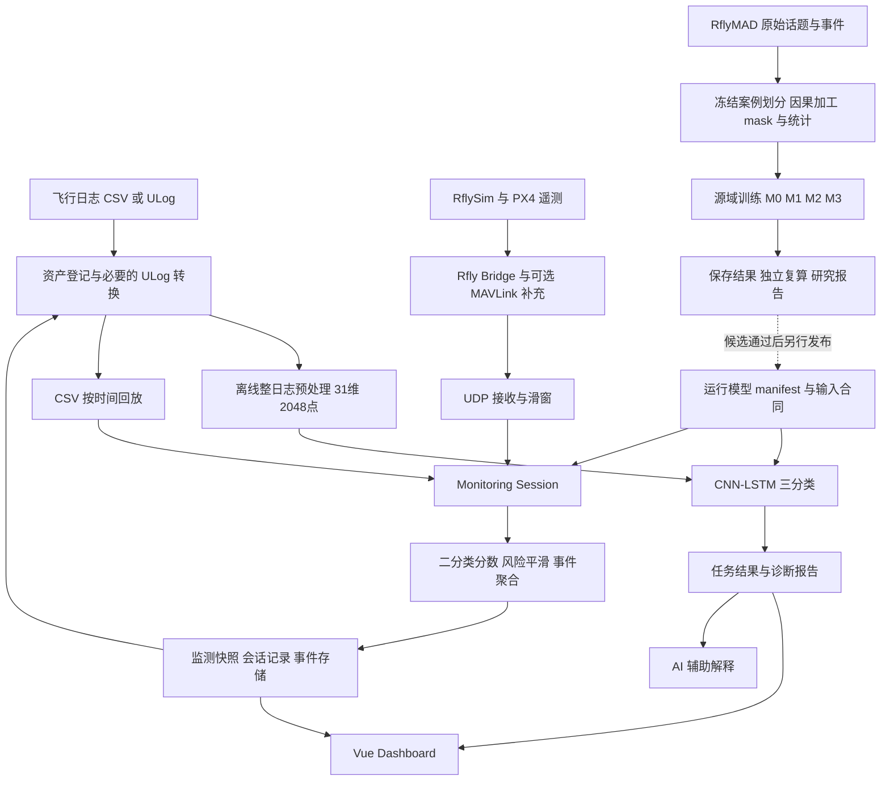
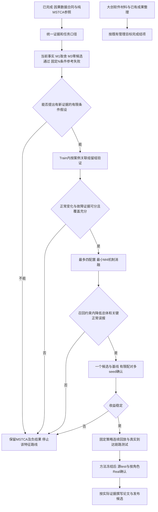

# 无人机故障智能诊断项目科研技术路线总览

> 审查日期：2026-11-05（北京时间）。项目：基于数据驱动的无人机故障智能诊断系统。  
> 审查基准：`main`，HEAD `28a5078186a60fd1e21bb7f8142f1941b5f2d2de`；GitHub `main` 经只读 API 查询与本地 HEAD 一致。  
> 本文是截至该快照的科研技术参考入口，不替代冻结协议、原始实验报告或项目进程中的管理决策。仅新增本文；未训练、推理、连接服务器、修改数据或部署，也未提交或推送。

**当前结论：已经建立了可追溯的因果发布回放数据版本、纯 MSTCA 参照及多轮受控实验，但尚没有候选证明能在保持规定故障召回的同时降低正常工况误报。**M1 存在误报—漏检取舍；M3 七个候选全部未通过既定召回约束；其后的固定工况条件化 N 残差统计方案也失败。M4 仍是需要重新形成可检验假设的研究方向，不能写成已完成创新。[R15][R18][R23][R26]

阅读顺序：先看第 3～4 节确认数据和任务口径，再看第 7～8 节实验事实，最后据第 9～13 节决定研究与论文表述。文中 `pp` 指绝对百分点；`U/B` 指均匀有放回采样／正常来源均衡采样。所有“当前”均指本次审查快照。

## 1. 项目概述与研究目标

### 1.1 产品目标和科研目标

系统将飞行日志或遥测输入转成监测分数、风险提示、离线故障类别、可追溯报告与辅助解释。工程主体是 **Flask + Vue 模块化单体、独立 Python 算法包和遥测桥接包**，并非分布式训练平台或已经认证的飞控闭环诊断系统。[S01][S02]

|层次|现有目标／状态|成果边界|
|---|---|---|
|大创软件交付|资产管理、CSV 回放、在线监测、离线三分类、诊断报告、历史记录、AI 辅助解释已有实现|本次为静态审查，未启动应用或重新验收现场功能|
|大创结项|进程文档记录用户已具备软著与 3 项比赛成果；暂定 11 月 30 日截止、11 月 15 日前内部完成|属于既有管理记录，未独立核验证书或截止通知；不把新算法成功、零误报或新增实飞增设为验收条件|
|当前源域科研|保持故障检出能力，降低不同正常运行状态的误报|有明确问题和负结果，尚无达标的新方法|
|目标域研究|仿真正常／故障监督训练，目标域仅正常数据适配|旧 few-shot 与正常适配 v1 是不同协议；v1 已失败，不能直接宣称迁移成功|
|后续论文|提炼可解释、可复现且有独立验证的研究贡献|不以模型名字、物理公式或软件完成代替算法新颖性和有效性|

管理依据见[项目进程](../../项目进程.md)，产品术语见 [CONTEXT](../../CONTEXT.md)。两者已有未提交内容，本次仅阅读，最新科研状态以正式报告和完成回执为准。

### 1.2 证据分级与审查范围

1. **代码事实**：实际张量、公式、调用和输入合同；不依据文件名推断算法。
2. **实验事实**：正式结果、配置、分母、保存概率的既有独立复算和文件身份记录。
3. **描述性证据**：同案例比较、分布差异、AUC、分支 margin 分解；不自动构成物理因果或独立增量。
4. **研究提案**：尚未实现／验证的设计、成功门槛和下一步工作，均单独标识。

本次读取源码、Git 历史、研究报告和已保存轻量结果；只读脚本用于提取表格、检查计数和链接。没有重新加载权重或实验张量评分，没有重做报告所述原始日志核验。下文“独立核验通过”指仓库保存的历史核验记录，不能理解为本次重新执行全部实验。GitHub 仅含精选源码和轻量证据，数据根 `D:/UAV-Data`、原始资料 `D:/RflyMAD`、研究权重及多数 NPZ 不构成完整可下载备份。[R30]

## 2. 系统总体架构

### 2.1 两条业务链与独立研究链



虚线是尚需验收的发布过程。**当前研究权重不等于 `assets/models` 的部署权重，研究用因果适配器也没有自动替换旧遥测输入链。**

### 2.2 模块、调用与依赖

|模块|实际实现与调用关系|依赖／限制|
|---|---|---|
|日志采集与资产|后端资产路由、`Asset`、运行记录；ULog 经 `services/bridge.py::run_ulg_to_csv` 调外部转换脚本|需配置外部工具及 `ML_PYTHON_BIN`；不是全流程自包含|
|离线诊断|`bridge.py::run_offline_multiclass` 子进程调用 `offline_multiclass_infer.py`，加载模型配置、统计和权重|保留独立的整日志预处理；不经过在线 150 帧研究 Dataset|
|在线检测核心|`FaultDetector` 按配置建模型、按 norm 的列顺序取数；`OnlineDetectionRunner` 负责预测节拍及事件聚合|支持 CNN1D/BiLSTM/MSTCA/KG-MSTCA/Transformer；注册支持不等于都有当前正式结果|
|会话与决策|`OnlineMonitoringSession` 持有当前分数、风险趋势、预警状态；聚合器输出最终事件|Dashboard 读取快照；分数风险、preview、确认和最终输出不是同一状态|
|数据源生命周期|`telemetry_manager.py` 由 Flask app 的 extensions 持有；`telemetry_backends.py` 提供 replay、rfly、px4 等后端|按白名单／能力开关开放；不是全局单例或每次请求结束即销毁|
|RflySim/PX4 桥接|`RflyLiveBridge` 将官方控制对象／可选 Pymav 状态转为内部 JSON，默认 50 Hz，经 `UDPForwarder` 发送|attach 和 Buaa 自动复现入口已有实现；Windows GUI、WSL SITL、QGC 分工明确；本次未实际运行|
|后端服务|Flask app factory、认证、资产、运行、分析、telemetry、报告和 AI 路由|配置选择 development/production/testing；服务不是训练 GUI|
|前端|Vue 3、Vite、Element Plus、Pinia、Vue Router、ECharts；总览、监测、诊断、资产、报告、AI、设置页面|页面按 runtime capability 控制；页面存在不证明相应数据源已实测|
|持久化与报告|Flask-SQLAlchemy，默认 SQLite，WAL／busy timeout；Asset、RunRecord、TelemetrySession、TelemetryFaultEvent、DiagnosisReport 等|原始会话 CSV 与数据库元数据／事件并存；另有在线 SQLite store，不能把数据库中的风险等级视为物理真值|
|AI 辅助解释|报告上下文、知识库和提供商适配服务|是解释功能，不是已验证的故障根因算法或自动维修决策|
|科研训练／评估|独立 `scripts/research`、版本化 Dataset、冻结 JSON、原 ID、SHA、结果复算|研究链与产品发布链分开；不能将 CPU smoke、合成测试或代码门禁当模型性能|

核心入口：[后端桥接][C10]、[会话][C11]、[遥测后端][C12]、[桥接实现][C13]、[前端导航][C14]、[应用工厂][C15]、[报告服务][C16]。

现有桥接使用周期快照、别名与部分回退／派生值；研究 `CausalInputStream` 要求逐话题 observation/availability 时钟。两者不能仅因最终都是 26/31 列就视为等价。RPM 归一化或输出合成值也不能当原始 ESC 测量。RflySim/PX4 是扩展接口，按 CONTEXT 不属于 V1.0 软著材料的核心能力边界。[S02][R10][R28]

## 3. 数据集与数据处理体系

### 3.1 数据来源、数量与标签空间

|来源／统计层|数量与内容|允许解释|
|---|---|---|
|2026-10-30 本地原始资料审计|SIL 3056、HIL 3056、Real 493，共 6605 案例目录|SIL 为软件在环、HIL 为硬件在环仿真；Real 是已有公开实飞记录，并非本项目新增实飞|
|冻结加工清单|train 2580、val 555、test 553、external Real 465、open-set 2390，共 6543|与原始 6605、历史加工 6603、论文展示的 2566/2566/497 是不同来源／筛选层，不能互相补数|
|当前因果加工范围|3135 源 train/val + 553 内部 test + 465 Real = 4153|不是全部原始库认证；开放集、角色外 28 条 Real、旧 31 维资产不在此版范围|
|自采 RflySim 正常|历史摘要 40 会话：32 训练补充、8 留出；3680/922 个抽样窗|与 RflyMAD SIL/HIL 和 Real 分别报告；3680 后缀在新因果版中被排除|

原始审计和冻结清单证据：[R03]、[已发布数据可行性审计][D01]及[项目冻结分集记录][S03]。原始目录数量、合格案例数量和窗口数量不是独立飞行次数。

当前闭集包含 **正常 + 六种故障目录**：motor、accelerometer、gyroscope、magnetometer、barometer、GPS。五种传感器故障在离线输出中合并为 `sensor`，在线输出进一步合并为 `fault`。旧合同中的“六分类 normal/motor/propeller/sensor/wind/load”是另一历史任务设计，不能混称为当前“六故障子类”。

冻结闭集的案例组成如下；这是旧冻结成员的案例标签统计，不是新版修复后故障端点窗数，也不保证 Real 子类目录无冲突。[D02][R03]

本次从本地已保存的 `2026-10-08/data_feasibility/class_counts.csv` 只读摘录该表，未重新解析案例数据。原CSV未纳入Git，故引用指向已发布审计报告；本文保留完整数值与来源SHA256 `2a3c2883937c651c66057d215691e7223c4aac623216f0b2148a58daa71d1862`。同目录 `split_counts.csv` SHA256为 `aa9ec15b12a2997477bd5399cf19db2c2d6047b5eeacbe5a37acbf1c2bbf033e`，其中分集数另与项目进程核对；不创建无法在GitHub点击的CSV链接。

|案例类别|SIL|HIL|Real|
|---|---:|---:|---:|
|normal|238|240|73|
|motor|915|921|223|
|accelerometer|135|138|24|
|gyroscope|138|138|35|
|magnetometer|137|138|36|
|barometer|137|138|42|
|GPS|137|138|32|
|合计|1837|1851|465|

Real 的 73 个正常角色含 48 个原无故障案例和 25 个仅保留正常片段；后者不能称独立健康整次飞行。原始审计发现 GPS 目录 6 例实际注入 ID 对应磁力计、另有元数据冲突，故 Real 细故障类型不能直接凭目录充当真值。[R03]

### 3.2 案例级划分和 SIL/HIL 配对隔离

`build_rflymad_case_split.py` 先按加工案例身份建立 `simulation_pair_key`，在故障子类×飞行目录内以固定 SHA 排序和约 70/15/15 组数分配，再生成窗口；同一案例以及 SIL/HIL 对应组不能跨 train/val/test。Real 在基础清单中整体属于 external，正常适配另建角色覆盖层。代码会拒绝重复域、组大小大于 2、标签冲突等。[C17]

这是**冻结协议中的关联组隔离**，不等于证明每个配对键都是物理重复实验。原始目录有 192 个 SIL 名字平台位异常、32 个命名对应组控制序列不同等记录；原始命名键、TestInfo 编号和加工后配对键不能混用。本轮没有据此重划集合或声称存在已证泄漏。[R03]

### 3.3 基础 26 维输入的精确定义

列顺序以 [model_contract.py][C01] 和 [causal_pipeline.py][C03] 为准。`z` 是源 train 固定逐通道标准化，不是逐窗去均值。

|序号|列|来源与含义|物理／处理限制|
|---|---|---|---|
|1–4|`actuator_ctrl_1..4`|`actuator_controls_0.control[0..3]`：roll、pitch、yaw、throttle 控制需求|不是四电机目标；不能按索引与输出槽作物理跟踪误差|
|5–8|`actuator_out_1..4`|`actuator_outputs.output[0..3]` 混控／驱动输出命令|原生输出单位依配置；不是反馈 RPM、实测推力或跨域统一 PWM 标定|
|9–11|`gyro_x/y/z`|`sensor_combined.gyro_rad`，机体角速度|rad/s；观测／发布时刻不同|
|12–14|`accel_x/y/z`|`sensor_combined.accelerometer_m_s2`|m/s²；不是外部无偏真值，也未统一减重力|
|15|`baro_alt_relative`|气压高度减该窗口第一帧高度|m；消除常数高度偏移，保留窗内变化；中间 case 文件的绝对高度不是最终输入|
|16–19|`att_q_w/x/y/z`|`vehicle_attitude.q` 姿态四元数|原固定参考保留；不能把 z 后分量范数叫几何能量|
|20–22|`vel_x/y/z`|`vehicle_local_position.vx/vy/vz`，NED 估计速度|m/s，z 向下正；不是独立于传感器的真值|
|23–25|`mag_x/y/z`|`vehicle_magnetometer.magnetometer_ga`|原话题磁场单位／坐标按数据源；不是故障类型标签|
|26|`acc_norm`|同帧 `sqrt(ax²+ay²+az²)`|m/s²，随后独立 z-score；不是 `norm(a)-g`|

不含位置 xyz、时间、裁剪进度、故障 ID、fault_state、命令字符串、PID 积分状态或 RPM。GPS 故障主要依靠估计速度等间接响应，不能预设均可观测；相对气压会数学上消除恒定高度偏移，也不能因此断言所有气压故障完全不可检出。[R02][R16]

旧 `rfly_seq_columns_v1` 为 31 维，额外包含 baro_temp、baro_pressure、actuator_mean、actuator_std、actuator_effort，且高度为绝对量；旧离线和部署仍使用它。26 维名称相同或“对齐离线特征合同”的历史注释，不能证明当前产品离线已经换为 26 维。[C01][C09]

### 3.4 50 Hz、150 帧、标签和标准化

- 官方加工／冻结实验使用 20 ms 网格。150 帧名义 3 s，第一到最后采样时刻跨度 **149×20 ms = 2.98 s**。这是既有工程设计及可复现基准；未见充分的采样率／窗长消融证明它是最优选择。
- 原清单 stride=5 帧（0.1 s），缓存按时间均匀每案例最多 cap64；抽样与末端故障标签分别处理，不能用父案例故障类别给整段贴故障。过渡窗可只在末端激活，`fault_fraction` 和整窗标签有效性另存。[C18]
- cap64 用于训练／窗口指标，不代表连续流仅判断 64 次。适配 v1 连续回放每 10 帧推理；M1 原生回放每 1 帧推理。二者事件确认最小时长不同，不可直接合并。
- 基础新统计仅从 **162069 个合格源 train 窗**拟合，含重叠帧贡献 24310350；不使用 val/test/Real。N 和 M3 的辅助统计另用 74700 个全窗已知正常且辅助有效的 train 窗，不能互换。

### 3.5 加工错误的发现、定位和修复


|问题|发现／定位证据|实际处理及剩余边界|
|---|---|---|
|标签按行数比例拉伸|字符串 cmd 使数值 fault_state 一起转字符串；旧 `str_freq_adjustment` 按记录比例而非时间对齐，且整 GTD 被拉伸进裁剪片段；70/70 定向原始样例可复现|不是缓存错位；按原始时钟最后状态保持修订，不统一平移、不延长裁剪。40 个 HIL circling 片段实际注入在裁剪结束后，1309 个旧故障窗有双流提前错标证据。[R02]|
|全源参考差异|3135 案例、200640 原 cap64 窗中 3914 个旧标签与 GTD 不同：3780 两源一致，134 变化但来源不同；另有 17 标签未变但来源不同|分歧总数 151；再加 192 个时钟复核窗，源标签版暂缓 343。不能把 3914 全部硬改、也不能把 151 当物理损坏。[R05][R06]|
|只遮 loss 不够|未知样本仍可能改变 BN，旧 FocalLoss 不支持 -1；改标后 normal_origin/phase 失效|在前向／BN 前过滤，重建元数据与采样权重；保留索引和排除原因，不能只给 loss 加 mask。[R06][C04]|
|Real 标签时间|ROS 发送 ID 与 ULog 接收事件是不同记录；bag 所需命令／同步字段逐案核验|456 例可验证，9 例相关记录索引／头不一致隔离；10 个合格 cap64 末端改标、775 待核。不是把仿真字符串修复一键套到 Real。[R07]|
|内部 test 收尾|553 案例独立修订，603 合格末端改标，27 来源不同|保留 35392 原 X 和 ID，mask 感知评估；标签修订不产生模型新成绩。[R08]|
|连续输入非因果|保留 val 窗结束 149.508661 s，旧插值使用 151.681060 s 原生观测，晚于窗末 **2.172399 s**|这只是一个可复现未来支持反例，不是统一延迟补偿值；标签版“X 不变”不等于输入已通过实时准入。[R09]|
|缺口、超龄、倒退、非有限|原始审计有大间隙、dropout、重复时钟；有限加工值不能证明原始采样连续|因果版逐话题保持最后已发布记录，超龄／最新无效／缺话题为 NaN+mask；不 bfill、补零、越过最新坏值回退或跨缺口压缩时间。[R03][R10][C02]|
|HIL 旧清单 SHA 不同|旧 3055 份 HIL 哈希与 8 月 13 日重处理日志一致|属于已登记版本差异，不能重复描述成新损坏；案例隔离通过也不等于数据内容身份通过。[S03]|

### 3.6 当前版本用途矩阵

|数据版本|源 train／val 窗|内部 test／Real 窗|可用于什么|禁止的解释|
|---|---|---|---|---|
|旧 `online_cache_v2`|168800／35520，含 3680 RflySim 后缀|35392／29319|复现旧实验、审查加工错误与历史行为|旧分数不能作为修复后成绩；不证明严格因果|
|源标签修订 `online_cache_v2_labeltime_v1`|168550／35427|另外两个标签证据包|固定历史 X 的标签时间对照；明确版本和 mask|不能直接套旧全量训练 CLI；输入仍保留未来插值|
|`internal_test_labeltime_v1`／`real_labeltime_v1`|不适用|35392（27 未知）／29319（775 未知）|按角色／资格核对的标签证据|故意无通用 y，不可忽略 mask 直接评分|
|**`causal_input_v1`**，版本 `rflymad_causal_publication_replay_v1`|**162069／34710**|**34802／26815 合格窗**|当前 26 维源开发；冻结后可按单独目的使用 test/Real|加工完成不等于新 test/Real 模型成绩或真实接收链路认证|
|**`causal_m1_continuous_v1`**|**151833／32381**|未扩展最终 test/Real|M1 与 M0-matched、M3 共同全 150 帧辅助有效比较|不能与 M0 全覆盖人口混比归因；不是全 Real 残差数据集|

因果版对 269031 个旧索引完整留账：258396 合格、10635 排除。train 排除 6731=2936 输入+115 仅标签+3680 时序未证后缀；val 810=782+28；test 590=564+26；Real 2504=1779+725。24 案例在原 cap64 内全无合格监督窗，不等于整次原始飞行物理损坏。不得补抽容易窗弥补。[R11]

8 组观测年龄预算为 controls 80、outputs 120、gyro 40、accel 40、baro 100、attitude 80、velocity 140、mag 60 ms。预算按 12 个 source-train 正常锚点的名义发布间隔、发布延迟及 20 ms 调度周期事前推导，随后固定扩展全量；未按保留率或测试分数放宽。ULog publication 只是回放可用时间代理，实际设备／网络接收时刻尚未认证。[R10][R11]

全量验证保存了四集合逐帧／逐窗检查、新 train 统计独立复算及 368 个代表窗批量—逐消息归一化输入精确一致的记录；这证明所声明回放合同的实现一致性，不证明物理同步或真实端到端链路。[V01]

### 3.7 Real 正常适配协议与接触历史

冻结协议 `rflymad_online_normal_adapt_v1` 从原 external 的 465 例上叠加角色，**不重划基础集合**。适配／校准／评估按候选关联组隔离；同 TestInfo 编号只是保守关联线索，未认证为同次飞行。[R01]

|角色|案例|旧 cap64 窗|新因果合格窗|用途|
|---|---:|---:|---:|---|
|adapt_normal|10|640|598|仅目标正常适配，不得混入故障|
|calibrate_normal|5|320|301|仅预先规定的正常阈值校准|
|test_normal|33|2112|1884|主正常误报测试|
|test_fault|392（223 motor+169 sensor）|25088|22947|主故障测试，不准用于监督训练／调参|
|supplemental_normal_test|25|1159|1085|限定正常片段单报，不混成 58 个完整正常案例|

10 月 30 日 v1 已查看最终 Real 模型结果，旧离线和在线 few-shot 也有历史暴露；后续数据审计还接触过原始相关信号。因此“新因果研究未新增 test/Real 模型评分”是准确边界，**“这批 test/Real 从未被查看”不成立**。后续只能如实报告冻结确认评估，不能重新命名为全新盲测。[R01][R03][R11]

## 4. 离线与在线任务边界

|项目|离线整日志三分类|在线连续流二分类|
|---|---|---|
|判断对象|一份日志资产（实现可先做 fault-focused crop）|每个历史滑窗端点以及其连续事件|
|当前输出|normal / motor / sensor|normal / fault；六故障仅用于分层评价|
|运行输入|旧 31 维，整段按索引线性插值为 2048 点|旧部署 31 维；近期研究 26×150，M1/M3 有单独辅助流|
|模型|`transfer3_cnnlstm_normalproto`|部署含 CNN1D/MSTCA/KG-MSTCA；科研另有 M0/M1/M2/M3|
|预处理|缺列／非有限旧回退、可按标签列裁故障周边、整段重采样、模型统计优先|研究因果版严格 mask、固定 20 ms 时间轴、逐窗气压相对化、train-only 统计|
|训练协议|历史 Real few-shot，多类标签参与的适配划分|近期源 SIL/HIL 监督开发；正常目标适配是独立协议|
|主指标|日志级每类 P/R/F1、Macro-F1、混淆矩阵、跨域结果|窗口 Recall/FPR/AP + 案例／关联组分布 + 事件召回、确认／最终发出延迟和正常曝光|
|不能相互代替|2048 点不是 40.96 s 固定物理窗，整日志诊断不定位在线注入时刻|高窗口 Accuracy 不证明实时事件告警；二分类不能给出六分类识别精度|

特别是离线 `load_and_resample(..., fault_focus=True)` 默认可能读取 fault_state/flight_phase 来裁剪，这不是标签列直接作为网络输入，但属于**标签感知预处理依赖**；实际无标注用户日志如何与训练裁剪协议匹配，证据不足。整段归一化缺文件时还有 sample z-score 回退，不能与正常数据适配 v1 的固定源统计混为一谈。[C09][C10]

## 5. 算法发展历程

以下按可追溯的实现／实验阶段整理；历史资产未完整保存首次训练命令的地方，不臆造精确发明日期。

|阶段|动机与实际变化|结果／后续地位|
|---|---|---|
|历史离线 CNN-LSTM 家族|从日志中学习局部波形与长程关系；当前运行的是多尺度 CNN、raw skip、BiLSTM、注意力池化与正常原型训练约束的三分类版本|有历史内部／Real holdout 结果；不是近期因果在线研究|
|历史在线 CNN1D、BiLSTM 等|用 150 帧历史窗输出二分类；CNN1D 提供轻量局部基线，BiLSTM 在已获得的窗内双向编码|源码支持不等于都有已核验的当前数据成绩；BiLSTM 不使用窗末以后的样本，但其旧预处理仍可能前视|
|MSTCA|用 k3/k7/k15 多尺度卷积和 SE 通道权重替代单尺度表示|没有 LSTM 或 Transformer；31 维历史对比已存在|
|旧名 KG-MSTCA|原始时序编码器之外增加 9 维人工关系序列、独立小 MSTCA 编码、投影、门控融合|不是知识图谱；26 维版本公式与 31 维含 effort 列的版本有分支差异|
|10 月 8 日正常数据基线支线|PCA、GRU 预测、persistence 检查仅正常建模可行性|有诊断价值但暴露事件时间问题；不将 GRU 全面优于传统方法写成结论|
|10 月 30 日目标正常适配和采样|BN 更新／正常阈值、BN 估计器诊断、正常来源均衡|失败或存在取舍；旧标签成绩封存，暂停盲调|
|10 月 31 日—11 月 1 日因果源重训|修标签、重建 past-only 输入、新统计；先短预算后恢复长预算|建立当前源域基准，仍存在正常后段误报；长预算完整旧 9 双分支后续记作 M2|
|11 月 2 日 M0|纯 26 维 MSTCA、两种采样、相同预算规则的正式参照|补齐“关系分支是否必要”的当前背景对照，未证明逐维贡献|
|11 月 2 日 M1|连续 200 ms 原生运动学 N1～N4，完整 150 帧，3168 参数加法 adapter；共同人口 M0 对照|Balanced 降误报同时损失六类召回；连续回放暴露最终事件延迟|
|11 月 3 日 M3|13 候选池统一缩放、统一 13 槽 adapter、8 组受控实验|七候选均未达约束；停止当前无条件特征融合路线|
|11 月 3～4 日机制／数据可行性|M3 配对错误、物理诊断、固定条件参考验证、控制信号语义／时钟审计|工况依赖有证据，简单条件参考失败，控制补偿早诊未证|
|M4／M5|M4 工况感知正常行为与故障判别；M5 加已证有效候选|研究提案；无已完成算法、正式训练或性能成果|

## 6. M0～M4 模型技术分析

### 6.1 离线 CNN-LSTM 与在线早期基线

**离线 CNNLSTMv2NormalProto**：31×2048 输入分为 raw skip（插值到 512 步，Linear→32 维）和 k3/k7/k15 三路 CNN（各 32 通道、GroupNorm、残差卷积、池化→128 维、对齐 512 步）；拼成 160 维序列，2 层双向 LSTM（每向 hidden128）后用 `Linear→Tanh→Linear→softmax(time)` 池化为 256 维，LayerNorm/Dropout/Linear 三分类。[C08]

训练的正常原型约束为正常表征到可学习中心的均方 pull，加故障到中心距离不足 margin 时的平方 hinge push，`L=L_cls+0.1 L_proto`，配置 margin=1。**forward 仅走表征和分类头，没有用 normal_center 在推理阶段再校准概率**；不能从文件名推断实现了在线原型适配。当前可靠参数量记录未在所读发布配置中给出，本文不补造。[C08][C19]

CNN1D 为 k7→k5→k3 卷积、BN/ReLU、两次 MaxPool、全局平均和二分类；31 维发布配置参数 105218。OnlineBiLSTM 默认 1 层双向 hidden64、32 维打分网络做时间注意力池化、LayerNorm/Dropout/Linear；未找到同本轮因果合同的正式 BiLSTM 完成成绩，不填推测值。[C05]

### 6.2 M0：纯 26 维 MSTCA

`_MSTCAFeatureEncoder` 在 hidden64 下为：

```text
26×150
  ├─ Conv k3 →24ch + BN/ReLU
  ├─ Conv k7 →24ch + BN/ReLU
  └─ Conv k15→16ch + BN/ReLU
concat 64ch → SE(64→16→64，时间均值后 sigmoid 加权)
→ MaxPool2 → Conv(64→128,k5)/BN/ReLU/MaxPool2
→ Conv(128→128,k3)/BN/ReLU/GlobalAvgPool
→128维 → Dropout0.2 → Linear(128→2)
```

SE 是通道权重，不是显式时间自注意力；卷积使用对称 padding，在**已经取得的整个历史窗内**计算，不外取窗末未来样本。类名／文件 `lstm.py` 不代表该结构包含循环层。M0 共 **105938 参数**，静态 Conv/Linear MAC **6764928/窗**。希望回答基础时序本身能做到什么，不添加旧 9 或新 4；实际仍有严重 hover 正常误报，见第 8 节。[C05][R15][R23]

### 6.3 M2：完整原 9 维关系特征双分支（历史名称 KG-MSTCA）

令 `X` 为基础 z 后序列，`O(X)` 为 9×150 序列。实际融合：

```text
h_raw = MSTCA64(X)                      # 128维
h_rel = Linear(MSTCA32(O(X)))           # 64→128维
alpha = sigmoid(MLP([h_raw,h_rel]))     # 每窗一个标量
h = alpha*h_raw + (1-alpha)*h_rel
logits = Linear(Dropout(h))
```

26 维研究版本 **156491 参数**；旧 31 维发布版本 **158891 参数**。原始分支与关系分支各含 BN，未构建实体、关系三元组、图邻接或消息传递；`alpha` 不是独立特征重要性或因果解释。[C05][R14][R30]

|ID|实际计算（沿时间逐点，z 为基础固定标准化值）|希望表达的统计／实际边界|
|---|---|---|
|O1|四输出槽 `std(unbiased=False)`|跨槽离散度，不是实测电机不平衡|
|O2|四输出槽 max−min|跨槽极差，与 O1 相关但非恒等|
|O3|四组 `abs(z_ctrl_i-z_out_i)` 的均值|控制与输出槽不具逐电机物理对应|
|O4|同组绝对差的总体标准差|是统计差异；未证逐维增量|
|O5|`mean(concat(z_ctrl,z_out))/max(z_acc_norm,0.1)`|当前 26 维比值代理；不是推力效率；全共同 Train/Val 约 76.36% 重复窗帧触发 clamp|
|O6|`abs(z_acc_norm)`|离总体均值的标准化偏离，不是重力残差|
|O7|`norm(z_gyro_xyz)`|旋转活动代理，不是物理 rad/s 模|
|O8|`abs(diff(z_baro,prepend=first)-z_vz)`|首差为 0；缺 dt、统一量纲及 NED 符号对应，不是严谨垂向残差|
|O9|`norm(z_q_xyz)`|标准化姿态统计，不是物理能量／旋转不变量|

31 维若有 `actuator_effort` 列，O5 直接读取该列的标准化值，不能把上表公式无条件外推所有旧部署。旧 9 是 X 的确定性重表达，不增加传感器信息源，但可能帮助有限容量网络；物理命名弱不能推出全无信息。M2 复用 11 月 1 日因果长预算双分支两臂，**不是擅自新建的 35 通道拼接模型**；与 M0 的参数量、架构和实际停止轮数不同，不能当逐维严格消融。[R14][R16][R21][C05]

### 6.4 M1：N1～N4 连续运动学残差与小型 adapter

N1 在固定 200 ms 支持上为 `h_av(t)-h_av(t-0.2)+∫vz_av(s)ds`，单位 m。气压向上与 NED vz 向下的符号已明确。积分按原生消息可用时间形成的 ZOH 分段和真实 dt，不是粗 50 Hz 网格差分。[C06]

N2～N4 为 `Log(R_hat.T @ R_end)` 的有符号旋转向量 xyz，单位 rad；`R_hat=R_start·∏Exp(ω_body·dt)`，Hamilton wxyz、机体 FRD→NED、右乘积分。四元数单位化、q/−q 等价、非交换旋转等已有合成核验。它们反映发布流运动学一致性，**不是同步外部真值残差，也不是健康充分条件**；估计姿态与 gyro、速度与 GNSS 可能共享误差。[R17][C06]

连续版本保留原生 200 ms 状态，不在每个滑窗重启；要求 baro/velocity/attitude/gyro 支持内年龄、有效值、reset／设备变化和四元数门禁通过。早期独立窗口 140 帧诊断与后来的完整连续 150 帧数据是不同协议，不能合并数字。[R17][R18]

融合为 `head(encoder(X)+adapter(N))`；adapter=`Conv4→16,k3/ReLU→Conv16→16,k3/ReLU→AvgPool→Linear16→128`，**3168 参数，总计109106**，无新增 BN。末投影零初始化，使初始 eval 函数与公共 M0 相同；两组 M1/M0-matched 分别从相应历史 M0 best 共同参数继续训练，使用新 AdamW，不是从头训练。[C07][R18]

M1 动机是提供单位与时序更清楚的一致性表达，减轻背景误报。实际 Balanced 同人口降正常 FPR，却净增 124 个故障漏窗，六类召回均降；说明“残差自洽→健康”不能作为无条件否决规则。独立容量影响和单轴作用尚未分离。

### 6.5 M3：13 候选的受控组合，非单一“39 维模型”

Base26 保持原统计；旧 O1～O9 调用原公式后，按 74700 个共同全窗已知正常 train 窗拟合第二层均值／总体标准差；N1～N4 沿用该人口的原 M1 物理统计。所有变体在选择前都要求完整 13 维有效，不以未启用槽掩盖真实缺失。[C20][R22]

除 C0 外统一 `Conv13→16,k3→ReLU→Conv16→16,k3→ReLU→AvgPool→Linear16→128` 加法 adapter，额外 **3600 参数，总109538**，MAC 6975776/窗（+3.12%）。未启用的合格候选槽置零是设计选择，不是缺失补零；名义参数相同也不保证有效连接数／优化自由度相同。[C21][R22]

|组|实际辅助输入|研究问题|
|---|---|---|
|C0|无，纯26|本批随机未训练公共起点参照|
|Ccap|固定13个 Base 通道：4 control、4 output、3 gyro、baro、acc_norm|相同新增参数的基础重表达／容量对照|
|CO|O1,O3,O6,O7,O8,O9|旧核心六项整体价值|
|CO9|O1～O9|O2/O4/O5 联合加入的影响，不归责单项|
|CV|N1|垂向块|
|CR|N2～N4|姿态块，不把块收益分给单轴|
|CN|N1～N4|完整新4块，**不是历史 M1 续训复现**|
|CON|旧核心6+新4|互补性；不是全部13同时使用|

M3 全部使用相同未训练 encoder/head、同一已冻结 adapter anchor、同 seed42/Balanced、同原 ID 和预算规则。CO9 不等于历史 M2：接入结构、辅助二次缩放、初始化和人口不同。M3 是对特征增益更受控的试验，结果为 0/7 候选达标。[R23]

### 6.6 M4：研究功能划分，尚无正式算法

候选功能是“可用历史中的工况表征→条件正常参考→与故障判别共同使用”。当前没有可确认的 M4 类、冻结训练协议、正式模型或成绩；旧 v2 的 M0–M5 是研究矩阵，不能按图示补齐算法。特别是 **N signed150 中位数 + vel/gyro 状态 + 固定经验99%参考** 已实际失败，不应作为尚待验证的正向捷径继续进入神经网络。[R20][R26]

M4 若继续，必须先提出区别于该失败方案的可检验机制，并解决状态被故障改变、正常参考泄漏和故障被吸收的问题。第 10～11 节是本次基于证据提出的建议，未执行。

## 7. 已完成实验总表

### 7.1 时间、假设、变量和决策

日期优先采用报告实际执行时间及北京时间；11 月 4 日提交的两份控制审计仍保存在 `2026-11-03/` 且文内日期为 11 月 3 日，不能按目录漏读。`旧版` 指修订前插值／标签，`因果版` 指第 3.6 节的明确版本。

|时间／轮次|目的与对照变量|数据／设置|关键结果与评价口径|结论、原因与后续|
|---|---|---|---|---|
|历史发布资产|离线三分类与在线 CNN1D/MSTCA/KG 比较|旧31维；离线75轮，在线49/55/90轮，历史 few-shot|离线 test 741日志 Macro-F1 0.991006、Real holdout 345日志 0.792803；在线历史 val/test/external 见8.1|内部高分不代表跨域和实时可靠；成员／seed完全公平性证据不足。[R30]|
|10-08 正常数据基线|PCA、GRU预测 vs persistence，检验时序模型增益|334正常训练案例，32064训练点；26维，10Hz评分、3s过去上下文；GRU seed42/12epoch/Adam1e-3/batch256；72正常val定99%分位阈值|553 test中481故障：严格新报警检出58.2%/64.2%/41.2%；正常时段误报45.0/121.0/92.8次/h|GRU未全面胜出；事件起点分歧与旧输入前视限制，保留诊断结果。[R00]|
|10-30 正常适配 v1|A0原BN vs A1正常重置BN；各配 T0固定/T1正常校准|旧26维KG源模型；10例640窗仅更新BN，momentum0.1、10批；5正常校准2192点；主33正常+392故障、补25正常|A1-T1主正常事件案例33→10，但故障命中 A0-T1 354/392→140/392；下降54.59pp|不发布；长报警、概率漂移及阈值压制故障，不能把事件少当可靠。[R01]|
|10-30 BN失败诊断|保存统计与分数、事件规则交叉分析|无新训练；允许正常开发与源val|重置初值残留0.9^10=34.87%；A1正常校准低于clear的点仅1.73%|初值残留是事实，尚非唯一根因；随后受控对照未修复。[R04]|
|10-30 BN估计器|同CPU B0、B1 EMA、B2累计平均；仅改估计方式|源val35520；同10正常640窗；无梯度|正常FPR3.17%→45.71%→98.77%，Macro-F1 0.9614→0.7421→0.3450|累计更新反而退化；停止扫BN系数。累计批内方差不等于合并方差。[R31]|
|10-30 分支／平移探针|固定模型，检查门控贡献和6个预定平移探针|源val+10适配正常640窗；无参数更新|源正常加control/output均值偏移后FPR3.17%→85.23%；全26反向平移目标正常FPR68.44%→79.38%|域敏感存在；不支持简单均值对齐／删关系分支。非物理干预不能当因果试验。[R32]|
|10-30 来源覆盖审计|旧正常来源及hover后段分层|全3135源案例／200640前缀窗；已保存CPU预测|全正常FPR3.17%，独立正常10.79%，hover38.93%；40–60s hover94.59%|总体汇总掩盖正常短板；来源和时间相关，非唯一因果。[R33]|
|10-30 六任务采样|Uniform vs正常来源均衡，逐seed同初始化|旧train168800/val35520，seed42/43/44，100轮上限，共437轮；其余同设置|独立正常FPR均值11.44%→9.85%，hover38.76%→34.98%，故障Recall95.29%→94.81%|有局部收益且三seed召回均降；旧标签不可靠，停止在此版继续追分。[R12]|
|10-30～31 标签和时间审计|加工CSV、原始GTD/ULog/ROS交叉对齐|先70定向样例，再3135源、553test、465Real的分范围核查；无训练|定位行数拉伸；3780源合格改标、603test改标、10Real改标，未知分母分别留账|完成独立标签修订，但“X保持不变”仍保留未来插值。[R02][R05][R08][R09]|
|10-31 因果输入|past-only发布流与批量—逐消息一致性|16例试验后全4153例；8组固定年龄、150帧全有效；新源train统计|合格train162069/val34710/test34802/Real26815；258396/269031合格|建立当前数据准入；实际接收链路尚未认证，不是模型分数。[R10][R11]|
|10-31 UTC／11-01 短预算重训|新版数据下两种采样|26维完整旧9双分支；seed42，max30/warmup3/min10/patience8；实际20/22轮|Macro-F1 .965973/.963326；Recall97.902%/95.698%；hover FPR52.122%/36.207%|保留取舍；不能把同时换数据和缩预算的变化归于修标签。[R13]|
|11-01 train-normal与BN窄诊断|检查是否仅未见泛化、是否主要BN模式差异|短预算checkpoint；83051训练正常；固定32×512混合train批BN比较|train hover FPR49.27%/33.50%，接近val52.12%/36.21%；切BN仅−0.82/−1.40pp|训练内也有短板；小BN效应不足解释主要失败；不是长预算模型train成绩。[R34][R35]|
|11-01 恢复预算，后记M2|同因果数据、同初值恢复原预算规则|seed42；max100/warmup5/min30/patience20，U100/best99，B60/best60|Macro-F1 .975068/.969228；hover FPR35.68%/27.59%；Recall97.53%/95.83%|预算确实影响结果；正常后段仍严重，未分离轮数／调度／早停贡献。[R14]|
|11-01 新4可算性／故障响应|旋转约定、时序和正常／故障响应|12正常锚点；后36hover案例，早期140帧共同资格；固定200ms，无分类器训练|正常幅值未普遍后段上升；GPS/gyro/motor等并无一致大残差；姿态正常峰值约0.196926rad保留|有定义不等于有增益，不支持直接替代旧9。[R17][R36]|
|11-02 M0|纯26维MSTCA相同两采样规则|因果train162069/val34710；seed42；同长预算；实际U65/best65、B74/best73|Macro-F1 .969773/.972353；Recall97.879%/96.806%；hover45.225%/35.809%|纯骨干也误报；不能把所有问题归旧9。[R15]|
|11-02 M1四作业|M1 vs M0-matched，U/B各一对|共同train151833/val32381；同arm历史M0 best继续训练，新AdamW；249轮73953更新|B正常FPR2.9717%→2.1092%、hover40.5634%→27.6056%；Recall97.5633%→96.8117%|未达保持检出；GPS95.1954%→90.4723%；U整体FPR反升。[R18]|
|11-02 M1连续响应|固定18源Val hover案例，M0共同／自然可用性两套|6正常+12故障；20ms推理、0.6/0.4、k3、min/merge0.5s；108组数组核验|M1每臂12/12参考后分数和确认命中；最早最终事件9/12结束flush、2/12缺口flush、1/12在线闭合|最终发出中位25.009s，不能用越界中位.210s替代；不是实机验收。[R19]|
|11-03 M1配对错误|同ID双向转移、分支margin和同案例对照|32381窗，455变化窗、129sidecar核验|新增漏检192、恢复68；纠正误报166、新增29；直接adapter使105新增漏检/84纠正误报跨正常边界|代数定位含bias−.576、共同路径也变；非单轴物理因果。[R21][V04]|
|11-03 13维初筛与M3门禁|旧证据+46例2644共同窗；统一模型／缩放／采样|11项B、O4/O5两项C、A空；本地冻结后服务器初始化门禁|首次Adapter734/3600坐标约1e-8不一致，0训练更新；后固定本地anchor再验收|首轮停机记录是历史阶段，不能据此说最终M3未训；也不能放宽旧pin伪造复现。[R22][R24]|
|11-03 M3八组正式|相同全150人口／公共未训练起点，特征块与Ccap|Balanced/seed42、513轮152361更新；固定0.5/严格Macro-F1 best|CO Macro-F1最高.969237但三类Recall下降；仅CN总FP384→382，FN623→721；0/7候选过约束|停止当前无条件融合；不事后改阈值、换epoch、放宽容忍度。[R23]|
|11-03 M3配对与物理诊断|全共同人口摘要、同状态AUC、154新漏hover、6原始ULog|无新模型训练／前向；案例统计、原生支持重建|145纯故障新漏中133低运动；CN纠正52个独立正常hover也全低运动；同状态后部分强AUC大幅减弱|支持状态混杂与正常／故障自洽重叠，不证明单一分支因果；没有需据此修的数据错位。[R25][R27]|
|11-03 固定条件残差验证|无条件N参考 vs按过去vel/gyro状态参考|74700 train已知正常，case等权，signed150中位，固定Q.005/.5/.995；共同Val32165|FP550→818，FPR3.463%→5.150%；Recall10.865%→21.754%；混合case-AUC.616→.553|固定方案失败，不支持直接进入模型实验；不等于所有条件方法都无效。[R26]|
|11-03报告／11-04提交 控制补偿审计|原始controls/outputs/RPM可用性、语义、时间|48固定案例，16时间子集；无训练／推理；覆盖1967源motor/normal ledger|control为roll/pitch/yaw/throttle，output是命令，RPM是仿真状态；后续支持约.1s粗事件关联|无法证明故障特异补偿、控制先于运动、跨域四电机映射或亚.1s早诊。[R28][R29]|

### 7.2 当前正式训练的共同设置与差别

|项目|因果M2长预算／M0|M1与M0-matched|M3八组|
|---|---|---|---|
|Train/Val|162069/34710|151833/32381|同M1共同人口|
|seed／采样|42；U/B|42；U/B|42；仅B|
|初始化|从共同未训练锚点映射；M2完整模型与M0公共层身份有记录|各arm从历史M0 best共同预训练继续学习|同一未训练公共M0+精确冻结辅助anchor|
|每epoch draws／更新|162069／317|151833／297|151833／297，逐轮draw-ID摘要一致|
|优化|AdamW lr3e-4、wd1e-4，batch512|同左；新optimizer|同左；新optimizer|
|目标|Focal gamma2、alpha=None，clip1；无AMP／增强|同左|同左，有限输入／logits/loss/grad检查|
|预算|上限100、warmup5、cosine100、min_lr1e-6|同左|同左|
|选best|完整源Val总体Macro-F1严格最大，同分最早|同左|同左|
|早停|min30/patience20/significant_delta.002|同左|同左|
|分类阈值|argmax二分类，等价固定.5，精确相等归正常|同左|同左；接受约束另判，不重挑checkpoint|

`.002` 只影响“显著改善参考”的早停计数，不是保存 best 的最小增幅，也不是统计显著性门槛。因此末轮保存 strict best 同时触发早停可以正确发生。[C22] 以上共同规则不保证不同结构的 dropout 掩码／优化轨迹逐位相同；同 seed 也不保证跨 PyTorch 版本初始化一致，M3 已有反例。[R24]

## 8. 关键实验结果与失败原因

### 8.1 历史发布模型：保留成绩，限定适用协议

离线发布配置：31维、3类、few-shot，训练使用 `train+real_adapt_train`、选模 `val+real_adapt_val`，外测 `real_holdout_test`。内部 test 741 日志 Accuracy99.325%、Macro-F1 .991006；Real holdout345日志 Accuracy85.217%、Macro-F1 .792803，其中正常 Recall **21/36=58.333%**、motor91.279%、sensor84.672%。这说明跨域正常短板，不能拿内部99%概括整个系统。[H01]

旧31维在线资产均声明 `rflymad_online_real3_binary_v1/fewshot`，下表是已保存聚合文件，不是当前因果版重测。[H02][R30]

|模型|参数／训练轮数|val Macro-F1（5121窗）|test Accuracy（5920窗）|external Accuracy／Macro-F1（2726窗）|
|---|---|---:|---:|---:|
|CNN1D|105218／49|.949181|95.608%|82.979%／.766645|
|MSTCA|108338／55|.95179|96.01%|85.95%／.82380|
|KG-MSTCA|158891／90|.96255|97.06%|85.07%／.81871|

KG 的旧内部更高、外部略低；成员数量相同不证明逐窗身份、seed和预算都相同，不能称严格关系分支消融。26维旧源 KG 在旧35520源Val精确复现 Macro-F1 .961449 的记录，与31维few-shot .96255本来就不是同一个模型／人口。[R01][R30]

### 8.2 Real BN适配失败：窗口、案例和事件分别报告

下表仅是 **旧输入与旧标签**的回顾性流式回放。T0 onset=.6；T1 为5份正常校准分数99.5%分位，按协议截断到[.6,.95]；clear=.4、连续3点、每10帧推理，min/merge=.5s不变。[R01]

|臂|onset|33主正常中有事件案例|正常事件数／跨度|392故障案例重叠命中|motor／sensor案例Recall|
|---|---:|---:|---|---|---|
|A0-T0|.600000|33/33|139／1565.0s|380/392=96.94%|97.31%／96.45%|
|A0-T1|.950000|33/33|100／1266.6s|354/392=90.31%|94.17%／85.21%|
|A1-T0|.600000|33/33|44／2314.0s|385/392=98.21%|99.10%／97.04%|
|A1-T1|.937556|10/33|10／200.8s|140/392=35.71%|45.29%／23.08%|

主正常记录曝光2835.38s，首窗就绪后2737.04s；完整记录分母对应事件/h为176.48/126.97/55.87/12.70。A1-T0事件少但占用告警时间更长，不能称误报改善。故障“命中”仅要求与区间重叠，已有长误报也可覆盖故障；889真实标注区间不是889次独立飞行。

既有[独立复算][V10]核对465案例29319窗与旧缓存逐元素一致、正常校准阈值和全部1800条case-arm事件重聚合；该检查认证历史回放实现，不能排除后来定位的旧标签／前视问题。

A0/A1在主Real27200个cap64窗的 Macro-F1 为 .5471/.4185、正常FPR58.09%/81.72%、故障Recall77.80%/91.45%；内部源test Macro-F1 .9633/.7468、正常FPR3.48%/45.36%。补充25正常的四臂事件案例17/14/16/1，单独报告。RflySim正常留出922窗 A0 0误判、A1 736误判，只是抽样窗，不是完整会话无误报证明。[R01]

已证机制：清空BN后10批EMA有34.87%重置初值残留；A1在正常校准只有1.73%点低于clear，部分日志无法解除；源正常分数中位.0941→.4892、故障.9995→.8203，T1阈值高于A1源故障90%分位。**未证**的是这些因素各占总失败多少。累计BN去除初值仍退化，排除了“只要充分重估即可修复”的简单解释。无新Real成绩可用于挽救 B2。[R04][R31]

### 8.3 来源均衡、数据修复和训练预算

旧train正常87030中，故障前61974（71.21%）、独立正常21376（24.56%）、RflySim3680（4.23%）；不是二分类极度失衡。新因果train正常83051中，故障案例未激活61906（74.54%）、独立正常21145；其中严格 pre_fault 为59808，不能把61906全部叫“故障前”。B只均衡两正常来源质量，不能解释为按每一工况／阶段均衡。[R33][R16]

旧三seed采样结果使用均值±样本标准差：U/B Macro-F1 .95958±.00166/.95775±.00208，Recall95.29±.16%/94.81±.48%；独立正常11.44±1.45%/9.85±.51%，hover38.76±3.00%/34.98±.62%。三seed都以召回损失换局部误报下降，不作显著性主张；40–60s hover仍约93%。[R12]

当前因果全覆盖源Val34710：正常17740、故障16970、独立正常4565、独立hover754。

|模型／预算／采样|epoch/best|Macro-F1|故障Recall|全正常FPR|独立正常FPR|独立hover FPR|
|---|---|---:|---:|---:|---:|---:|
|旧9双分支短U|20/20|.965973|97.9022%|825/17740=4.6505%|820/4565=17.9628%|393/754=52.1220%|
|旧9双分支短B|22/22|.963326|95.6983%|542/17740=3.0552%|538/4565=11.7853%|273/754=36.2069%|
|M2长U|100/99|.975068|97.5250%|445/17740=2.5085%|444/4565=9.7262%|269/754=35.6764%|
|M2长B|60/60|.969228|95.8279%|359/17740=2.0237%|351/4565=7.6889%|208/754=27.5862%|
|M0 U|65/65|.969773|97.8786%|689/17740=3.8839%|685/4565=15.0055%|341/754=45.2255%|
|M0 B|74/73|.972353|96.8061%|417/17740=2.3506%|408/4565=8.9376%|270/754=35.8090%|

依据：[短预算][R13]、[M2长预算][R14]及其[本地独立复算][V09]、[M0][R15]及[M0本地独立复算][V02]。小数末位按原计数展示，不构成精度或显著性保证。

M2长U正常FP比短U少380，但故障FN356→420；不能写全指标提高。M2长B比短B的FP、FN均改善，但仍非充分收敛证明。M0与M2在相同采样下都有误报—召回取舍：M0两臂hover误报更高、故障Recall也更高；B的M0 Macro-F1反而高。**旧9不是所有误报的必要原因，也没有逐维增益证明。**

旧→新比较还同时改变标签、波形、统计、覆盖、3680后缀以及30/100轮调度。在同754正常hover身份上，旧seed42 U314→新短U393，旧B268→新短B273；旧报告768窗和三seed均值不能直接代入此表。后续恢复预算确认了额外训练设计影响，不能归因于“修标签使模型变差”。[R37]

### 8.4 M1：严格共同人口下的取舍

M1新资格使train损失10236（6.3158%）、Val损失2329（6.7099%）；Val正常损失1857/17740=10.468%，故障472/16970=2.7814%，不均匀。原M0在被排除1857正常窗中两臂都仅6个误报，44个被排除hover均无误报。因此共同人口并非自动更容易；不能把资格过滤当模型收益。[R18]

|指标|U M0-matched|U M1|B M0-matched|B M1|
|---|---:|---:|---:|---:|
|epoch/best|85/81|56/48|49/45|59/58|
|Macro-F1|.974354|.971267|.972997|.973406|
|故障Recall|97.9149%|97.3997%|97.5633%|96.8117%|
|故障FN／16498|344|429|402|526|
|故障Precision|97.0793%|96.9765%|97.1511%|97.9457%|
|AP（阶梯积分）|.997230|.996868|.997026|.997365|
|全正常FP／15883|486（3.0599%）|501（3.1543%）|472（2.9717%）|335（2.1092%）|
|独立正常FPR／4264|11.3274%|11.6792%|10.8818%|7.8096%|
|独立hover FP／710|283（39.8592%）|262（36.9014%）|288（40.5634%）|196（27.6056%）|
|hover >30s FP／280|221（78.9286%）|224（80.0000%）|220（78.5714%）|162（57.8571%）|

六类故障Recall是对应故障窗检出率，非六分类输出：[R18]

|故障（窗数）|U M0-matched|U M1|B M0-matched|B M1|
|---|---:|---:|---:|---:|
|Motor（9875）|99.7570%|99.6557%|99.6456%|99.5544%|
|Accelerometer（1130）|94.7788%|97.1681%|97.9646%|95.5752%|
|Gyroscope（1683）|98.3957%|96.9103%|96.1973%|95.1872%|
|Barometer（1046）|96.5583%|93.8815%|96.4627%|95.6023%|
|Magnetometer（1536）|88.6068%|87.5651%|88.0208%|87.7604%|
|GPS（1228）|98.1270%|95.4397%|95.1954%|90.4723%|

B总体Recall下降.7516pp，却掩盖GPS下降4.7231pp；Motor占故障窗59.86%，不能用它的高召回覆盖传感器失败。B配对192新漏、68恢复，SIL净多漏100、HIL净多漏24；新增漏检174稳定故障、18过渡，不能全部归于标签起点。166纠正误报中159独立正常；hover纠正95、新增3。adapter直接贡献跨正常边界的105新漏/84纠正误报含固定bias，其他由共同路径变化参与，尚不能锁定N1或某旋转轴原因。[R21][V04]

### 8.5 M3八组正式结果：同人口、固定工作点、原约束

原先门禁曾失败，随后经独立固定anchor执行版通过并完成八组。正式配置以 [执行配置][P04] 和结果回执为准，不能用预审JSON保留的 `null/ready=false` 或首次失败报告推翻后续完成事实。没有训练失败重跑计入这八组。[R24][R23]

|组|epoch/best|Macro-F1|Precision|Recall|正常FPR|FP/FN|AP|
|---|---|---:|---:|---:|---:|---|---:|
|C0|65/65|.968897|97.638%|96.224%|2.418%|384/623|.996587|
|Ccap|63/46|.967044|97.489%|96.006%|2.569%|408/659|.996555|
|CO|76/65|.969237|97.616%|96.315%|2.443%|388/608|.996696|
|CO9|54/47|.965745|97.076%|96.175%|3.010%|478/631|.996453|
|CV|65/59|.967350|97.137%|96.436%|2.953%|469/588|.995785|
|CR|65/58|.966950|97.232%|96.254%|2.846%|452/618|.996817|
|CN|65/65|.965934|97.636%|95.630%|2.405%|382/721|.996337|
|CON|60/56|.966204|96.798%|96.563%|3.318%|527/567|.995981|

分母统一：Val32381=正常15883+故障16498。所有值来自保存的best概率及独立复算；[总体CSV][T01]、[配置CSV][T02]、[核验回执][V03]。AP为同分数组合的阶梯PR积分，不是梯形PR-AUC，亦不是部署阈值选择。

|组|GPS 1228|Accel 1130|Baro 1046|Gyro 1683|Mag 1536|Motor 9875|未通过的Recall硬约束|
|---|---:|---:|---:|---:|---:|---:|---|
|C0|90.065%|94.513%|92.925%|93.523%|86.328%|99.534%|参照|
|Ccap|89.821%|96.283%|92.925%|92.038%|86.068%|99.291%|总体/GPS/Gyro/Mag/Motor/SIL|
|CO|89.414%|95.929%|94.551%|92.989%|86.784%|99.453%|GPS/Gyro/Motor|
|CO9|90.879%|95.398%|95.602%|92.454%|86.328%|99.149%|总体/Gyro/Motor/SIL/HIL|
|CV|92.508%|96.637%|96.272%|92.454%|84.180%|99.504%|Gyro/Mag/Motor/HIL|
|CR|91.857%|93.451%|93.499%|95.128%|84.505%|99.433%|Accel/Mag/Motor/HIL|
|CN|87.541%|92.655%|93.499%|91.682%|85.482%|99.453%|总体/GPS/Accel/Gyro/Mag/Motor/SIL/HIL|
|CON|90.391%|95.044%|93.021%|95.068%|88.021%|99.463%|Motor/HIL|

原约束要求总体、六类、SIL和HIL各自总体Recall均不低于本批C0，采用同分母TP整数判定；六类×域强制报告，未额外设硬门槛。候选通过 **0/7**。CO虽总体及两域总体Recall略高仍损失三类；CON总体最高仍少7个Motor TP、1个HIL总体TP。零下降是此批预定接受规则，既不是行业安全标准，也不是统计非劣检验。[T03][T04][V03]

|组|SIL Recall（8337故障）|HIL Recall（8161故障）|SIL正常FPR（7836）|HIL正常FPR（8047）|
|---|---:|---:|---:|---:|
|C0|95.874%|96.581%|2.361%|2.473%|
|Ccap|95.358%|96.667%|2.552%|2.585%|
|CO|95.898%|96.741%|2.386%|2.498%|
|CO9|95.826%|96.532%|3.190%|2.833%|
|CV|96.426%|96.447%|3.331%|2.585%|
|CR|96.294%|96.214%|3.280%|2.423%|
|CN|95.298%|95.969%|2.731%|2.088%|
|CON|96.558%|96.569%|3.790%|2.858%|

CN总体少2个FP，但SIL正常误报185→214，HIL199→168；改善不跨域一致。[T04]

|正常层（共同分母）|C0|Ccap|CO|CO9|CV|CR|CN|CON|
|---|---:|---:|---:|---:|---:|---:|---:|---:|
|独立正常4264窗 FPR|8.865%|9.357%|8.912%|11.069%|10.835%|10.530%|8.865%|12.078%|
|独立hover710窗 FPR|34.789%|36.901%|36.338%|33.803%|43.662%|39.577%|30.986%|38.028%|
|hover ≤30s，430窗 FPR|6.047%|7.442%|10.465%|8.837%|18.605%|13.488%|10.698%|12.791%|
|hover >30s，280窗 FPR|78.929%|82.143%|76.071%|72.143%|82.143%|79.643%|62.143%|76.786%|

CN独立hover FP247→220，却把独立velocity54→94，独立正常总FP仍378。全正常low-motion代理FPR16.221%→12.977%，climb却1.005%→2.101%；不能挑hover后段宣称全工况改善。[T05]

配对证据进一步限定解释：[R25]

- CN纠正83个C0 FP、增加81个新FP；恢复129个故障、丢失227个原TP，净多98个FN。35/227原C0分数≥.6、12个≥.8，不能全解释成微小边界抖动。
- CON相对CN恢复168个被CN丢掉的原TP，但重新误报66/83个CN纠正窗，并引入其他新FP；不是单向互补。
- CO9相对CO净多90FP、少23TP；O2/O4/O5联合变化不能归责某一维。Ccap本身比C0差，说明单纯增容量未带来收益；CO优于Ccap也不足证明其已满足研究目标。
- 81源文件SHA、三个checkpoint状态、共同初值、513轮采样／LR／选点和保存best概率已核验。每轮Val loss、Train分类指标未保存；不能补曲线，也不能声称逐轮完整概率均独立重算。未重新前向绑定权重与概率；已有SHA和训练端reload记录相互一致。**M3没有正式trained-best连续回放／推理延迟结果**，不能继承M1数字。[V03]

### 8.6 物理诊断与固定条件正常参考：依赖成立，收益不成立

M3物理诊断没有发现154个目标窗的mask／reset／原生支持错位；145个纯故障新漏中133低运动，纠正的52个独立正常hover误报全部低运动。正常和故障都可以运动学自洽。N3在Hover目录对GPS/Gyro/Mag的Train强排序，经同低运动状态对照后明显减弱，例如GPS HIL/SIL AUC .861/.852→.513/.489；不应把状态差异当故障机制。[R27][V05]

工况依赖不仅是均值：正常N3窗内方差Train Hover2.35e-8rad²、Circling2.36e-5、Dece4.19e-5；某些故障的signed方向随状态反转。低相关、Base26摘要近邻后剩余差异都不证明额外信息；摘要匹配共同支持只覆盖Train352/2198、Val87/472故障案例。故障自身会改变速度／旋转，同状态控制也可能控制掉故障效应，不构成因果实验。[R27]

随后唯一冻结统计方案：四个signed150中位摘要，Train74700已知正常，case总质量等权，各状态固定Q.005/.5/.995，四维任一越界为异常，边界接受。参考在读Val前保存，不调阈值。下降代理无Train正常，Val216个故障窗明确“无法验证”；主比较 **32165=15883正常+16282故障**，不能拿32381补分。[R26][V06]

|观测状态|Train正常窗|正常异常率：统一→条件|故障检出率：统一→条件|判断|
|---|---:|---:|---:|---|
|climb|25981|.164%→5.608%|23.697%→58.143%|两侧都更易异常|
|low-motion|7441|0→11.005%|.524%→42.329%|正常并未改善|
|maneuver|8571|13.687%→4.413%|18.872%→13.383%|误报下降伴检出损失|
|translation|27706|4.893%→3.334%|10.848%→9.448%|仍有取舍|
|other|5001|.371%→5.561%|7.826%→46.739%|误报上升|

总体FP550→818，纠正299却新增567；TP1769→3542，恢复2092却丢319。案例等权FPR3.058%→4.328%，关联组等权3.031%→4.297%；非单纯长日志权重大造成。五状态内AUC局部提高，混合case-AUC .616→.553；HIL Mag TP101→93，独立正常hover FP1/710→171/710。**不能用局部AUC、总体TP上升或“每维99%”宣传联合低误报，纯N规则绝对召回远低于C0。当前应停止这一个固定方案，不直接上模型。**

### 8.7 连续检测：分数、确认和最终发出必须分开

M1的固定18例源Val hover回放包括SIL/HIL各故障一例和6正常，已用于开发、仅3正常配对组，非独立实飞或新盲测。固定20ms推理、onset.6/clear.4、k_on/k_off3、min_event/merge_gap .5s；.5仅分类越界。连续3高点最少需40ms，但持续高分事件可能直到流结束才闭合。[R19]

|层次|已核验结果|不能替换成|
|---|---|---|
|输入启动|理想M0 2.98s，M1 .2+2.98s；完整原生日志新增就绪median.20s/P90约3.038s/max3.36s|每个窗口固定再等200ms；或所有情况只增加200ms|
|分数越界|M1两臂12/12参考后≥.5，中位.210s、max.432s|最终告警延迟.21s|
|新事件确认|两臂12/12参考后新确认；相对自然M0部分更慢，B最大+440ms|少量12例检出率代替完整Val窗口召回|
|最早最终发出|每臂9/12结束flush、2/12缺口flush、1/12在线闭合；median25.009s、max60.016s|以事件回溯start_t冒充实际返回时间|
|正常事件|共同有效曝光249.34s，原正常记录290.64s；U6→6、B6→4最终误报，也分别有6→6/6→4确认误报|在线闭合最终误报为0就宣称无误报|
|事件/h|有效曝光U86.63→86.63、B86.63→57.75；原记录U74.32→74.32、B74.32→49.55|用窗口FPR折算每小时，或外推长航时可靠性|
|推理计算|RTX4090D单窗M1 median约1.338/1.340ms；已测部分串行就绪约2.273/2.285ms|机载硬件、真实网络／浏览器端到端耗时|

保留冷调用长尾：U-M0推理max225.126ms、U-M1 29.072ms，20ms预算积压11/1帧；B两者本次未积压。就绪模拟未计ULog解码、push汇合、会话／事件、实际传输和浏览器调度，不能保证最坏实时性。GTD激活与ULog command相差32–128ms，均是注入记录参考，不是物理损伤起点。[R19]

`lead_time_s` 是历史preview与调用方确认／最终输出时刻之差，可能为空或沿用旧值，**不是稳定定义的物理故障提前量**。已有合成序列 confirmed_t=.2s、emitted_t=1s、lead_time=1s；另一条confirmed=.2、emitted=1.4而lead为空。风险EMA和多级分数阈值没有未来退化预测目标；critical文案也可能把高分写成“稳定故障事件”。这些是保留的工程语义限制，不能解释为先兆预测成果。[R16]

### 8.8 控制补偿信号语义与时间：可探索，尚不能做早诊成果

48固定源Train/Val案例按split×六目录×motor/no_fault×SIL/HIL选取，16例时间子集覆盖hover/velocity；不是全1967相关ledger案例的有效率估计。四RPM在48例有限，HIL TLog ESC RPM/电流审计值全零，ULog控制/输出频率HIL约250Hz、SIL约20/10Hz，custom事件约9.5Hz。[R28]

11月4日语义审计补充确认：control[0..3]是roll/pitch/yaw/throttle需求；output[0..3]是设备原生命令，HIL观察到quad-X mixer，但SIL/HIL airframe不同、noutputs6/12，**未建立output与四RPM的统一编号映射**。TrueState RPM是仿真内部状态，不是实物转速计；故障ID/参数是注入命令，fault_state生成器触发条件未获得。[R29]

时钟结论须采用最新限定：工具按PX4/UAVState/TrueState首点建立常量偏移。后续16例中8motor的ULog事件相对UAVState标志误差32–105ms、相对TrueState46–115ms、两工作簿标志相对差≤23ms，支持**约.1s尺度的粗事件关联**；不再笼统说三个流毫无联系。但无独立同步脉冲、漂移／传输标定，TestInfo注入秒数仍无已验证公共原点，不能证明亚.1s控制领先运动。最新数值主要见报告正文；Git提交仅新增该语义报告，未见对应新增逐例残差核验表，故证据强度低于有完整独立机器复算的M3性能结论。

正常Velocity也有明显单通道RPM/输出变化；故障样例共有降速或输出升高可来自运行点和控制序列改变。控制补偿特异性、控制领先状态退化、真实物理故障严重度响应均**尚未验证**；不能从前后共变推导补偿机制或早期检测收益。[R28][R29]

## 9. 当前核心科学问题

### 9.1 对八个关键问题的回答

|问题|现有证据支持的回答|尚不能确定|
|---|---|---|
|基础MSTCA主要不足是什么？|总体F1掩盖独立正常／hover后段误报，困难传感器召回低；M3-C0 GPS90.065%、Mag86.328%，相对约束通过不等于绝对可用|是否由具体通道、优化目标、数据背景或它们相互作用主导；不是单凭模型小或没有图层即可解释|
|正常hover后段为什么易误报？|实际片段从爬升转低运动，正常／故障背景和标签阶段不匹配；修复后故障案例hover >30s train14975/val3323窗全为故障，而独立正常仍有1237/280窗。分数和状态在同案例共变|未证时间／位置直接泄漏：26维不含时间/pos/PID积分，baro逐窗相对；vel_z接近0也不是必报故障的充分条件|
|正常工况分布是否不同？|是。既有正常N3时变尺度可差约千倍；同目录还存在爬升／低运动，条件正常方差与参考区间差异明确|目录不是窗口状态真值；vel/gyro代理不是可靠飞行意图，也不能外推无正常支持的下降状态|
|为何新残差可降误报又增漏检？|一些正常误报和故障都运动学自洽且靠近分类边界；已学adapter和共同路径会同时把它们推向正常。M1和M3均有双向配对反例|不是所有漏检都低残差，也不是每个纠正误报都靠负adapter；物理轴、bias、共享学习的独立责任未分离|
|旧9与新4各有什么价值？|旧9有可复现统计及特定故障/状态排序，可能重表达Base26；新4有较清楚的单位、坐标和原生历史定义|旧9不是严格物理约束；新4不是新增传感器或健康真值。两者均无满足目标的稳定增量证据|
|为何加特征／容量未稳定改善？|冗余重表达、状态相关方向／尺度、正常故障重叠和容量／优化影响同时存在。Ccap不优于C0，CO9比CO差，CN/CON仍取舍|不能从一seed断言优化无关，或锁定某一维有害；增加结构不自动增加可辨识信息|
|控制／输出／RPM的限制？|控制需求、驱动命令、仿真RPM三者语义不同；混控映射／生成路径不全，ESC审计全零，跨流仅粗时间关联|故障特异补偿、物理转速反馈、真实损伤程度及亚.1s先后关系未证|
|究竟支持哪些假设？|存在源正常背景短板和工况依赖；只看总体F1会漏报问题；正常模型不能无条件否决故障；需要明确有效覆盖和事件输出语义|工况感知必有效、N残差必有独立价值、控制先于运动、图模型可解决、论文创新成立均未证|

依据集中于[R14][R16][R18][R21][R23][R26][R27][R29]；表内因果解释均保持假设等级。

### 9.2 更准确的研究问题

可以将当前问题写为：**在因果可用输入与有限健康运行覆盖下，如何区分正常运行状态变化和故障相关变化，并在预先声明的总体、故障子类和域检出要求内降低误报？**

难点不只是学习 `p(normal | state)`：状态本身可能由故障改变，参考又可能覆盖不足，健康与故障可共享运动学自洽性。条件化收紧参考会把正常也判异常，放宽参考又可能吞故障。现有固定条件参考的失败正说明“有工况依赖”与“利用它能提高诊断”之间还缺关键证据。

M4真正需要回答的是条件的可辨识性、同状态下故障剩余信息和判别保护是否可同时成立。若这些问题没有可验证答案，保留纯MSTCA与如实呈现负结果比增加模块更符合现有证据。

## 10. 下一阶段研究方向

本节是**建议路线，均未执行，也不修改任何既定实验**。先处理研究假设，再决定是否值得新训练；不默认增加GNN、Transformer、更多注意力或扩大特征组合。

### 10.1 M4候选的必要条件

**工况信息来源。**当前可用的是历史物理速度、gyro、姿态和控制背景，能作观测状态代理；不能当独立意图。若使用rate/setpoint/任务指令，须先证明其来源、时钟、正常覆盖和与故障的关系，不能从桥接字段存在就宣称26维训练数据已具备。故障ID、目录、裁剪进度、最终日志长度和未来帧不得作为推理条件。[R20][R29]

**正常参考。**只从获准源train全窗已知正常样本建立，在案例／仿真关联组隔离下检查；参考缺支持时输出“未覆盖／不可判”，不能强行扩成正常。统一参考和条件参考必须共用同一表征、统计权重和数据人口。旧N中位99%包络方案已否定，不宜仅换分位数或状态边界再搜一次。

**防止故障吸收。**保留故障监督、冻结明确的正常参考更新范围，不用预测低分自动吸收未知数据；直接审查故障前后条件／路由改变和新增漏检。正常建模、条件编码、共同编码器、分类头各自是否更新须写清；即便正常模块冻结，共同编码器变化也会移动参考。不能把辅助normal loss、stop-gradient或监督保留当无损召回定理。

**不以单调分数下限伪造保护。**在相同.5边界上若强制所有新分数≥M0分数，虽可避免丢失原TP，也无法纠正原FP。这是设计层面的逻辑约束，说明检出保护需要可分辨的信息及实际验证，不能靠一句“保留基线通道”保证两全。

### 10.2 按先后顺序的有限研究计划

|阶段|目标／科学问题／依据|要完成的工作与对照|指标和成功判据（新实验前冻结）|失败后的决策|
|---|---|---|---|---|
|A：整理开发合同，不开新模型|把现有负结果、M0版本、人口和暴露历史作为研究起点|复用本文及原报告；明确参照究竟全覆盖M0还是本批C0、采样、标签mask、参数起点、状态可用域和事件时钟；预列退出条件|身份／人口／统计可复核；不拿旧test分数选择方案；召回要求不得从新结果反推|缺证据列待核，不能通过换口径开新实验|
|B：先做一个Train内留组的条件可辨识性检验|条件分布不同不等于条件化有益；状态可被故障改变|仅在现有Train内按冻结association group留组，选**一个**有理由区别于失败N包络的候选。例如冻结M0表征的最简单正常参考作为新假设；统一/条件参考同权重同表征，不联合搜索摘要、分位和状态|留组正常最差状态FPR、六故障/两域剩余响应、条件路由漂移、未知支持率；需在多个关联组看到误报和故障证据可分，不能只靠总体AUC|若仅重现“减少误报即损失故障”或支持不足，停止该条件方案；不直接训练M4，也不为挽救N继续搜阈值|
|C：仅门槛B通过才设计最小M4消融|区分条件本身、统一正常正则、召回保护和额外容量的作用|首轮最多4配置/同一seed与采样：纯M0、统一正常机制、条件正常机制、条件+预定判别保护；尽量匹配新增参数；固定全人口或共同ID并附全覆盖基线；对现有反例保留完整评价|固定.5、总体/六类/SIL-HIL Recall与FP整数、全正常/独立/六目录/运动代理/最差案例FPR、AP、覆盖、计算成本；建议沿用既有零下降点估计门槛；总正常FP严格减少，独立正常及事前列定主要状态FP不增加。若改变这些建议门槛，须在新结果前说明新目标|任一硬约束失败则该配置失败；不换epoch、不调工作点“救”本轮；条件组不优于统一组就不宣称工况机制收益|
|D：通过候选的可复现确认|区分一seed偶然波动与稳定方向|只确认一个候选和匹配基线，有限3个配对seed；同数据、采样ID生成、起点来源和预算；保留全部失败seed|逐seed配对差、均值/标准差、按association group的配对不确定性；不把重叠窗当IID。多seed重复仍须故障子类约束与误报收益一致|波动大或方向不一致，结论降为探索；停止扩大结构和种子，调查具体机制|
|E：冻结后的连续流与链路验证|窗口收益能否转化为实际确认和发出收益|先复用18固定案例作回归，再预先确定有限正常工况/故障会话；各模型自身可用域与共同域并报；RflySim实际到达时间、掉包/缺口、冷启动和长告警分开记录|事件召回、正常确认/最终事件每有效小时、告警占用时长、首次分数/确认/最终返回、未检出/删失/不可用、P90/max和20ms积压；实际浏览器送达另有时钟证据|若只改善分数、最终告警仍严重依赖flush，就限定为窗口检测成果；事件发布语义另列工程问题，不通过改分母宣传实时达标|
|F：最终源test／Real确认|冻结方法的泛化，而非继续开发|仅在方案固定后使用版本化mask/role感知评估；Real如做正常适配须新协议，保持10/5/其余角色和原关联组；先完成源域收益再决定是否重做目标适配|原分母/合格覆盖、窗口/案例/事件分开、两域及Real差距；明确历史暴露，不能称新盲测；不使用Real故障调参|泛化失败如实报告，保留源域贡献边界；不重复最终评估找最佳变体|

上表B的冻结表征参考只是**候选新假设示例**，当前证据尚不支持将其定为新主模型。若没有明显区别于失败方案且可证的机制，B应允许输出“不继续M4”。同样，M5只有M4和某候选特征分别通过增量检验后才有意义，当前不排入默认训练清单。

### 10.3 合理消融和有效性证明的最低要求

1. **对照一致**：同原ID、全150帧、相同label/mask/统计、相同采样和预算规则，公开不同资格域；相同预训练机会，不能只给新方法历史M0 best。
2. **机制可分**：统一与条件参考对照验证“条件化”；有无保护验证“故障保留”；容量／基础重表达对照防止把参数量变化当新信息。
3. **选择透明**：唯一选模规则与后置接受规则事前固定；如另做匹配召回工作点，必须新协议、仅开发数据确定，与固定.5结果并列，不改M3历史规则。
4. **失败可见**：新增／恢复漏检、纠正／新增误报双向计数，六类×域与正常状态、案例集中、未知覆盖均保留。关键故障失败不能用Motor数量相抵。
5. **验证独立性准确**：Train内留组减少同源参考泄漏，既有Val用于有限确认并披露反复暴露；最终集不参与再设计。点估计通过不是统计等效，单seed不叫显著。

## 11. 推荐科研技术路线图



这条路线允许“不增加任何候选特征／不形成M4”作为有效研究决策。大创结项与算法研究并行，不被图中的M4成功条件阻塞。控制补偿支线仅在信号映射和时钟依据补足、正常背景匹配可行时再讨论，当前不与M4合并成未经验证的大架构。

## 12. 论文研究可提炼的贡献点

|类型|可提炼内容|当前可写程度／进一步要求|
|---|---|---|
|已证实的工程方法|案例／关联组隔离、输入/标签资格分离、逐话题可用时间与年龄合同、批量—逐消息一致性、原ID排除台账|可写可复现数据与评估方法，限定publication replay；不是已证明普适创新或实际接收链路认证|
|已证实的经验发现|总体F1掩盖独立正常工况误报；采样、BN、预算、物理残差存在不同取舍；M3在预定召回约束下0/7通过|可作为系统性实验和负结果；需完整交代旧标签、覆盖、seed和开发暴露，不能抹去不利试验|
|已证实的算法实现|多尺度CNN+SE、人工关系分支门控、连续N残差小adapter及统一槽受控比较|是已实现机制，不等于原创性或有效新算法；名称KG不提供知识图谱贡献|
|已证实的解释边界|有物理含义/条件AUC不保证Base26外增量；分数越界不等于最终事件发出|有价值的方法学教训，需对应配对结果、时钟和反例，不夸大为普遍定理|
|待验证的方法贡献|工况条件正常行为与故障判别保护，在可用覆盖下实现约束内低误报|目前无达标算法；须先过第10节有限验证及消融，不能直接写“提出并验证有效M4”|
|待验证的跨域贡献|仅目标正常适配且保住真实故障能力|BN v1失败；旧few-shot不是此设定证明。正常域适配本身已有先例，后续须针对具体机制查新|
|尚无证据的声明|物理故障提前预测、实机端到端实时低误报、跨机型/强度泛化、知识图谱诊断、控制补偿先兆|不得作为已完成贡献；需要相应独立任务、真值、数据与验证|

论文准备已有研究方向和文献阅读记录，但投稿方向、最终方法、新颖性、结论强度未确定。本文没有重新进行文献全文查新，不以历史文献列表证明首创。大创软件与比赛成果可以单独支撑项目成果展示，算法论文的严格贡献是后续目标。[S03][R20]

## 13. 当前技术风险、成果边界与待核实事项

### 13.1 按完成程度划分

|状态|具体工作|对外表述边界|
|---|---|---|
|已完成且有证据|软件模块源码；冻结案例/Real角色；标签修订；4153因果加工；M0两臂、M1四作业与回放、M2复用、M3八组及后续诊断|静态源码和历史回执支持完成事实；不同实验的通过检查数量不能累加为一个“全系统全通过”|
|已完成但有限制|离线/旧在线发布模型、正常适配回放、原生因果输入、GPU时延测量、条件分布分析|旧协议/跨域短板、旧标签前视、publication代理、少量案例和单seed限制必须保留|
|失败／停止|BN EMA正常适配与累计估计器、简单均值反向对齐、仅来源均衡的充分性假设、当前13候选无条件融合、固定N条件包络|保留原始结果，不称修复成功，不事后选阈值/换epoch挽救|
|暂停的历史方案|2s落地确认/统一.2s年龄的替代裁剪试加工；强制KG/GNN路线|候选运行过不等于规则有效；当前数据仍保留官方裁剪；模型名字不约束未来路线|
|已提出未验证|M4、M5、可靠独立工况条件、故障保留机制、控制补偿特异性|没有对应正式成果，模型公式/损失和参考策略未定|
|尚未完成|新研究模型的最终因果test/Real性能与适配、完整工况连续验证、实际逐话题接收链路、机载/浏览器端到端认证、跨设备与强度泛化|不能由旧test、18例回放、软件可启动或数据核验推导完成|

仓库确有历史 [topology_gnn.py][C26] 和训练入口：逐通道时间编码、邻接先验加权的Q/K/V图注意力、节点/边/图输出，属于另一探索支线。不能因KG-MSTCA没有图就说整个仓库从未实现图网络；也不能把10月25日的3秒窗口三分类探索冒充当前离线整日志或在线二分类的M4有效证据。其模块注释中的拓扑效应数字不是本轮可独立认证的主线结论。[S03]

### 13.2 文档冲突和正确解释

|容易误读的记录|调查后的解释／采用口径|
|---|---|
|README让先看项目进程，进程最后更新11-02|管理方向保留；科研状态必须补读11-03/04报告，本文并未改写原进程|
|M0/M1/M3准备配置仍写未开训、旧失败报告写0更新|保留历史冻结SHA是有意设计；以授权/执行版、训练history、完成报告/核验确定最终状态，不把准备状态改写成完成|
|研究v2仍写新4全量未准备、M0未训、140帧方案待定|均被后续M0完成、连续全150数据及M1/M3覆盖；早期声明只在当时有效|
|旧合同主任务是六分类／换数据集或强制图路线|历史探索；当前是离线三类/在线二类及六故障分层。后来选择修复RflyMAD；替代数据集未正式切换|
|3914/3780/151/343等“错误数”不同|3914旧-GTD差异；3780可确认改标；151原始来源分歧含17旧标签未变；343再含192时钟复核。不是互相矛盾|
|原始6605、加工6603、清单6543、因果4153|来源层与资格范围不同；没有完整一张统一差额映射可据以自动补成员，保持待核而不凑数|
|旧source-Val35520、因果34710、M1/M3 32381、条件参考32165|标签/输入/辅助资格/下降参考支持逐层变化，须同ID对照；754/710/768 hover也分别属于不同人口|
|v1源A0 GPU正常FP566，CPU开发567；Macro-F1末位不同|既有报告记录CPU/GPU少量边界差及TF32设置排查；BN估计器主比较同CPU，不能混用分母/平台或据1窗偏差否定巨大退化|
|BN适配正常事件次数变少、故障重叠命中变高|长告警更难解除即可造成这两个现象；需要正常占用时间、pre-onset持续报警、真正新确认和发出时刻共同判断|
|10-31时钟公式误差约2e-12s，11-04说仅.1s粗关联|前者验证CSV遵守工具映射的算术；后者讨论独立流事件同步的证据强度。数值换算精确不代表物理同步精确|
|控制补偿首报告说时钟未证，后报告补充关联|最新证据部分确认约.1s量级关联，不是完全无公共进程，也不是精细共同时间已校准；TestInfo仍未对齐|
|candidate_feature_evidence历史报告写Git缺失|当时恢复/发布状态；本次Git索引可见原报告及后续恢复证据，不继续沿用“当前远端必缺”旧判断|
|早期结果CSV及部分本机D盘链接在GitHub不可用|部分本地证据未受Git跟踪，个别报告还保留了本机路径式链接。本文只链接已跟踪目标；两份本地数量CSV的完整相关数值和SHA已保留于3.1，不将本地存在冒充远端可下载|
|历史测试/检查“通过”与当前全套测试失败记录|11-01归档有922 passed/1 failed/1 skipped/22 deselected，剩余是旧代码pin与新安全门禁不同；本次不重跑或改pin，不声称全套全绿。[R38]|

### 13.3 待核实事项与研究限制

|事项|当前缺口／影响|有限核实方式（不属于本次已执行工作）|
|---|---|---|
|实际接收与源时钟|旧TelemetryState快照没有逐话题arrival；publication不是真实网络可用时间|未来只在选定链路登记source/sample/receive/emit/UI时钟，做小规模掉包与延迟核对|
|物理故障起点／强度|GTD flag、ULog命令、ROS发送/接收和仿真实际响应不同；未有独立损伤测量|保留多参考，不为得到提前量拟合时移；缺原生成器/同步证据时限制结论|
|控制映射与RPM生成|SIL/HIL完整mixer/输出函数表、TrueState生成实现未取得；ESC全零|仅在得到原配置与生成路径后讨论电机特异残差；不得从槽号硬配|
|11-04时钟残差逐例复算|报告正文给出新范围，新增提交仅该报告；既有CSV仍带未确认原点注记|需要另行归档原始锚点、换算规则和逐例差表/独立核验；当前仅引用报告级证据|
|9份Real bag|相关记录索引/头失败，未知mask保留；不能宣称已全部修好|若后续取得正确原件另版核对，不用更有利来源强补；不默认影响整个飞行所有值|
|背景覆盖与标签可辨识|低运动正常与故障、不同命令/强度构成不匹配；下降正常缺支持；GPS无直接质量输入|用现有Train内有限共同支持/反例验证；缺支持先报告，不无边界补采/重审|
|完整历史训练身份|旧发布/旧26源模型的完整命令、随机起点和逐成员公平性不齐|引用现有config/metrics/SHA，保留“历史比较”级别，不声称全链重现|
|离线用户日志协议|fault-focused crop可能依赖标签，缺标注输入、旧缺列补零和sample-zscore回退的适用性未充分验证|未来在离线维护中单独做合同核对，不能外推在线因果结论|
|M3记录缺项|无每轮Val loss/Train分类指标、无trained-best连续时延；缺逐轮完整概率|不自行补造；若未来新实验需要，事前保存，而不回写历史曲线|
|统计独立性与开发接触|重叠窗、SIL/HIL关联、多轮Val开发、Real/test历史暴露|按案例/关联组报告不确定性，记录全部试验；不把更多窗口或单seed称统计显著|
|算法新颖性与可部署性|没有已达标M4、没有目标真实域新结果、没有实机端到端|先完成有限验证，再决定论文贡献与部署；不能用大创已有成果代替算法证明|

本次未打开原始数据盘去重跑上述核实，也未将未确认问题自行补成结论。

## 14. 核心代码及研究文档索引

### 14.1 本次实际阅读的代码／配置

以下均做了静态阅读；长文件按相关类、函数和调用段阅读，未声称逐行覆盖仓库所有代码。文件名之外已核对前向、预处理、采样、选模、mask、时钟与持久化实际实现。

|类别|核心文件与阅读重点|
|---|---|
|合同与数据|[model_contract.py][C01]、[causal_input.py][C02]、[causal_pipeline.py][C03]、[causal_cache.py][C04]、[案例划分][C17]、[窗口清单][C18]、[特征合同提取][C23]|
|离线模型与入口|[CNN-LSTM骨干][C08]、[NormalProto模型][C41]、[正常原型训练目标][C19]、[旧整日志缓存预处理][C09]、[离线推理脚本][C24]、[后端子进程桥接][C10]|
|在线模型|[lstm.py实际模型族][C05]、[M1模型][C07]、[M3模型][C21]、[M3候选Dataset][C20]、[M1 Dataset][C25]、[FocalLoss][C27]|
|原生残差|[连续残差计算／流适配器][C06]、[旋转和原生支持定义][C28]|
|研究训练|[因果源训练][C29]、[M0训练][C30]、[M1训练][C31]、[M3训练/评价][C32]、[共享选模规则][C22]|
|研究诊断|[固定条件参考验证][C33]；M3原始CSV及独立回执、M1配对/回放回执已读取；未执行其模型入口|
|在线推理与事件|[FaultDetector][C34]、[Monitoring Session][C11]、[Detection Policy][C35]、[Event Aggregator][C36]|
|业务系统|[Flask应用工厂][C15]、[bridge.py][C10]、[telemetry_manager][C37]、[telemetry_backends][C12]、[diagnosis_report][C16]、[会话数据库模型][C38]、[analysis字段处理][C39]|
|桥接／前端|[RflyLiveBridge][C13]、[桥接README][S04]、[前端package][C40]、[导航与能力][C14]|
|历史支线|[拓扑GNN模型][C26]（通道编码、图注意力及支线任务边界，不采用注释效应量作为本轮主证据）|
|冻结配置|[正常适配角色/协议][P01]、[旧采样六任务][P02]、[因果M0][P03]、[M1][P05]、[M3预审][P06]、[M3正式执行][P04]、[固定adapter元数据][P07]、[因果输入合同][P08]、[运行模型清单][P09]|

### 14.2 本次阅读的研究报告

|日期|报告及用途|
|---|---|
|10-08|[正常数据训练第一轮基线][R00]、[数据可行性审计][D01]；本地分集/类别/工况CSV（已保存结果与人口，未全部发布Git）|
|10-30|[正常适配首次结果][R01]、[失败诊断][R04]、[BN估计器][R31]、[特征分支敏感性][R32]、[正常来源覆盖][R33]、[采样六任务][R12]、[加工适用性][R02]、[原始三域审计][R03]|
|10-31|[原始事件与裁剪边界][R39]（相关段）、[候选试加工][R40]（已暂停）、[原始时钟][R41]、[固定裁剪标签验证][R05]、[源标签实际修订][R06]、[Real实际修订][R07]、[修订收尾][R08]、[修改独立复核与未来插值反例][R09]、[因果输入一致性][R10]、[全量因果交付][R11]、[有限源重训][R13]|
|11-01|[短预算train-normal][R34]、[BN窄对照][R35]、[旧新比较][R37]、[长预算M2][R14]、[关系特征公式审查][R46]、[悬停慢变量][R42]、[预警语义][R16]、[运动学可计算验证][R17]、[故障响应][R36]、[13候选已有证据][R43]（相关段）、[研究方向v2][R20]、[Git交接][R30]、[提交验证与已知失败][R38]|
|11-02|[M0完成][R15]、[M1结构和协议][R44]、[M1训练与响应][R18]、[M1连续时序][R19]|
|11-03/04|[M1配对错误][R21]、[13维综合筛选][R45]（公式/覆盖/设计相关段）、[M3预审][R22]、[M3首次服务器门禁失败][R24]、[M3正式八组][R23]、[定向错误样本][R25]、[物理诊断][R27]、[冻结工况条件残差验证][R26]、[控制补偿可行性][R28]、[控制语义与时钟补充][R29]|

### 14.3 重要结果／核验入口

|证据|入口与实际覆盖|
|---|---|
|因果输入|[train逐帧/逐窗核验][V01]，同目录另有val/test/real/norm/parity记录；报告[R11]解释全量范围与实际接收限制|
|M0|[独立结果核验][V02]：两臂34710窗与139轮选择／调度，不把同seed当显著|
|M2长预算|[本地独立复算][V09]：同因果人口两臂、160轮历史、混淆计数及源数据身份|
|M1|[源结果汇总][T06]、[连续回放逐故障响应][T07]、[Balanced配对独立核验][V04]|
|适配／数据修订|[适配历史回放独立复算][V10]、[旧三seed采样独立复算][V11]、[源标签修订独立核验][V12]|
|M3|[overall][T01]、[configuration][T02]、[六故障条件二分类表][T03]、[domain][T04]、[正常分层][T05]、[513轮历史][T08]、[收集核验][V03]|
|M3错误／物理|[配对计数核验][V07]、[物理统计独立核验][V05]、[条件参考独立核验][V06]、[条件参考协议与全部表入口][V08]|
|历史发布|[离线指标目录][H01]、[在线发布资产][H02]，不能与当前数据新成绩混用|

**交付边界：**审查开始已有 `CONTEXT.md`、`项目进程.md`、`docs/research/2026-11-01/model_research_direction_v1.md` 三份修改，以及两个未跟踪控制审计日志。此次仅新增本文，保留这些文件及其字节。未安装依赖、运行训练／推理／测试套件、连接训练服务器、编辑其他文档或Git commit/push。新文档所在路径受既有 `docs/*` 忽略规则影响；本次不改 `.gitignore` 或暂存区，文件存在不等于已发布GitHub。

<!-- 以下均为相对路径；引用链接指向当前仓库的可追溯证据。 -->

[S01]: ../../README.md
[S02]: ../../CONTEXT.md
[S03]: ../../项目进程.md
[S04]: ../../packages/rfly_bridge/rfly_bridge/README.md
[D01]: 2026-10-08/data_feasibility/数据可行性审计.md
[D02]: 2026-10-08/data_feasibility/数据可行性审计.md
[R00]: 2026-10-08/uav_baselines_v1/第一轮基线结果.md
[R01]: 2026-10-30/normal_adaptation_v1_results.md
[R02]: 2026-10-30/rflymad_dataset_suitability_audit.md
[R03]: 2026-10-30/rflymad_raw_source_audit.md
[R04]: 2026-10-30/normal_adaptation_v1_diagnosis.md
[R05]: 2026-10-31/fixed_crop_label_validation.md
[R06]: 2026-10-31/fixed_crop_labeltime_repair_v1.md
[R07]: 2026-10-31/real_labeltime_repair_v1.md
[R08]: 2026-10-31/dataset_labeltime_closeout.md
[R09]: 2026-10-31/labeltime_modification_review.md
[R10]: 2026-10-31/causal_input_parity_v1.md
[R11]: 2026-10-31/full_causal_input_v1.md
[R12]: 2026-10-30/normal_source_sampling_train_v1_results.md
[R13]: 2026-10-31/causal_source_finite_retrain_v1.md
[R14]: 2026-11-01/causal_source_longbudget_v1.md
[R15]: 2026-11-02/mstca_m0_training_v1.md
[R16]: 2026-11-01/model_warning_shortcut_claim_review.md
[R17]: 2026-11-01/kinematic_residual_validation_v1.md
[R18]: 2026-11-02/m1_training_and_response_results_v1.md
[R19]: 2026-11-02/m1_continuous_latency_v1.md
[R20]: 2026-11-01/model_research_direction_v2.md
[R21]: 2026-11-03/m1_balanced_window_difference_v1.md
[R22]: 2026-11-03/M3_preflight_review_v1.md
[R23]: 2026-11-03/M3_eight_group_results_v1.md
[R24]: 2026-11-03/M3_server_reproduction_failure_v1.md
[R25]: 2026-11-03/M3_targeted_error_samples_v1.md
[R26]: 2026-11-03/M3_conditioned_residual_validation_v1.md
[R27]: 2026-11-03/M3_physical_data_diagnosis_v1.md
[R28]: 2026-11-03/control_compensation_feasibility_audit.md
[R29]: 2026-11-03/control_signal_semantics_and_clock_audit.md
[R30]: 2026-11-01/github_handoff.md
[R31]: 2026-10-30/bn_estimator_dev_v1_results.md
[R32]: 2026-10-30/feature_branch_sensitivity_results.md
[R33]: 2026-10-30/source_training_coverage_results.md
[R34]: 2026-11-01/causal_train_normal_diagnosis_v1.md
[R35]: 2026-11-01/causal_bn_mode_diagnosis_v1.md
[R36]: 2026-11-01/kinematic_residual_discrimination_v1.md
[R37]: 2026-11-01/causal_old_new_comparison_v1.md
[R38]: 2026-11-01/github_submission_verification.md
[R39]: 2026-10-31/source_event_boundaries_audit.md
[R40]: 2026-10-31/source_reprocessing_probe.md
[R41]: 2026-10-31/source_clock_alignment_check.md
[R42]: 2026-11-01/hover_slow_variable_review_v1.md
[R43]: 2026-11-01/candidate_feature_evidence_v1.md
[R44]: 2026-11-02/m1_model_and_experiment_protocol_v1.md
[R45]: 2026-11-03/13_feature_screening_analysis_v1.md
[R46]: 2026-11-01/relation_feature_scope_review.md
[C01]: ../../packages/uav_fault/uav_fault/model_contract.py
[C02]: ../../packages/uav_fault/uav_fault/causal_input.py
[C03]: ../../packages/uav_fault/uav_fault/causal_pipeline.py
[C04]: ../../packages/uav_fault/uav_fault/data/causal_cache.py
[C05]: ../../packages/uav_fault/uav_fault/models/cnn/lstm.py
[C06]: ../../scripts/research/continuous_kinematic_residuals.py
[C07]: ../../packages/uav_fault/uav_fault/models/cnn/mstca_kinematic_m1.py
[C08]: ../../packages/uav_fault/uav_fault/models/cnn/cnn_lstm_v2.py
[C09]: ../../packages/uav_fault/uav_fault/data/build_sequence_cache.py
[C10]: ../../apps/dashboard/backend/uav_dashboard_api/services/bridge.py
[C11]: ../../packages/uav_fault/uav_fault/online/monitoring_session.py
[C12]: ../../apps/dashboard/backend/uav_dashboard_api/services/telemetry_backends.py
[C13]: ../../packages/rfly_bridge/rfly_bridge/rfly_live_bridge.py
[C14]: ../../apps/dashboard/frontend/src/shared/constants/navigation.js
[C15]: ../../apps/dashboard/backend/uav_dashboard_api/__init__.py
[C16]: ../../apps/dashboard/backend/uav_dashboard_api/services/diagnosis_report.py
[C17]: ../../scripts/data/build_rflymad_case_split.py
[C18]: ../../scripts/data/generate_window_manifest.py
[C19]: ../../packages/uav_fault/uav_fault/models/train_transfer3_normalproto.py
[C20]: ../../packages/uav_fault/uav_fault/data/m3_features.py
[C21]: ../../packages/uav_fault/uav_fault/models/cnn/mstca_m3.py
[C22]: ../../scripts/research/train_source_normal_sampling.py
[C23]: ../../scripts/data/rfly_feature_contract.py
[C24]: ../../apps/dashboard/backend/scripts/offline_multiclass_infer.py
[C25]: ../../packages/uav_fault/uav_fault/data/m1_continuous.py
[C26]: ../../packages/uav_fault/uav_fault/models/cnn/topology_gnn.py
[C27]: ../../packages/uav_fault/uav_fault/models/cnn/focal_loss.py
[C28]: ../../scripts/research/validate_kinematic_residuals.py
[C29]: ../../scripts/research/train_causal_source_v1.py
[C30]: ../../scripts/research/train_causal_mstca_m0.py
[C31]: ../../scripts/research/train_causal_m1_continuous.py
[C32]: ../../scripts/research/train_causal_m3.py
[C33]: ../../scripts/research/validate_m3_conditioned_residuals.py
[C34]: ../../packages/uav_fault/uav_fault/online/fault_detector.py
[C35]: ../../packages/uav_fault/uav_fault/online/detection_policy.py
[C36]: ../../packages/uav_fault/uav_fault/online/event_aggregator.py
[C37]: ../../apps/dashboard/backend/uav_dashboard_api/services/telemetry_manager.py
[C38]: ../../apps/dashboard/backend/uav_dashboard_api/models/telemetry_session.py
[C39]: ../../apps/dashboard/backend/uav_dashboard_api/services/analysis.py
[C40]: ../../apps/dashboard/frontend/package.json
[C41]: ../../packages/uav_fault/uav_fault/models/cnn/cnn_lstm_v2_normalproto.py
[P01]: ../../artifacts/normal_adaptation_audit_20261029/normal_adaptation_protocol_v1.json
[P02]: ../../configs/experiments/normal_source_sampling_train_v1.json
[P03]: ../../configs/experiments/causal_pure_mstca_m0_v1.json
[P04]: ../../configs/experiments/M3_fixed_anchor_execution_v1.json
[P05]: ../../configs/experiments/causal_m1_continuous150_v1.json
[P06]: ../../configs/experiments/M3_preflight_v1.json
[P07]: ../../configs/initialization/m3_adapter_seed42_v1.json
[P08]: ../../configs/experiments/causal_input_contract_v1.json
[P09]: ../../assets/models/manifest.json
[H01]: ../../assets/models/transfer3_cnnlstm_normalproto/
[H02]: ../../assets/models/
[T01]: ../../artifacts/M3_results_v1_20261103/results_verified_v1/overall_summary.csv
[T02]: ../../artifacts/M3_results_v1_20261103/results_verified_v1/run_configuration.csv
[T03]: ../../artifacts/M3_results_v1_20261103/results_verified_v1/fault_category_metrics_same_normal_pool.csv
[T04]: ../../artifacts/M3_results_v1_20261103/results_verified_v1/domain_metrics.csv
[T05]: ../../artifacts/M3_results_v1_20261103/results_verified_v1/normal_state_and_flight_fpr.csv
[T06]: ../../artifacts/causal_m1_continuous_v1_20261102/source_comparison/summary.json
[T07]: ../../artifacts/causal_m1_continuous_v1_20261102/verified_replay_analysis/per_fault_response.csv
[T08]: ../../artifacts/M3_results_v1_20261103/results_verified_v1/training_curves.csv
[V01]: ../../artifacts/causal_input_full_v1_20261031/verification_train.json
[V02]: ../../artifacts/causal_pure_mstca_m0_v1_20261101/local_results_verification.json
[V03]: ../../artifacts/M3_results_v1_20261103/results_verified_v1/collection_summary.json
[V04]: ../../artifacts/m1_balanced_window_difference_v1_20261103/independent_verification_v2.json
[V05]: ../../artifacts/M3_physical_diagnosis_v1_20261103/independent_verification.json
[V06]: ../../artifacts/M3_conditioned_residual_validation_v1_20261103/independent_verification.json
[V07]: ../../artifacts/M3_error_samples_v1_20261103/independent_check.json
[V08]: ../../artifacts/M3_conditioned_residual_validation_v1_20261103/README.md
[V09]: ../../artifacts/causal_source_longbudget_v1_20261101/local_results_verification.json
[V10]: ../../artifacts/normal_adaptation_run_20261030/independent_verification.json
[V11]: ../../artifacts/source_normal_sampling_gpu_run_20261030/independent_verification.json
[V12]: ../../artifacts/fixed_crop_label_repair_v1_20261031/independent_verification.json
